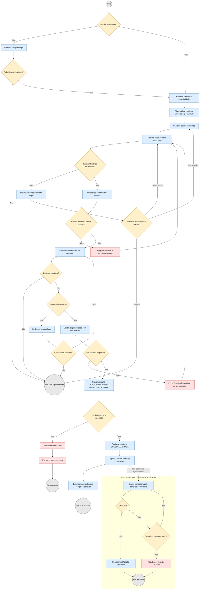

# Aps1-modelagem-software

# Sumário

1. [Diagrama de Atividades](#diagrama-de-atividades)
2. [Diagrama de Sequência](#diagrama-de-sequência)
3. [Diagrama de Classes](#diagrama-de-classes)

# Diagrama de Atividades

## Diagrama de Atividade 1 - Agendamento de uma consulta
- Objetivo: Permitir que o paciente reserve um horário para atendimento
- Ator: Paciente (principal); Sistema de Notificação (secundário)
- Requisitos: RF-06 a RF-10 (fluxo F-01); regras RN-10 a RN-13, RN-16, RN-25

# Diagrama de Sequência

O Diagrama de Sequência 1 (agendamento de uma consulta, DS-01) está em [diagrama-sequencia.md](diagrama-sequencia.md).

# Diagrama de Classes
- Objetivo: Apresentar as principais classes do domínio, seus atributos, métodos e relacionamentos
- Escopo: macro (classes principais), conforme a seção 8 de `especificacao-requisitos.md`
- Requisitos: todos os RF e RN; destaque para RN-10 a RN-13, RN-15, RN-16 (consulta/horário), RN-19 e RN-24 (autoria) e RNF-22 e RNF-23 (auditoria)

