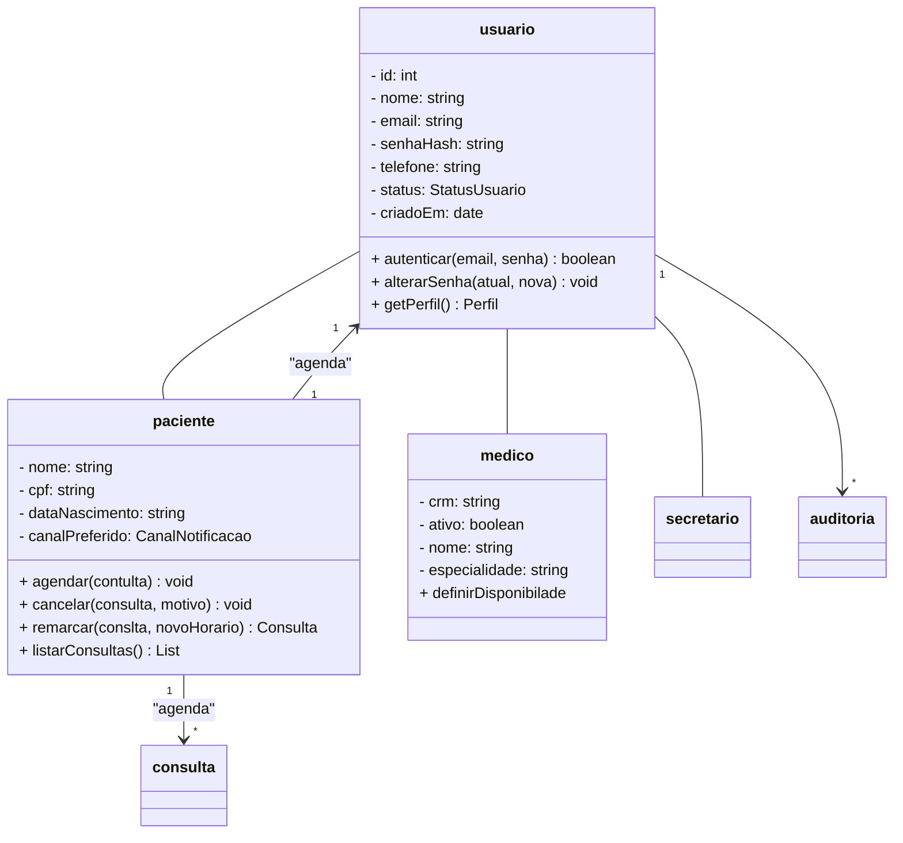

# Aps1-modelagem-software

# Sumário

1. [Diagrama de Atividades](#diagrama-de-atividades)
2. [Diagrama de Sequência](#diagrama-de-sequência)
3. [Diagrama de Classes](#diagrama-de-classes)

# Diagrama de Atividades

# Diagrama de Sequência

# Diagrama de Classes

