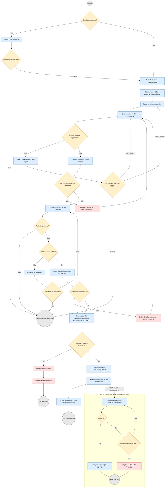
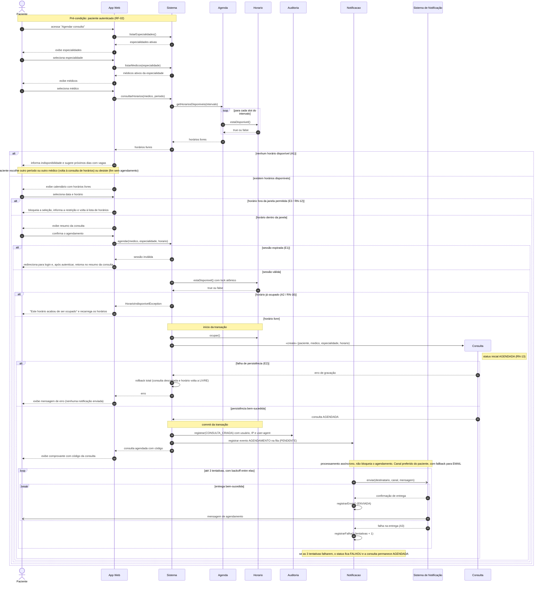
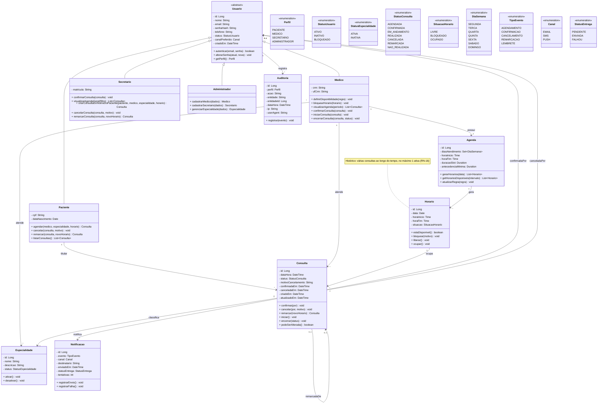

# Aps1-modelagem-software

# Sumário

1. [Diagrama de Atividades](#diagrama-de-atividades)
2. [Diagrama de Sequência](#diagrama-de-sequência)
3. [Diagrama de Classes](#diagrama-de-classes)

# Diagrama de Atividades

## Diagrama de Atividade 1 - Agendamento de uma consulta
- Objetivo: Permitir que o paciente reserve um horário para atendimento
- Ator: Paciente (principal); Sistema de Notificação (secundário)
- Requisitos: RF-06 a RF-10 (fluxo F-01); regras RN-10 a RN-13, RN-16, RN-25

# Diagrama de Sequência

## Diagrama de Sequência 1 - Agendamento de uma consulta (DS-01)
- Objetivo: Mostrar a interação entre o Paciente, o sistema e o Sistema de Notificação durante o agendamento de uma consulta, incluindo os cenários alternativos e de exceção do fluxo F-01
- Atores: Paciente (principal) e Sistema de Notificação (secundário, não humano)
- Requisitos: RF-06 a RF-10, RF-20, RF-21 (fluxo F-01)
- Regras de negócio: RN-09, RN-10, RN-12, RN-13, RN-16, RN-20, RN-25
- Coerência: segue o Diagrama de Atividades 1 (mesmos desvios A1, A2, A3, E1, E2, E3) e usa os métodos do Diagrama de Classes (`Paciente.agendar`, `Agenda.getHorariosDisponiveis`, `Horario.estaDisponivel`, `Horario.ocupar`, `Auditoria.registrar`, `Notificacao.registrarEnvio`, `Notificacao.registrarFalha`)
- Convenções: `App Web` é a interface; `Sistema` representa a camada de aplicação, que orquestra as chamadas (por isso `listarEspecialidades`, `listarMedicos` e `consultarHorarios` não aparecem como métodos de classe); a criação de `Consulta` é mostrada como criação de objeto

# Diagrama de Classes
- Objetivo: Apresentar as principais classes do domínio, seus atributos, métodos e relacionamentos
- Escopo: macro (classes principais), conforme a seção 8 de `especificacao-requisitos.md`
- Requisitos: todos os RF e RN; destaque para RN-10 a RN-13, RN-15, RN-16 (consulta/horário), RN-19 e RN-24 (autoria) e RNF-22 e RNF-23 (auditoria)

