# Roteiro Completo de Apresentação: Sistema de Agendamento de Consultas Médicas
## Modelagem de Software — APS 1 | Universidade Federal de Goiás (UFG / INF)

---

### Dados da Apresentação

- **Instituição:** Universidade Federal de Goiás (UFG) — Instituto de Informática (INF)
- **Curso:** Bacharelado em Engenharia de Software
- **Disciplina:** Modelagem de Software (2026/2)
- **Professor:** Me. Diogo Oliveira Santos
- **Tema:** Aplicativo de Agendamento de Consultas Médicas
- **Integrantes do Grupo (5 acadêmicos):**
  1. Carlos Eduardo Freire da Silva
  2. Gabriel Henrique Lourenço Dias
  3. Kayque Vicente Silva
  4. Luiz Pedro Pereira Mendes Saraiva
  5. Yury Nogueira de Oliveira Silva
- **Duração Total Recomendada:** 15 minutos (~3 minutos por integrante) + tempo para arguição da banca.

---

## 1. Guia de Distribuição entre os 5 Integrantes

Para que a apresentação seja equilibrada e cada integrante demonstre domínio técnico perante a banca, os 35 slides foram divididos de acordo com as 5 seções temáticas naturais do trabalho:

| Integrante Sugerido | Seção Temática | Slides | Foco Técnico Principal | Tempo Estimado |
| :--- | :--- | :---: | :--- | :---: |
| **Carlos Eduardo** | **Capa, Sumário e Visão Geral (Seção 1)** | 01 a 07 | Problema da clínica, 5 atores, 6 módulos funcionais e máquina de estados da consulta | ~3 min 00 s |
| **Kayque Vicente** | **Diagrama de Atividades DA-01 (Seção 2)** | 08 a 15 | Fluxo de processo nas 3 raias, concorrência atômica, fork/join assíncrono e desvios | ~3 min 30 s |
| **Gabriel Henrique** | **Diagrama de Sequência DS-01 (Seção 3)** | 16 a 23 | As 45 mensagens ordenadas, controle via classe Sistema, chamada atômica `ocupar()`, rollback e bloco `par` | ~3 min 30 s |
| **Luiz Pedro** | **Diagrama de Classes DC (Seção 4)** | 24 a 31 | Estrutura de objetos, herança protegida `#`, composições fortes, conformidade LGPD e os 9 Enums | ~3 min 00 s |
| **Yury Nogueira** | **Conclusão, Apêndices e Final (Seção 5)** | 32 a 35 | Rastreabilidade dos 21 RFs e 28 RNs, PlantUML versionável, síntese de engenharia e encerramento | ~2 min 00 s |

> **Nota:** Caso o grupo decida por outro rodízio ou por um único relator, as sugestões de fala continuam 100% aplicáveis bastando omitir as frases de passagem de palavra.

---

## 2. Orientações Gerais de Postura e Oratória

1. **Ritmo e Dicção:** Fale com segurança, sem pressa. As pausas de 1 a 2 segundos após destacar um conceito (como *"lock atômico"* ou *"classe abstrata"*) ajudam a banca a assimilar a profundidade do projeto.
2. **Contato com a Audiência:** Olhe nos olhos do professor e da turma. Evite ficar de costas lendo os slides; use o slide apenas como âncora visual.
3. **Uso do Apontador / Cursor:** Quando estiver nos slides de diagrama ampliado (zooms das Regiões 1, 2 e 3), aponte fisicamente para o elemento que está mencionando (por exemplo, aponte para o nó rosa do fluxo alternativo A2 ou para o losango de composição preenchido).
4. **Passagem de Bastão Fluida:** Sempre mencione o nome do colega que assumirá a palavra, garantindo uma transição coesa e profissional: *"Agora passo a palavra para o colega Kayque, que detalhará o Diagrama de Atividades."*

---

## 3. Roteiro Detalhado Slide a Slide

```
========================================================================================
SLIDE 01: CAPA FORMAL
========================================================================================
```

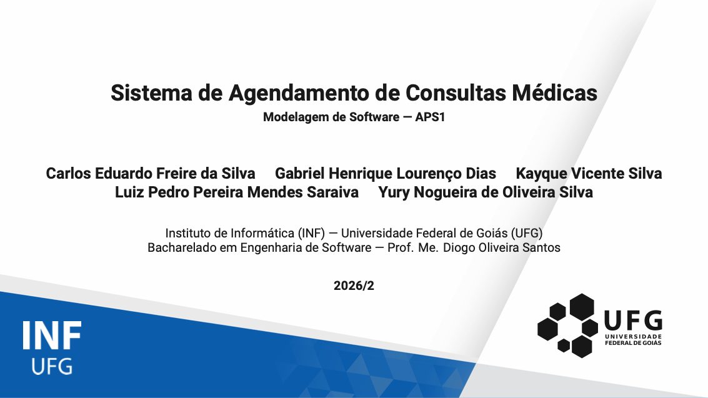

- **Título do Slide:** Sistema de Agendamento de Consultas Médicas — Modelagem de Software — APS1
- **Seção do Relatório:** Capa Oficial
- **Apresentador Sugerido:** Carlos Eduardo (Seção 1)
- **Tempo Estimado:** 20 segundos
- **Objetivo do Slide:** Cumprimentar a banca, contextualizar o tema e demonstrar formalidade acadêmica e alinhamento com as diretrizes do INF/UFG.

#### O que falar (Sugestão de fala):
> *"Boa noite, professor Diogo, boa noite a todos os colegas presentes. Nosso grupo — composto pelo Carlos Eduardo, Gabriel Henrique, Kayque Vicente, Luiz Pedro e Yury Nogueira — apresenta hoje a APS 1 da disciplina de Modelagem de Software da Universidade Federal de Goiás.*  
> *O nosso trabalho é a especificação e modelagem formal de um **Sistema Web de Agendamento de Consultas Médicas**. Durante o projeto, desenhamos e refinamos os modelos conceituais, comportamentais e estruturais da aplicação, garantindo alto rigor técnico em conformidade com as regras de negócio de uma clínica real e com as normas ABNT."*

- **Pontos-Chave & Postura:** Postura ereta, tom de voz firme e acolhedor. Fazer contato visual com o professor e com a turma.
- **Transição:** *"Para orientar nossa apresentação, vejamos a estrutura do nosso roteiro no sumário a seguir."*

```
========================================================================================
SLIDE 02: SUMÁRIO DA APRESENTAÇÃO
========================================================================================
```

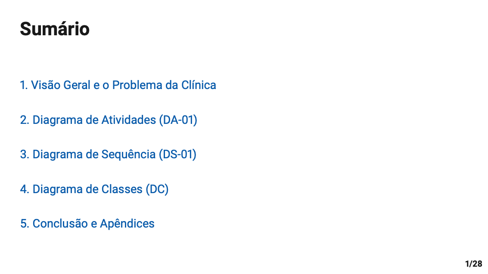

- **Título do Slide:** Sumário
- **Seção do Relatório:** Estrutura Geral do Trabalho
- **Apresentador Sugerido:** Carlos Eduardo
- **Tempo Estimado:** 20 segundos
- **Objetivo do Slide:** Mostrar a organização lógica do discurso, dividida rigorosamente nas 5 seções do relatório técnico.

#### O que falar (Sugestão de fala):
> *"A nossa apresentação está dividida em 5 etapas principais:*  
> *Primeiro, apresentaremos a **Visão Geral e o Problema da Clínica**, detalhando as regras de negócio e os módulos do sistema.*  
> *Em seguida, entraremos no **Diagrama de Atividades (DA-01)**, mostrando a experiência e os processos de agendamento em raias.*  
> *Na terceira etapa, veremos o **Diagrama de Sequência (DS-01)**, demonstrando a troca de mensagens em tempo de execução e a gestão de concorrência.*  
> *Na quarta etapa, abordaremos o **Diagrama de Classes (DC)** com a modelagem estrutural orientada a objetos.*  
> *Por fim, concluiremos com os **Apêndices e a Convergência dos Três Modelos**, abrindo espaço para as dúvidas da banca."*

- **Pontos-Chave & Postura:** Passar pelos 5 pontos de forma dinâmica, sem se alongar.
- **Transição:** *"Iniciaremos compreendendo a dor real que motivou este projeto de software."*

```
========================================================================================
SLIDE 03: TRANSIÇÃO — VISÃO GERAL E O PROBLEMA DA CLÍNICA
========================================================================================
```


- **Título do Slide:** Seção 1: Visão Geral e o Problema da Clínica
- **Seção do Relatório:** Seção 1 (Introdução e Contextualização)
- **Apresentador Sugerido:** Carlos Eduardo
- **Tempo Estimado:** 10 segundos
- **Objetivo do Slide:** Marcar visualmente a abertura da Seção 1.

#### O que falar (Sugestão de fala):
> *"Entramos na primeira seção: a contextualização do negócio e os desafios da rotina médica que o nosso sistema se propõe a resolver com eficiência."*

- **Transição:** Avançar diretamente para o Slide 04.

```
========================================================================================
SLIDE 04: O PROBLEMA DA CLÍNICA E O QUE O SISTEMA RESOLVE
========================================================================================
```

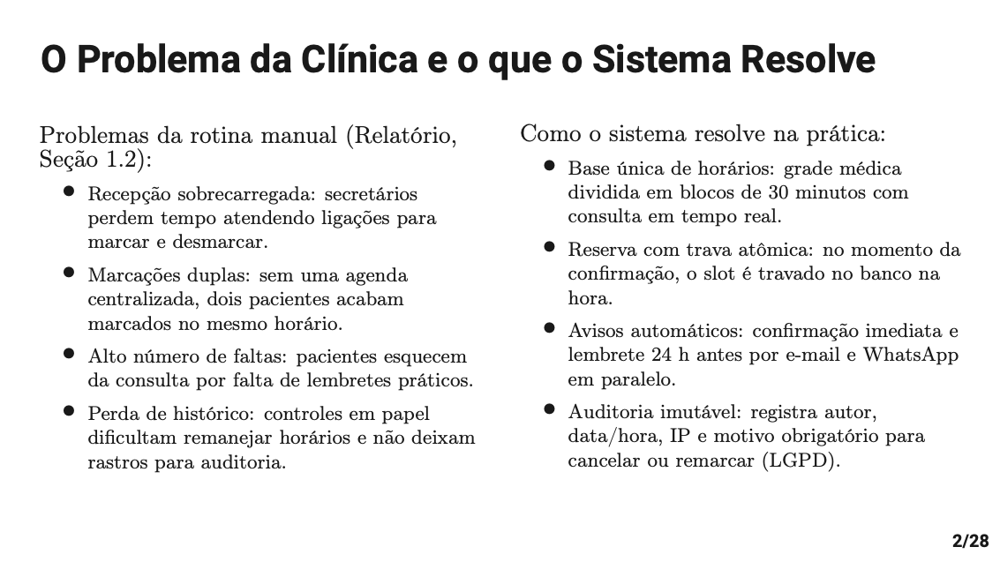

- **Título do Slide:** O Problema da Clínica e o que o Sistema Resolve
- **Seção do Relatório:** Seção 1.1 e 1.2
- **Apresentador Sugerido:** Carlos Eduardo
- **Tempo Estimado:** 40 segundos
- **Objetivo do Slide:** Contrastar o caos das rotinas manuais com as soluções automatizadas e elegantes de engenharia de software.

#### O que falar (Sugestão de fala):
> *"Conforme documentamos na Seção 1.2 do nosso relatório, a rotina tradicional de clínicas médicas sofre com quatro gargalos severos:*  
> *1. A recepção vive **sobrecarregada**, pois secretários gastam quase todo o expediente atendendo telefonemas para agendar, remarcar ou desmarcar.*  
> *2. Ocorrem **marcações duplas**, quando duas pessoas tentam agendar o mesmo médico ao mesmo tempo sem um banco centralizado.*  
> *3. Há um **alto índice de faltas**, o chamado no-show, porque os pacientes simplesmente esquecem da consulta.*  
> *4. E há uma crônica **perda de histórico**, já que planilhas e agendas em papel não deixam rastros de auditoria.*  
>  
> *O nosso sistema elimina esses problemas através de quatro pilares de software:*  
> *Centralizamos tudo em uma **base única de horários** em slots padronizados de 30 minutos;*  
> *Aplicamos uma **trava atômica** no banco de dados na fração de segundo em que o paciente confirma a vaga;*  
> *Disparamos **lembretes automáticos** imediatos e 24 horas antes por e-mail e WhatsApp em paralelo;*  
> *E mantemos uma **auditoria imutável**, exigindo justificativa obrigatória para qualquer cancelamento ou remarcação, garantindo total conformidade com a LGPD."*

- **Pontos-Chave & Postura:** Enfatizar termos fortes: *"trava atômica"*, *"slots de 30 min"* e *"auditoria imutável"*.
- **Transição:** *"Para que esses processos funcionem harmonicamente, definimos claramente quem interage com o sistema."*

```
========================================================================================
SLIDE 05: QUEM USA O SISTEMA: OS 5 ATORES E SUAS RESPONSABILIDADES
========================================================================================
```

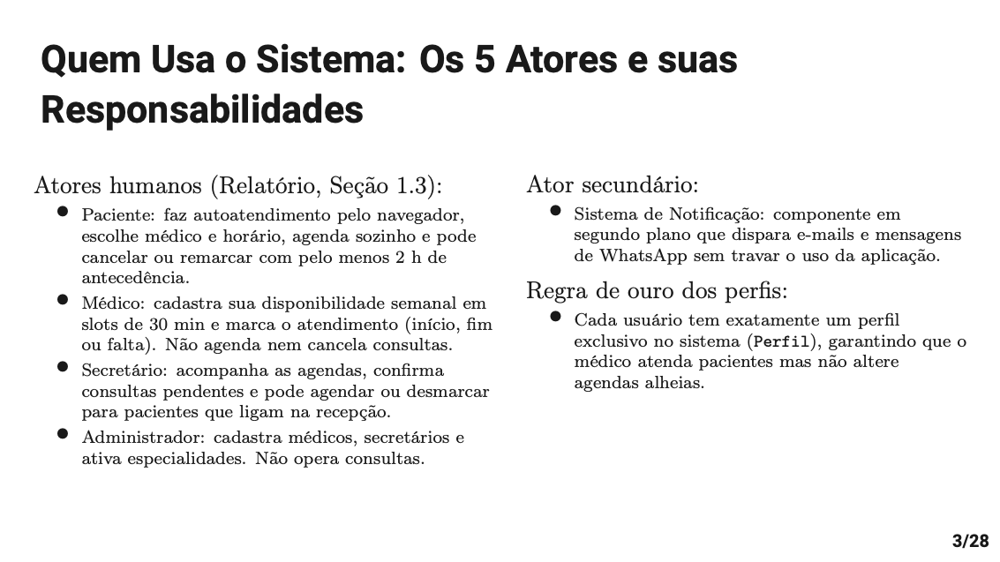

- **Título do Slide:** Quem Usa o Sistema: Os 5 Atores e suas Responsabilidades
- **Seção do Relatório:** Seção 1.3 (Atores do Sistema)
- **Apresentador Sugerido:** Carlos Eduardo
- **Tempo Estimado:** 35 segundos
- **Objetivo do Slide:** Apresentar os 4 atores humanos, o ator secundário automatizado e enunciar a regra de ouro dos perfis de acesso.

#### O que falar (Sugestão de fala):
> *"O sistema possui 5 atores rigorosamente delimitados (Seção 1.3 do artigo):*  
> *Os quatro atores humanos são:*  
> *O **Paciente**, que tem autoatendimento completo pelo navegador: pesquisa médicos, escolhe horários e gerencia suas consultas, com cancelamento ou remarcação permitidos até 2 horas antes.*  
> *O **Médico**, que configura sua grade semanal em blocos de 30 minutos e registra o atendimento na sala. O médico **não** marca nem cancela consultas de pacientes.*  
> *O **Secretário**, que atua na recepção, confirmando consultas pendentes e agendando para pacientes que telefonam ou comparecem ao balcão.*  
> *E o **Administrador**, que gerencia os cadastros de médicos, secretários e especialidades.*  
>  
> *Temos ainda um ator secundário essencial: o **Sistema de Notificação**, que atua como serviço de segundo plano disparando e-mails e WhatsApp sem onerar a aplicação web.*  
> *Vale ressaltar a nossa **Regra de Ouro dos Perfis**: cada usuário tem exatamente um perfil ativo no sistema, garantindo segregação estrita de funções e segurança de privilégios."*

- **Pontos-Chave & Postura:** Apontar no slide a coluna da esquerda com os 4 atores e a da direita com a segregação de funções.
- **Transição:** *"Vejamos agora como essa operação foi distribuída arquiteturalmente em módulos funcionais."*

```
========================================================================================
SLIDE 06: COMO O SISTEMA FOI DIVIDIDO: OS 6 MÓDULOS DA APLICAÇÃO
========================================================================================
```

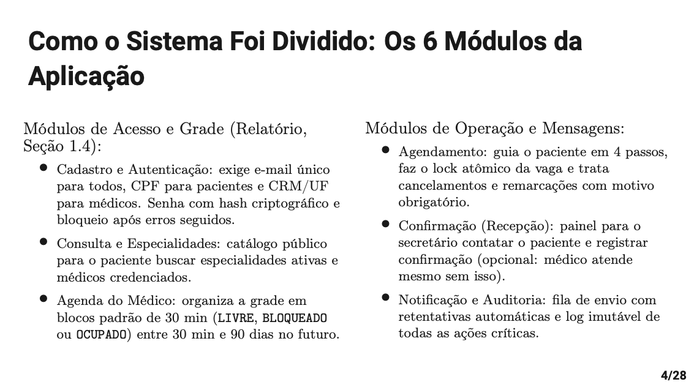

- **Título do Slide:** Como o Sistema Foi Dividido: Os 6 Módulos da Aplicação
- **Seção do Relatório:** Seção 1.4 (Módulos Funcionais e Regras de Negócio)
- **Apresentador Sugerido:** Carlos Eduardo
- **Tempo Estimado:** 30 segundos
- **Objetivo do Slide:** Demonstrar a separação modular de responsabilidades do sistema de acordo com os requisitos especificados.

#### O que falar (Sugestão de fala):
> *"Dividimos a aplicação em 6 módulos complementares, estruturados em dois grandes grupos (Seção 1.4):*  
> *Na parte de **Acesso e Grade**:*  
> *O módulo de **Cadastro e Autenticação** exige e-mail único, CPF para pacientes e validação de CRM e UF para médicos, guardando senhas com hash criptográfico e bloqueio por força bruta.*  
> *O módulo de **Consulta e Especialidades** fornece o catálogo público para busca de médicos vinculados a especialidades ativas.*  
> *O módulo de **Agenda do Médico** parametriza a grade em blocos de 30 minutos, gerenciando os estados `LIVRE`, `BLOQUEADO` ou `OCUPADO` em uma janela de 30 minutos a até 90 dias no futuro.*  
>  
> *Na parte de **Operação e Mensagens**:*  
> *O módulo de **Agendamento** conduz o fluxo em 4 passos e realiza o lock da vaga.*  
> *O módulo de **Confirmação** permite o trabalho proativo da recepção, sendo propositalmente opcional para que o médico nunca seja impedido de atender uma consulta válida.*  
> *E o módulo de **Notificação e Auditoria**, que opera de forma assíncrona com logs perenes de todas as alterações."*

- **Pontos-Chave & Postura:** Ressaltar que a confirmação é opcional — um cuidado essencial de modelagem para a realidade de clínicas.
- **Transição:** *"A dinâmica desse atendimento se materializa no ciclo de vida de uma consulta."*

```
========================================================================================
SLIDE 07: CICLO DE VIDA DA CONSULTA: OS ESTADOS E AS REGRAS DE MUDANÇA
========================================================================================
```

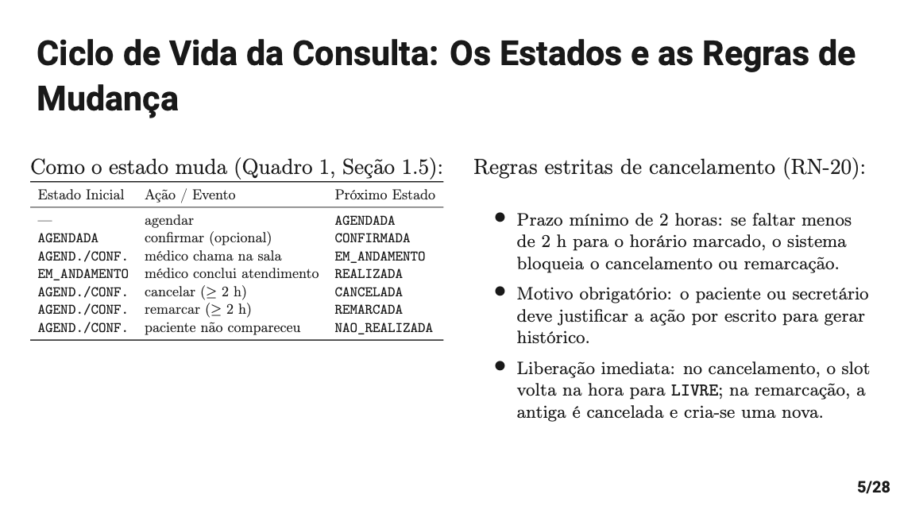

- **Título do Slide:** Ciclo de Vida da Consulta: Os Estados e as Regras de Mudança
- **Seção do Relatório:** Seção 1.5 (Ciclo de Vida da Consulta — Quadro 1) e Regra RN-20
- **Apresentador Sugerido:** Carlos Eduardo
- **Tempo Estimado:** 25 segundos
- **Objetivo do Slide:** Explicar a máquina de estados completa da consulta, os gatilhos de transição e a Regra de Negócio RN-20 de cancelamento.

#### O que falar (Sugestão de fala):
> *"No Slide 7 e no Quadro 1 do nosso relatório, modelamos com precisão os 7 estados da consulta médica:*  
> *Ao ser criada, a consulta nasce como `AGENDADA`.*  
> *Se a recepção fizer o contato, ela avança para `CONFIRMADA`.*  
> *Quando o médico chama o paciente para a sala, passa para `EM_ANDAMENTO`, e ao concluir o atendimento, atinge o estado final `REALIZADA`.*  
> *Caso o paciente não compareça, o sistema ou o médico registram `NAO_REALIZADA`.*  
>  
> *Destacamos aqui a nossa **Regra de Negócio RN-20**: cancelamentos e remarcações só são permitidos com no mínimo **2 horas de antecedência**. Se faltar menos de 2 horas, o sistema bloqueia a operação para não deixar o médico ocioso de última hora.*  
> *Além disso, toda desmarcação exige **motivo justificado por escrito** e libera o slot imediatamente de volta para `LIVRE`.*  
>  
> *Com essa visão do negócio em mente, passo agora a palavra para o colega **Kayque Vicente**, que apresentará a modelagem de processos através do Diagrama de Atividades."*

- **Pontos-Chave & Postura:** Apontar as linhas da tabela e reforçar os estados finais (`REALIZADA`, `CANCELADA`, `REMARCADA`, `NAO_REALIZADA`).
- **Transição:** Passagem formal da palavra para Kayque Vicente (Seção 2).

```
========================================================================================
SLIDE 08: TRANSIÇÃO — DIAGRAMA DE ATIVIDADES (DA-01)
========================================================================================
```

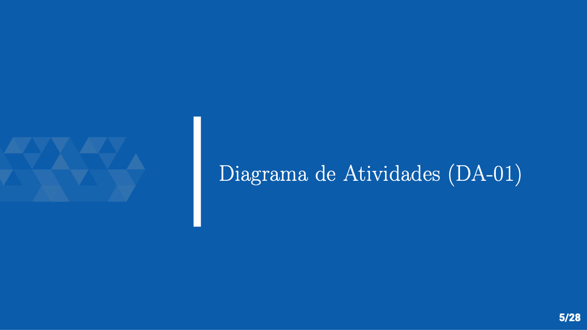

- **Título do Slide:** Seção 2: Diagrama de Atividades (DA-01)
- **Seção do Relatório:** Seção 2 (Diagrama de Atividades — DA-01)
- **Apresentador Sugerido:** Kayque Vicente (Seção 2)
- **Tempo Estimado:** 10 segundos
- **Objetivo do Slide:** Assumir a palavra e abrir a análise dos fluxos de trabalho e raias de responsabilidade.

#### O que falar (Sugestão de fala):
> *"Obrigado, Carlos. Entramos agora na Seção 2 do nosso trabalho: o **Diagrama de Atividades DA-01**, onde mapeamos o fluxo comportamental do processo de agendamento."*

- **Transição:** Avançar diretamente para o Slide 09.

```
========================================================================================
SLIDE 09: DA-01 — VISÃO GERAL DO FLUXO DE AGENDAMENTO (COMPLETO)
========================================================================================
```

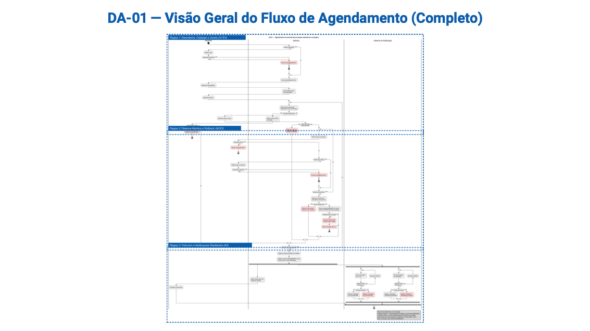

- **Título do Slide:** DA-01 — Visão Geral do Fluxo de Agendamento (Completo)
- **Seção do Relatório:** Seção 2.1 (Figura 1 do artigo)
- **Apresentador Sugerido:** Kayque Vicente
- **Tempo Estimado:** 25 segundos
- **Objetivo do Slide:** Apresentar a visão panorâmica do diagrama completo, suas 3 raias de execução e preparar o mergulho detalhado nas três fases.

#### O que falar (Sugestão de fala):
> *"Este é o nosso Diagrama de Atividades completo. Ele está particionado em **três raias de responsabilidade (*swimlanes*)**:*  
> *A raia da esquerda representa o **Paciente**, registrando suas ações na interface;*  
> *A raia central representa o **Sistema Web**, executando validações de regras e operações de banco de dados;*  
> *E a raia da direita representa o **Sistema de Notificação**, responsável pelo processamento assíncrono em segundo plano.*  
>  
> *Para que possamos enxergar cada decisão com clareza máxima, dividimos a explicação em 3 ampliações sucessivas: a Escolha inicial, a Confirmação com trava de concorrência e o Envio paralelo de mensagens."*

- **Pontos-Chave & Postura:** Destacar as três colunas verticais com o braço/apontador.
- **Transição:** *"Vamos iniciar dando um zoom na Fase 1, correspondente ao início da jornada."*

```
========================================================================================
SLIDE 10: DA-01 (FASE 1) — ESCOLHA DO MÉDICO, HORÁRIOS LIVRES E JANELA
========================================================================================
```

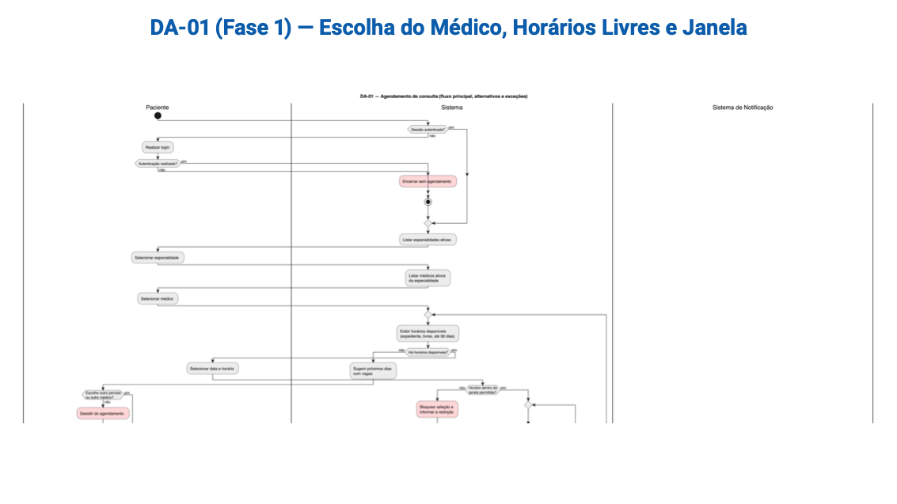

- **Título do Slide:** DA-01 (Fase 1) — Escolha do Médico, Horários Livres e Janela
- **Seção do Relatório:** Seção 2.1 (Região 1 do DA-01)
- **Apresentador Sugerido:** Kayque Vicente
- **Tempo Estimado:** 15 segundos
- **Objetivo do Slide:** Exibir a imagem com zoom da Região 1 focando nos filtros de grade e nós de decisão com caminhos alternativos destacados em rosa.

#### O que falar (Sugestão de fala):
> *"Nesta primeira ampliação, vemos o momento em que o paciente acessa a aplicação. Notem a clareza dos nós de decisão e dos caminhos alternativos destacados em cor de destaque na raia do Sistema.*  
> *O paciente filtra especialidade e médico, e o sistema recupera a grade. Caso não haja horários ou a janela seja inválida, o fluxo desvia com tratamento imediato."*

- **Pontos-Chave & Postura:** Apontar para os nós de decisão e para as rotas em rosa que desviam antes de avançar à reserva.
- **Transição:** *"No slide seguinte, detalhamos as regras de negócio que sustentam essa primeira região."*

```
========================================================================================
SLIDE 11: O INÍCIO DO AGENDAMENTO: FILTROS NA GRADE E VALIDAÇÃO DA JANELA
========================================================================================
```

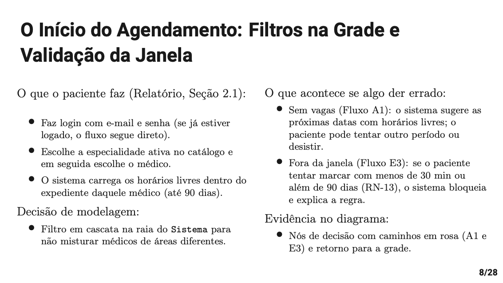

- **Título do Slide:** O Início do Agendamento: Filtros na Grade e Validação da Janela
- **Seção do Relatório:** Seção 2.1 (Detalhamento da Região 1)
- **Apresentador Sugerido:** Kayque Vicente
- **Tempo Estimado:** 35 segundos
- **Objetivo do Slide:** Explicar a filtragem em cascata e os desvios de exceção A1 (sem vagas) e E3 (fora da janela operacional).

#### O que falar (Sugestão de fala):
> *"O fluxo normal dessa fase segue um **filtro em cascata**: o paciente seleciona a especialidade ativa, o sistema lista os médicos vinculados e carrega apenas os horários com status `LIVRE`.*  
> *Porém, uma boa modelagem se prova nos tratamentos de exceção:*  
> *Se o médico não possuir horários vagos, cai no **Fluxo Alternativo A1**: o sistema não frustra o usuário com uma tela vazia; ele sugere as datas mais próximas com vagas, permitindo escolher outro dia ou desistir.*  
> *Além disso, validamos a **Regra de Negócio RN-13 (Fluxo E3)**: consultas não podem ser marcadas com menos de 30 minutos de antecedência nem a mais de 90 dias no futuro. Se o paciente burlar a interface, o sistema bloqueia no nó de decisão e retorna para a grade informando a restrição."*

- **Pontos-Chave & Postura:** Frisar que os desvios A1 e E3 retornam com elegância ao fluxo sem quebrar a navegação.
- **Transição:** *"Superada a escolha do horário, avançamos para a fase mais crítica da modelagem: a confirmação da vaga."*

```
========================================================================================
SLIDE 12: DA-01 (FASE 2) — RESUMO, LOCK ATÔMICO DO HORÁRIO E ROLLBACK
========================================================================================
```

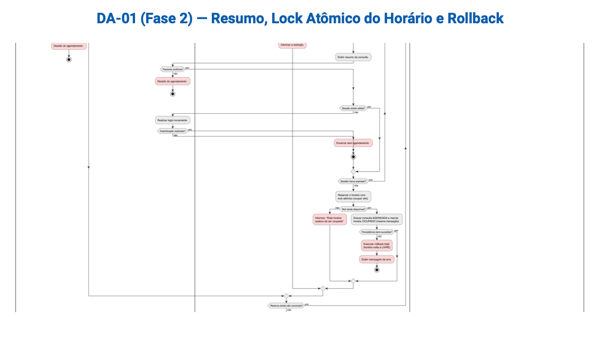

- **Título do Slide:** DA-01 (Fase 2) — Resumo, Lock Atômico do Horário e Rollback
- **Seção do Relatório:** Seção 2.1 (Região 2 do DA-01)
- **Apresentador Sugerido:** Kayque Vicente
- **Tempo Estimado:** 15 segundos
- **Objetivo do Slide:** Mostrar o zoom da Região 2, onde ocorre a decisão de disponibilidade e a garantia de persistência com reversão.

#### O que falar (Sugestão de fala):
> *"Chegamos à Fase 2 do DA-01. Observem no centro do diagrama os dois nós de decisão cruciais:*  
> *O primeiro avalia: 'Slot ainda disponível no banco de dados?'*  
> *E o segundo avalia: 'A gravação da consulta foi bem-sucedida?'.*  
> *Vejam o fluxo alternativo A2 em rosa e a rota de rollback E2 em caso de erro no banco."*

- **Pontos-Chave & Postura:** Apontar para os dois losangos centrais na raia do Sistema.
- **Transição:** *"Vejamos a fundamentação de engenharia para essa proteção contra concorrência."*

```
========================================================================================
SLIDE 13: RESERVA DA VAGA: CONCORRÊNCIA E TRATAMENTO DE ERROS
========================================================================================
```

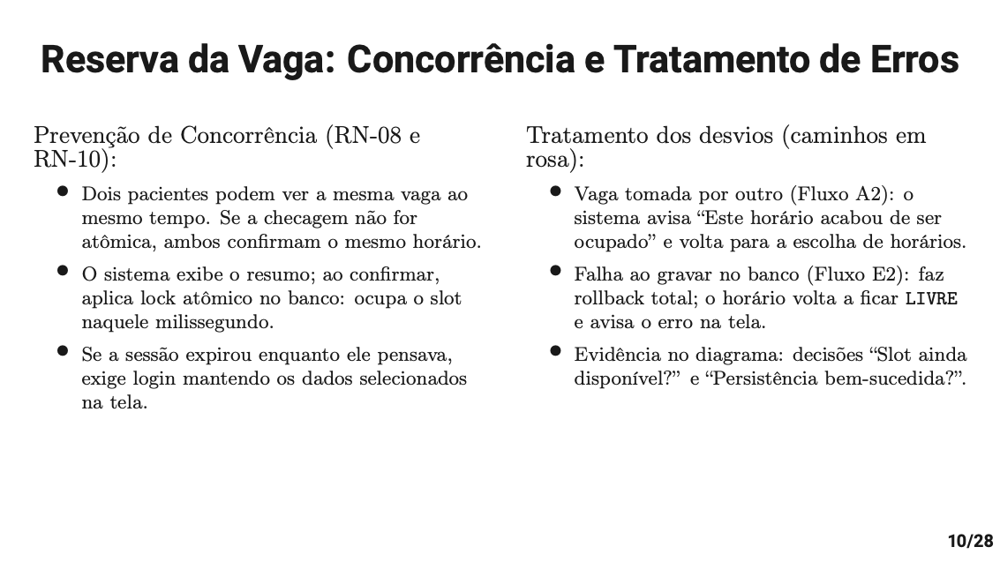

- **Título do Slide:** Reserva da Vaga: Concorrência e Tratamento de Erros
- **Seção do Relatório:** Seção 2.1 e Regras RN-08 e RN-10
- **Apresentador Sugerido:** Kayque Vicente
- **Tempo Estimado:** 40 segundos
- **Objetivo do Slide:** Explicar a eliminação de *race conditions* (marcações duplas) via lock atômico e o rollback automático em falhas de gravação.

#### O que falar (Sugestão de fala):
> *"Dois pacientes podem abrir a tela e visualizar o mesmo horário de 14h30 ao mesmo tempo. Se o sistema apenas checar a vaga e esperar o paciente clicar em confirmar segundos depois, ambos ocupariam a mesma cadeira — gerando uma clássica condição de corrida.*  
> *Resolvemos isso aplicando as **Regras RN-08 e RN-10**: a validação é atômica no banco de dados no exato instante do clique de confirmação.*  
> *Se outro paciente confirmou uma fração de segundo antes, entra o **Fluxo A2**: o sistema emite o alerta 'Este horário acabou de ser ocupado' e atualiza a grade na hora.*  
> *E se por acaso ocorrer uma queda de infraestrutura durante a persistência (**Fluxo E2**), o sistema executa **rollback imediato**: o horário é liberado de volta para `LIVRE` e nenhuma cobrança ou consulta fantasma é criada."*

- **Pontos-Chave & Postura:** Usar o conceito de *"condição de corrida"* e explicar como o lock atômico protege a integridade do negócio.
- **Transição:** *"Após a vaga estar garantida no banco, entramos na terceira fase: a entrega e as mensagens."*

```
========================================================================================
SLIDE 14: DA-01 (FASE 3) — COMPROVANTE EM TELA E NOTIFICAÇÕES ASSÍNCRONAS
========================================================================================
```

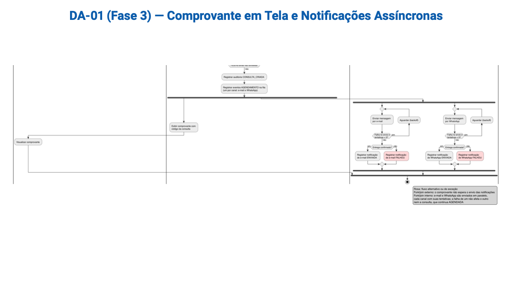

- **Título do Slide:** DA-01 (Fase 3) — Comprovante em Tela e Notificações Assíncronas
- **Seção do Relatório:** Seção 2.1 (Região 3 do DA-01)
- **Apresentador Sugerido:** Kayque Vicente
- **Tempo Estimado:** 20 segundos
- **Objetivo do Slide:** Mostrar a barra de bifurcação (*fork*), os dois caminhos paralelos e os laços de repetição com recuo (*backward:Aguardar*).

#### O que falar (Sugestão de fala):
> *"Nesta ampliação da Fase 3, observem a barra horizontal espessa de **fork**: o fluxo se divide simultaneamente entre a raia do Paciente e a raia do Sistema de Notificação.*  
> *Vejam também os laços com cláusula `backward:Aguardar tempo de backoff` representando a resiliência das tentativas antes da junção no join."*

- **Pontos-Chave & Postura:** Apontar para a barra de fork e para as setas que bifurcam para a direita.
- **Transição:** *"Vamos entender o porquê dessa decisão arquitetural de paralelismo."*

```
========================================================================================
SLIDE 15: COMPROVANTE E MENSAGENS: POR QUE O ENVIO É EM PARALELO
========================================================================================
```

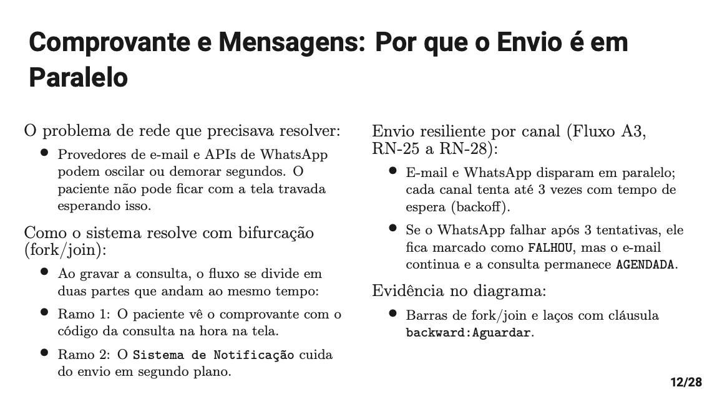

- **Título do Slide:** Comprovante e Mensagens: Por que o Envio é em Paralelo
- **Seção do Relatório:** Seção 2.1 e Regras RN-25 a RN-28
- **Apresentador Sugerido:** Kayque Vicente
- **Tempo Estimado:** 50 segundos
- **Objetivo do Slide:** Justificar o uso de chamadas assíncronas para não bloquear a experiência do usuário devido a latências externas de e-mail e WhatsApp.

#### O que falar (Sugestão de fala):
> *"APIs de terceiros, como provedores de e-mail e WhatsApp, sofrem com oscilações e latências que podem levar vários segundos. Se o agendamento fosse síncrono, a tela do paciente ficaria congelada esperando o WhatsApp responder.*  
> *Para isolar esse problema, usamos o **fork/join**:*  
> *No **Ramo 1**, o paciente recebe o comprovante com o código de agendamento imediatamente na tela — ele é liberado na hora.*  
> *No **Ramo 2**, o Sistema de Notificação assume a fila em segundo plano.*  
> *Aplicamos as **Regras RN-25 a RN-28 (Fluxo A3)**: cada canal tenta o envio até 3 vezes com espaçamento progressivo (*backoff*).*  
> *Se o WhatsApp falhar definitivamente após a 3ª tentativa, o status da notificação vai para `FALHOU`, mas a consulta permanece íntegra como `AGENDADA` e o e-mail segue seu curso sem afetar a clínica.*  
>  
> *Para mostrar como esse comportamento se traduz em chamadas concretas entre objetos de software, passo a palavra ao colega **Gabriel Henrique**, que apresentará o Diagrama de Sequência."*

- **Pontos-Chave & Postura:** Enfatizar que uma falha externa na API do WhatsApp nunca deve derrubar um agendamento médico já persistido.
- **Transição:** Passagem da palavra para Gabriel Henrique (Seção 3).

```
========================================================================================
SLIDE 16: TRANSIÇÃO — DIAGRAMA DE SEQUÊNCIA (DS-01)
========================================================================================
```

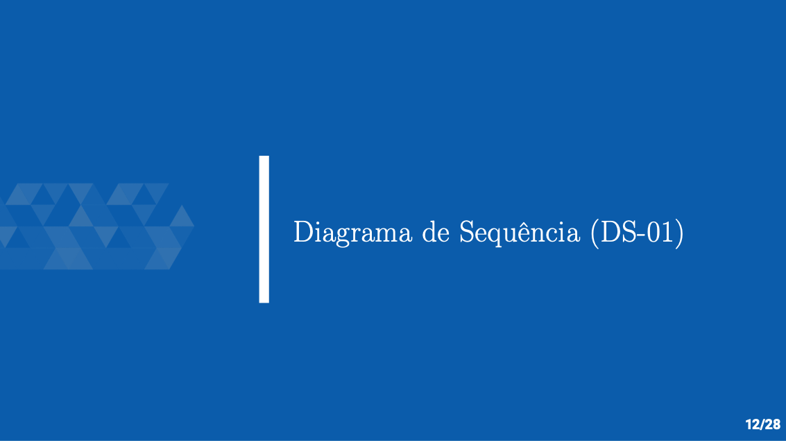

- **Título do Slide:** Seção 3: Diagrama de Sequência (DS-01)
- **Seção do Relatório:** Seção 3 (Diagrama de Sequência — DS-01)
- **Apresentador Sugerido:** Gabriel Henrique (Seção 3)
- **Tempo Estimado:** 10 segundos
- **Objetivo do Slide:** Assumir a palavra e contextualizar a transição da visão de processos para a visão de código em tempo de execução.

#### O que falar (Sugestão de fala):
> *"Obrigado, Kayque. Entramos na Seção 3: o **Diagrama de Sequência DS-01**, onde detalhamos as trocas de mensagens ordenadas no tempo entre as instâncias dos nossos objetos."*

- **Transição:** Avançar diretamente para o Slide 17.

```
========================================================================================
SLIDE 17: DS-01 — VISÃO GERAL DAS 45 MENSAGENS ENTRE OBJETOS (COMPLETO)
========================================================================================
```

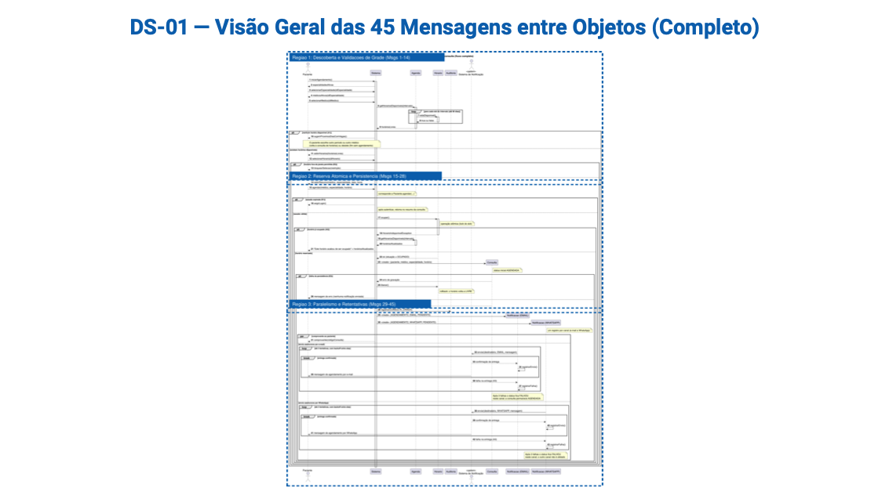

- **Título do Slide:** DS-01 — Visão Geral das 45 Mensagens entre Objetos (Completo)
- **Seção do Relatório:** Seção 3.1 (Figura 2 do artigo)
- **Apresentador Sugerido:** Gabriel Henrique
- **Tempo Estimado:** 25 segundos
- **Objetivo do Slide:** Apresentar a grandiosidade e o rigor do diagrama completo com suas 7 linhas de vida e 45 mensagens estritamente numeradas.

#### O que falar (Sugestão de fala):
> *"Este é o nosso Diagrama de Sequência completo. Ele contém **7 linhas de vida**: o ator `:Paciente`, a classe controladora `:Sistema`, e as classes de domínio `:Agenda`, `:Horario`, `:Consulta`, `:Auditoria` e o componente `:SistemaNotificacao`.*  
> *Modelamos **45 mensagens sequenciais e rigorosamente numeradas**, estruturadas com fragmentos combinados da UML como `loop`, `alt/else` e `par`.*  
> *Vamos examinar a execução em três blocos cronológicos de mensagens."*

- **Pontos-Chave & Postura:** Mostrar no topo do diagrama as 7 linhas de vida alinhadas horizontalmente.
- **Transição:** *"Iniciamos com as mensagens 1 a 14, que cuidam da montagem da grade."*

```
========================================================================================
SLIDE 18: DS-01 (MSGS 1 A 14) — MONTAGEM DA GRADE E DESVIOS INICIAIS
========================================================================================
```

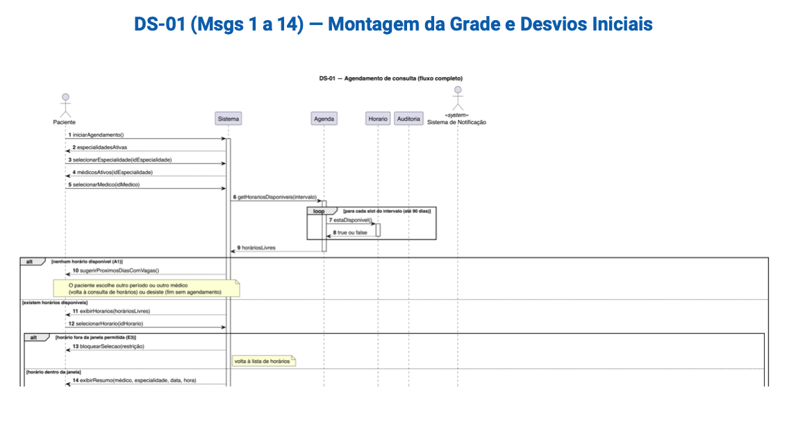

- **Título do Slide:** DS-01 (Msgs 1 a 14) — Montagem da Grade e Desvios Iniciais
- **Seção do Relatório:** Seção 3.1 (Região 1 do DS-01)
- **Apresentador Sugerido:** Gabriel Henrique
- **Tempo Estimado:** 15 segundos
- **Objetivo do Slide:** Destacar a ampliação das primeiras 14 mensagens e o fragmento de repetição `loop` de busca de slots livres.

#### O que falar (Sugestão de fala):
> *"Nesta primeira ampliação, vemos o participante `:Sistema` recebendo o comando `iniciarAgendamento()` e delegando a busca para a `:Agenda` do médico.*  
> *Reparem no fragmento `loop [para cada horario da data]` chamando repetidamente o método `Horario.estaDisponivel()`, seguido pelos blocos `alt` que tratam os desvios iniciais."*

- **Pontos-Chave & Postura:** Apontar para o retângulo do laço `loop` e para os retornos tracejados.
- **Transição:** *"Vejamos as decisões de design de software embutidas nessa sequência."*

```
========================================================================================
SLIDE 19: TROCA DE MENSAGENS INICIAL: COMO A GRADE É MONTADA
========================================================================================
```

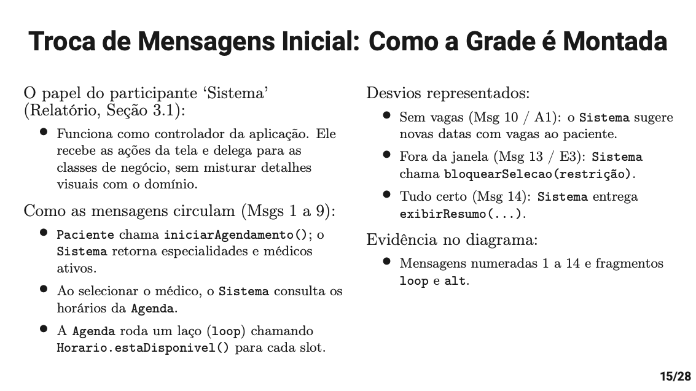

- **Título do Slide:** Troca de Mensagens Inicial: Como a Grade é Montada
- **Seção do Relatório:** Seção 3.1 (Detalhamento da Região 1)
- **Apresentador Sugerido:** Gabriel Henrique
- **Tempo Estimado:** 35 segundos
- **Objetivo do Slide:** Explicar o papel da classe Sistema como Controller e o tratamento das mensagens 10 (A1) e 13 (E3).

#### O que falar (Sugestão de fala):
> *"Adotamos aqui o padrão **Controller de GRASP**: o objeto `:Sistema` atua como fronteira da camada de aplicação. Ele recebe as requisições da interface e orquestra o domínio sem acoplar a tela às entidades de negócio.*  
> *Notem a dinâmica:*  
> *Ao receber `selecionarMedico(idMedico)`, o `:Sistema` invoca `Agenda.obterHorariosDisponiveis(data)`.*  
> *A `Agenda` itera chamando `Horario.estaDisponivel()` e devolve a lista filtrada.*  
> *Se a lista voltar vazia, dispara a **Mensagem 10 (Fluxo A1)**, sugerindo novas datas.*  
> *Se o horário violar a janela operacional, o `:Sistema` executa a **Mensagem 13 (Fluxo E3)** `bloquearSelecao(restrição)`.*  
> *Estando tudo correto, a **Mensagem 14** exibe o resumo com médico, data, hora e valor para o paciente."*

- **Pontos-Chave & Postura:** Enfatizar o desacoplamento promovido pelo Controller `:Sistema`.
- **Transição:** *"Com o resumo em mãos, o paciente clica em confirmar. Vejamos o que acontece no código."*

```
========================================================================================
SLIDE 20: DS-01 (MSGS 15 A 28) — OPERAÇÃO HORARIO.OCUPAR() E ROLLBACK
========================================================================================
```

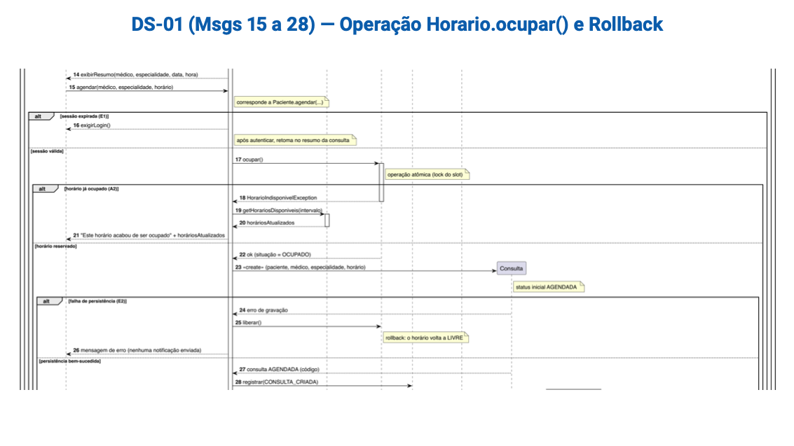

- **Título do Slide:** DS-01 (Msgs 15 a 28) — Operação Horario.ocupar() e Rollback
- **Seção do Relatório:** Seção 3.1 (Região 2 do DS-01)
- **Apresentador Sugerido:** Gabriel Henrique
- **Tempo Estimado:** 15 segundos
- **Objetivo do Slide:** Mostrar a ampliação do núcleo transacional: mensagens 17 e 18, a criação da consulta e a reversão.

#### O que falar (Sugestão de fala):
> *"Nesta segunda região do DS-01, temos o trecho mais crítico do sistema. Notem a mensagem síncrona 17 `ocupar()` enviada diretamente para o objeto `:Horario`.*  
> *Logo abaixo, temos o bloco `alt` com a criação da instância `Consulta` via estereótipo `<<create>>`, o tratamento de erro com `Horario.liberar()` e a chamada de auditoria."*

- **Pontos-Chave & Postura:** Apontar para o método `Horario.ocupar()` e para a mensagem `<<create>>`.
- **Transição:** *"Vejamos em detalhes como essa lógica garante tolerância a falhas e consistência atômica."*

```
========================================================================================
SLIDE 21: A CONFIRMAÇÃO NO CÓDIGO: CHAMADA OCUPAR() E ROLLBACK
========================================================================================
```

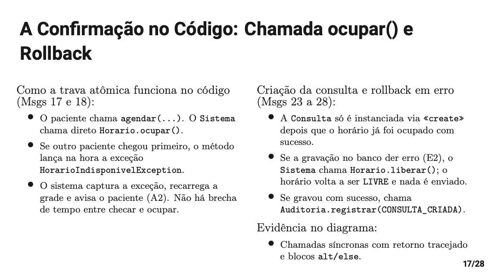

- **Título do Slide:** A Confirmação no Código: Chamada ocupar() e Rollback
- **Seção do Relatório:** Seção 3.1 (Detalhamento da Região 2)
- **Apresentador Sugerido:** Gabriel Henrique
- **Tempo Estimado:** 40 segundos
- **Objetivo do Slide:** Detalhar a exceção `HorarioIndisponivelException`, a instanciação da Consulta e o registro de auditoria.

#### O que falar (Sugestão de fala):
> *"No código, a prevenção de concorrência é direta e infalível:*  
> *Na **Mensagem 17**, o `:Sistema` não pergunta se está livre; ele chama direto `Horario.ocupar()`. O próprio método do objeto verifica o estado interno:*  
> *Se o horário já tiver sido reservado por outro milissegundos antes, lança na hora a exceção `HorarioIndisponivelException` (Mensagem 18).*  
> *O `:Sistema` captura essa exceção, recarrega a grade e avisa o usuário (Fluxo A2).*  
>  
> *Se a vaga foi ocupada com sucesso, avançamos para as **Mensagens 23 a 28**:*  
> *A instância de `:Consulta` é criada via `<<create>>` com status inicial `AGENDADA`.*  
> *Caso o banco falhe ao salvar (Fluxo E2), o bloco `else` chama `Horario.liberar()`, revertendo a situação para `LIVRE`.*  
> *Se persistiu com sucesso, a Mensagem 28 grava o log imutável via `Auditoria.registrar(CONSULTA_CRIADA)` com autor, IP e timestamp."*

- **Pontos-Chave & Postura:** Destacar que o objeto `Consulta` só é instanciado **depois** que o slot foi garantido no `Horario`.
- **Transição:** *"Com a consulta salva e auditada, avançamos para as mensagens 29 a 45: as notificações assíncronas."*

```
========================================================================================
SLIDE 22: DS-01 (MSGS 29 A 45) — PARALELISMO (PAR) E RETENTATIVAS COM BACKOFF
========================================================================================
```

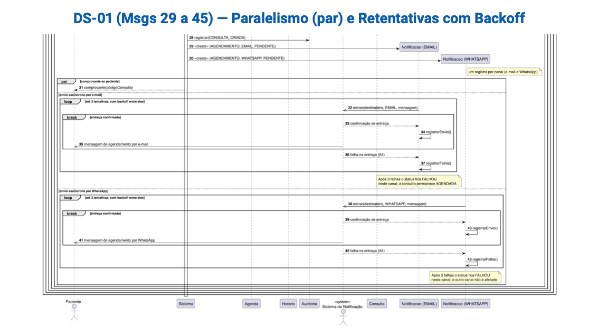

- **Título do Slide:** DS-01 (Msgs 29 a 45) — Paralelismo (par) e Retentativas com Backoff
- **Seção do Relatório:** Seção 3.1 (Região 3 do DS-01)
- **Apresentador Sugerido:** Gabriel Henrique
- **Tempo Estimado:** 20 segundos
- **Objetivo do Slide:** Mostrar a ampliação do fragmento `par`, as setas com ponta aberta de chamadas assíncronas e os laços de repetição de envio.

#### O que falar (Sugestão de fala):
> *"Vejam a sofisticação da Região 3 do DS-01. O grande retângulo delimita o operador combinado `par`, dividido por linhas tracejadas em 3 seções paralelas.*  
> *Notem as setas de ponta aberta `->>` que representam mensagens assíncronas, e dentro de cada canal, um fragmento `loop` com cláusula `break`."*

- **Pontos-Chave & Postura:** Apontar as setas abertas `->>` e as divisões horizontais do bloco `par`.
- **Transição:** *"Vamos entender como a semântica da UML expressa essa arquitetura tolerante a falhas."*

```
========================================================================================
SLIDE 23: ENVIO DAS MENSAGENS NO CÓDIGO: BLOCO PAR E RETENTATIVAS
========================================================================================
```

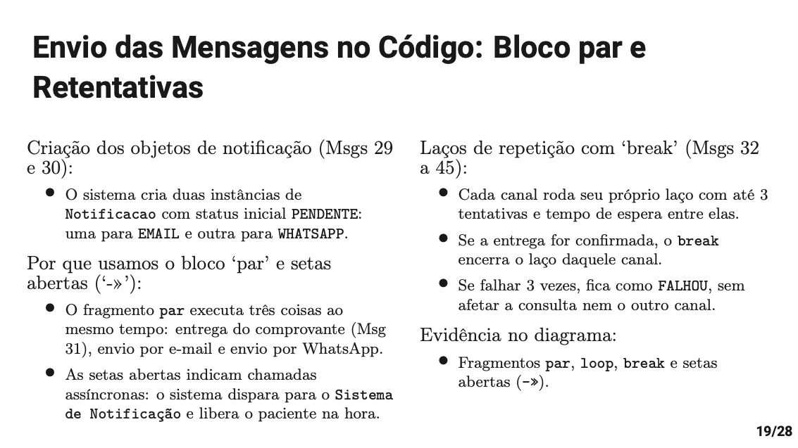

- **Título do Slide:** Envio das Mensagens no Código: Bloco par e Retentativas
- **Seção do Relatório:** Seção 3.1 (Detalhamento da Região 3)
- **Apresentador Sugerido:** Gabriel Henrique
- **Tempo Estimado:** 50 segundos
- **Objetivo do Slide:** Explicar a instanciação das 2 notificações, as mensagens assíncronas e os laços de retentativa com break independente.

#### O que falar (Sugestão de fala):
> *"Nas Mensagens 29 e 30, o `:Sistema` instancia dois objetos da classe `Notificacao`: um configurado para o canal `EMAIL` e outro para `WHATSAPP`, ambos com status `PENDENTE`.*  
> *Dentro do fragmento `par`, ocorrem três execuções simultâneas:*  
> *No primeiro ramo, a Mensagem 31 retorna imediatamente `exibirComprovante(codConsulta)` na tela do paciente.*  
> *Nos outros dois ramos, o sistema dispara mensagens assíncronas com setas abertas (`->>`) delegando o envio para o `:SistemaNotificacao`.*  
>  
> *Cada canal executa seu próprio laço de até 3 tentativas com backoff:*  
> *Se o WhatsApp responder sucesso na 1ª tentativa, a condição `break` encerra imediatamente o laço daquele canal.*  
> *Se esgotar as 3 tentativas, o status muda para `FALHOU`, mas a execução do e-mail não é interrompida e a consulta do paciente segue 100% garantida.*  
>  
> *Para compreendermos a base estrutural e as classes que sustentam todos esses objetos, passo a palavra ao colega **Luiz Pedro**, que apresentará o Diagrama de Classes."*

- **Pontos-Chave & Postura:** Destacar a independência total entre os canais de e-mail e WhatsApp.
- **Transição:** Passagem da palavra para Luiz Pedro (Seção 4).

```
========================================================================================
SLIDE 24: TRANSIÇÃO — DIAGRAMA DE CLASSES (DC)
========================================================================================
```

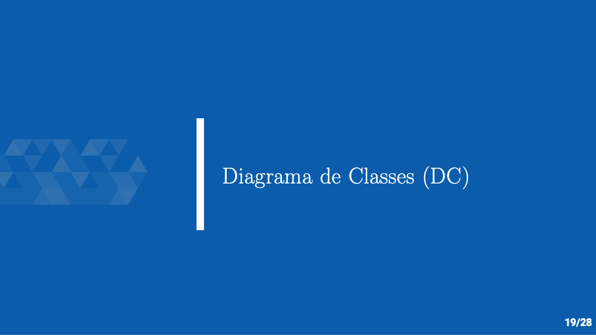

- **Título do Slide:** Seção 4: Diagrama de Classes (DC)
- **Seção do Relatório:** Seção 4 (Diagrama de Classes — DC)
- **Apresentador Sugerido:** Luiz Pedro (Seção 4)
- **Tempo Estimado:** 10 segundos
- **Objetivo do Slide:** Assumir a palavra e abrir a análise da estrutura estática do sistema.

#### O que falar (Sugestão de fala):
> *"Obrigado, Gabriel. Entramos na Seção 4 do nosso trabalho: o **Diagrama de Classes**, que modela a arquitetura estática, os tipos de dados e os relacionamentos do domínio da clínica."*

- **Transição:** Avançar diretamente para o Slide 25.

```
========================================================================================
SLIDE 25: DC — VISÃO GERAL DAS 11 CLASSES E 9 ENUMERAÇÕES (COMPLETO)
========================================================================================
```

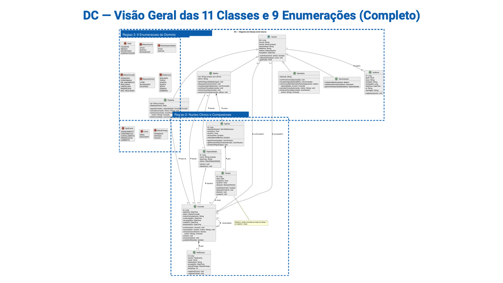

- **Título do Slide:** DC — Visão Geral das 11 Classes e 9 Enumerações (Completo)
- **Seção do Relatório:** Seção 4.1 (Figura 3 do artigo)
- **Apresentador Sugerido:** Luiz Pedro
- **Tempo Estimado:** 25 segundos
- **Objetivo do Slide:** Apresentar a visão macro do diagrama estático com 11 classes de domínio e 9 tipos enumerados fortemente tipados.

#### O que falar (Sugestão de fala):
> *"Este é o nosso Diagrama de Classes completo. Ele é constituído por **11 classes de domínio** e **9 tipos enumerados**.*  
> *A modelagem está organizada em três subsistemas visíveis:*  
> *No topo, a **Hierarquia de Usuários e Perfis de Acesso**;*  
> *No centro e à direita, o **Núcleo Clínico**, com clínica, agenda, horários, consultas e notificações;*  
> *E na base, os **Tipos Enumerados** que garantem consistência a todo o ecossistema.*  
> *Vamos examinar cada uma dessas regiões em detalhe."*

- **Pontos-Chave & Postura:** Apontar as três grandes regiões do diagrama no slide.
- **Transição:** *"Comecemos pela hierarquia de herança dos perfis de usuário."*

```
========================================================================================
SLIDE 26: DC (PERFIS) — HERANÇA A PARTIR DA CLASSE ABSTRATA USUARIO
========================================================================================
```

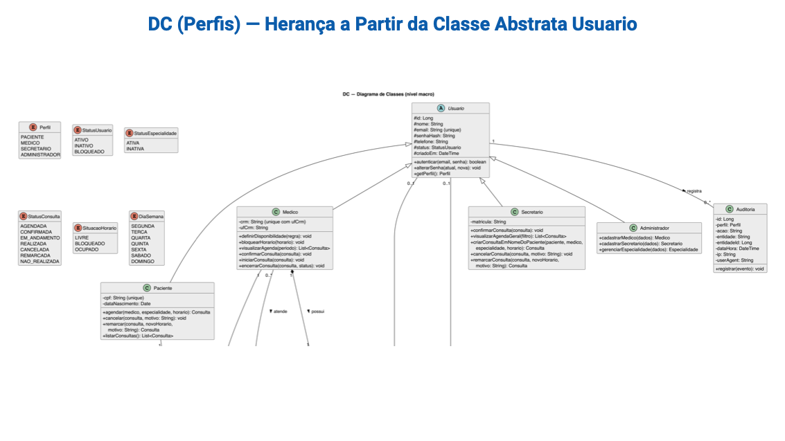

- **Título do Slide:** DC (Perfis) — Herança a Partir da Classe Abstrata Usuario
- **Seção do Relatório:** Seção 4.1 (Região 1 do DC)
- **Apresentador Sugerido:** Luiz Pedro
- **Tempo Estimado:** 15 segundos
- **Objetivo do Slide:** Mostrar a ampliação da árvore de herança com a classe abstrata `Usuario` e suas 4 especializações.

#### O que falar (Sugestão de fala):
> *"Nesta primeira ampliação, vemos a aplicação do conceito de herança em orientação a objetos.*  
> *Notem o nome em itálico da classe `{abstract} Usuario` no topo, com seus atributos precedidos pelo símbolo `#` de visibilidade protegida, e as 4 flechas de generalização apontando para ela a partir de `Paciente`, `Medico`, `Secretario` e `Administrador`."*

- **Pontos-Chave & Postura:** Apontar para o símbolo de triângulo oco da generalização e para os símbolos `#`.
- **Transição:** *"Vejamos as justificativas de projeto para essa estrutura."*

```
========================================================================================
SLIDE 27: A HIERARQUIA DE PERFIS: POR QUE USAMOS HERANÇA
========================================================================================
```

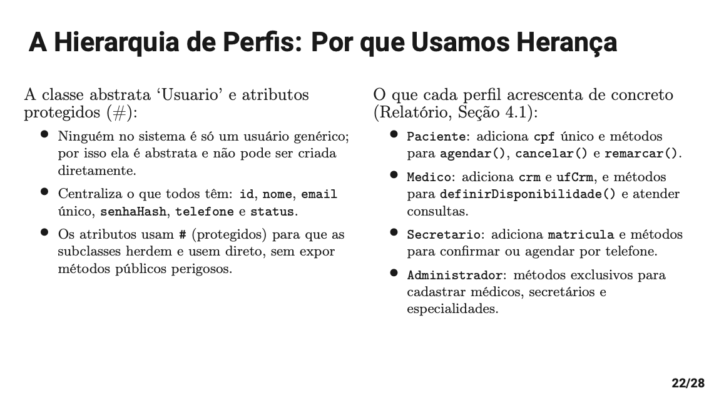

- **Título do Slide:** A Hierarquia de Perfis: Por que Usamos Herança
- **Seção do Relatório:** Seção 4.1 (Detalhamento da Região 1)
- **Apresentador Sugerido:** Luiz Pedro
- **Tempo Estimado:** 35 segundos
- **Objetivo do Slide:** Justificar o uso da classe abstrata `Usuario`, visibilidade protegida `#` e as responsabilidades únicas de cada subclasse.

#### O que falar (Sugestão de fala):
> *"Por que modelamos `Usuario` como classe abstrata?*  
> *Porque em uma clínica real, ninguém é simplesmente um 'usuário genérico'. Todo usuário precisa ser identificado como um perfil específico com regras próprias.*  
> *Centralizamos em `Usuario` os atributos comuns a todos: `id`, `nome`, `email` único, `senhaHash`, `telefone` e `status`.*  
> *Utilizamos **visibilidade protegida (`#`)** para que as subclasses herdem esses atributos diretamente sem a necessidade de expor métodos modificadores públicos perigosos.*  
>  
> *Cada subclasse adiciona dados e comportamentos estritamente necessários:*  
> *O `Paciente` tem `cpf` único e os métodos de autoatendimento `agendar()`, `cancelar()` e `remarcar()`.*  
> *O `Medico` tem `crm` e `ufCrm`, e os métodos para gerenciar disponibilidade e registrar atendimentos.*  
> *O `Secretario` tem sua matrícula funcional para confirmações e apoio telefônico.*  
> *E o `Administrador` tem métodos exclusivos para gerenciar especialidades e profissionais credenciados."*

- **Pontos-Chave & Postura:** Destacar a ausência de métodos de agendamento na classe `Medico`, reforçando a segregação de funções.
- **Transição:** *"Avançamos agora para o coração da clínica: os relacionamentos de composição e o histórico de horários."*

```
========================================================================================
SLIDE 28: DC (CLÍNICA) — COMPOSIÇÕES, HISTÓRICO DE HORÁRIOS E AUDITORIA
========================================================================================
```

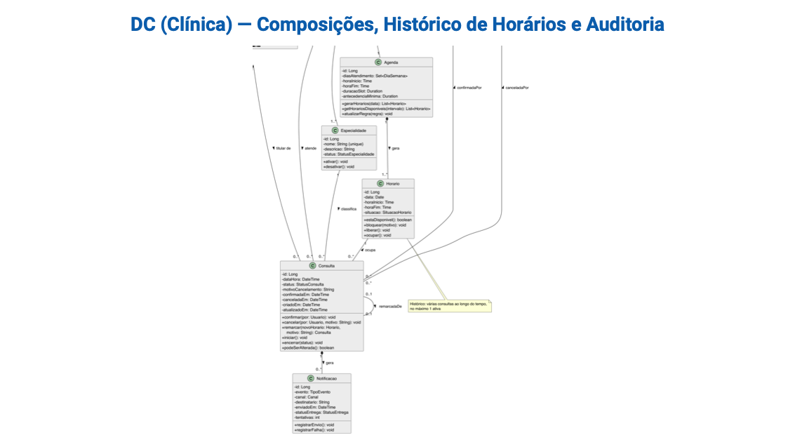

- **Título do Slide:** DC (Clínica) — Composições, Histórico de Horários e Auditoria
- **Seção do Relatório:** Seção 4.1 (Região 2 do DC)
- **Apresentador Sugerido:** Luiz Pedro
- **Tempo Estimado:** 15 segundos
- **Objetivo do Slide:** Mostrar a ampliação do núcleo clínico com os losangos pretos de composição, autoassociação de remarcação e auditoria.

#### O que falar (Sugestão de fala):
> *"Nesta ampliação central do Diagrama de Classes, temos o coração operacional do sistema.*  
> *Reparem nos losangos preenchidos representando composições estritas, na associação reflexiva da classe `Consulta` e na conexão desvinculada da classe `Auditoria`."*

- **Pontos-Chave & Postura:** Apontar para os losangos de composição preenchidos entre Médico-Agenda e Consulta-Notificação.
- **Transição:** *"Vejamos as decisões conceituais de alto nível aplicadas nesses relacionamentos."*

```
========================================================================================
SLIDE 29: COMPOSIÇÕES, HISTÓRICO DE HORÁRIOS E AUDITORIA
========================================================================================
```

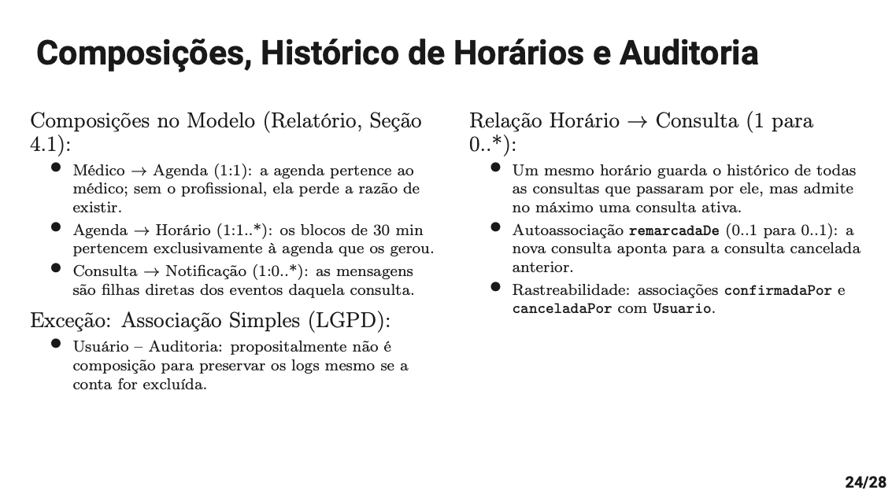

- **Título do Slide:** Composições, Histórico de Horários e Auditoria
- **Seção do Relatório:** Seção 4.1 (Detalhamento da Região 2)
- **Apresentador Sugerido:** Luiz Pedro
- **Tempo Estimado:** 40 segundos
- **Objetivo do Slide:** Justificar as 3 composições fortes, a exceção de associação simples da Auditoria para a LGPD e o histórico de consultas no Horário.

#### O que falar (Sugestão de fala):
> *"Aplicamos **Composição (losango preto)** em três pontos onde o ciclo de vida dos objetos é indissociável:*  
> *1. Entre `Medico` e `Agenda` (1 para 1): a agenda pertence àquele médico; sem o médico, ela perde o sentido de existir.*  
> *2. Entre `Agenda` e `Horario` (1 para 1..*): os blocos de 30 minutos são partes integrantes da agenda.*  
> *3. Entre `Consulta` e `Notificacao` (1 para 0..*): as mensagens são geradas a partir dos eventos daquela consulta específica.*  
>  
> *Porém, vejam a **exceção consciente de engenharia**: o relacionamento entre `Usuario` e `Auditoria` é propositalmente uma **associação simples**!*  
> *Por quê? Porque sob a LGPD, mesmo que um usuário solicite a inativação ou exclusão de sua conta, o registro de auditoria médica precisa ser mantido imutável por questões legais e de governança.*  
>  
> *Notem também o relacionamento entre `Horario` e `Consulta` (1 para 0..*): um mesmo horário físico de 14h30 admite várias consultas ao longo do tempo (por exemplo, consultas canceladas ou remarcadas), mas **apenas uma consulta ativa**.*  
> *E a autoassociação `remarcadaDe`: a nova consulta guarda o ponteiro para a consulta anterior cancelada, garantindo rastreabilidade perfeita."*

- **Pontos-Chave & Postura:** Frisar a decisão de LGPD na Auditoria — é o tipo de detalhe que costuma impressionar muito os professores da banca.
- **Transição:** *"Para garantir que nenhum valor inválido chegue a essas classes, criamos 9 tipos enumerados."*

```
========================================================================================
SLIDE 30: DC (ENUMERAÇÕES) — OS 9 TIPOS ENUMERADOS DO DOMÍNIO
========================================================================================
```

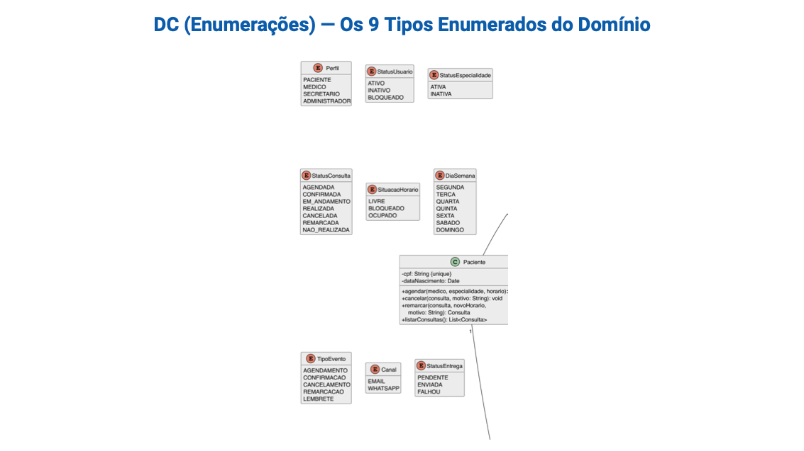

- **Título do Slide:** DC (Enumerações) — Os 9 Tipos Enumerados do Domínio
- **Seção do Relatório:** Seção 4.1 (Região 3 do DC)
- **Apresentador Sugerido:** Luiz Pedro
- **Tempo Estimado:** 15 segundos
- **Objetivo do Slide:** Mostrar a ampliação dos 9 blocos `<<enumeration>>` na base do diagrama.

#### O que falar (Sugestão de fala):
> *"Nesta ampliação, vemos os 9 tipos enumerados com estereótipo `<<enumeration>>`.*  
> *Eles fecham completamente os universos de valores para perfis, status de usuários, dias da semana, estados da grade, eventos e canais de notificação."*

- **Pontos-Chave & Postura:** Apontar para os blocos compactos de enumerações.
- **Transição:** *"Vejamos o impacto prático dessa tipagem no sistema."*

```
========================================================================================
SLIDE 31: ENUMERAÇÕES E CONTROLE DOS ESTADOS DO SISTEMA
========================================================================================
```

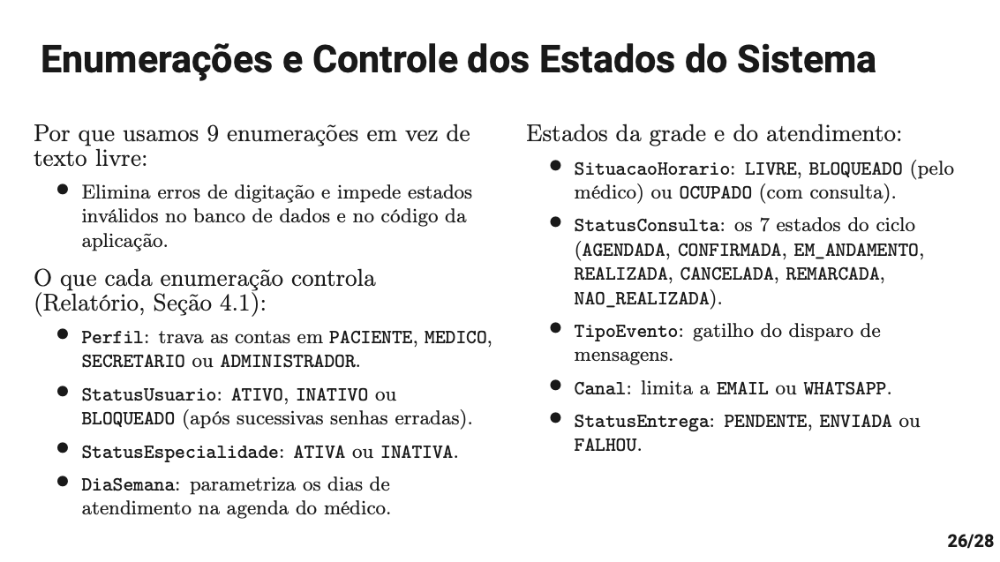

- **Título do Slide:** Enumerações e Controle dos Estados do Sistema
- **Seção do Relatório:** Seção 4.1 (Detalhamento da Região 3)
- **Apresentador Sugerido:** Luiz Pedro
- **Tempo Estimado:** 25 segundos
- **Objetivo do Slide:** Explicar a eliminação de strings soltas, prevenção de bugs e coerência com o compilador e banco de dados.

#### O que falar (Sugestão de fala):
> *"Por que modelamos 9 enumerações em vez de usar strings soltas ou números mágicos?*  
> *Porque enumerações trazem **tipagem estrita**: impedem erros de digitação e tornam estados inválidos impossíveis de serem compilados ou persistidos no banco de dados.*  
>  
> *Elas controlam o sistema em duas frentes:*  
> *Nos **Acessos e Configurações**: `Perfil`, `StatusUsuario` (`ATIVO`, `INATIVO`, `BLOQUEADO`), `StatusEspecialidade` e `DiaSemana`.*  
> *Na **Operação e Mensagens**: `SituacaoHorario` (`LIVRE`, `BLOQUEADO`, `OCUPADO`), os 7 estados de `StatusConsulta`, o `TipoEvento`, os canais restritos a `EMAIL` ou `WHATSAPP` e o `StatusEntrega` (`PENDENTE`, `ENVIADA`, `FALHOU`).*  
>  
> *Com essa robusta estrutura estática finalizada, passo a palavra ao colega **Yury Nogueira**, que apresentará os Apêndices normativos e a síntese final de convergência dos modelos."*

- **Pontos-Chave & Postura:** Ressaltar a frase: *"tornam estados inválidos impossíveis de representar"*.
- **Transição:** Passagem da palavra para Yury Nogueira (Seção 5 e Final).

```
========================================================================================
SLIDE 32: TRANSIÇÃO — CONCLUSÃO E APÊNDICES
========================================================================================
```


- **Título do Slide:** Seção 5: Conclusão e Apêndices
- **Seção do Relatório:** Seção 5 e Apêndices A e B
- **Apresentador Sugerido:** Yury Nogueira (Seção 5 e Final)
- **Tempo Estimado:** 10 segundos
- **Objetivo do Slide:** Assumir a palavra e abrir a etapa de fechamento técnico e conformidade com requisitos.

#### O que falar (Sugestão de fala):
> *"Obrigado, Luiz. Entramos na última etapa da nossa apresentação: a **Conclusão e os Apêndices Normativos**, onde consolidamos as garantias de engenharia da nossa entrega."*

- **Transição:** Avançar diretamente para o Slide 33.

```
========================================================================================
SLIDE 33: O QUE ESTÁ ESPECIFICADO NOS APÊNDICES DO TRABALHO
========================================================================================
```

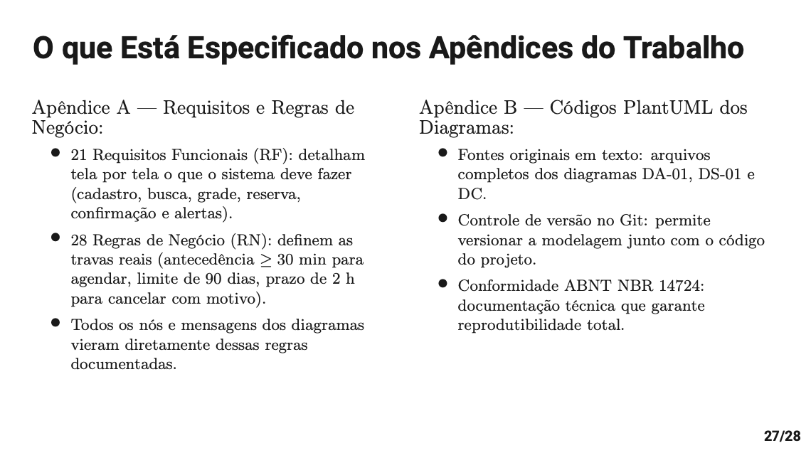

- **Título do Slide:** O que Está Especificado nos Apêndices do Trabalho
- **Seção do Relatório:** Apêndice A (Requisitos e Regras) e Apêndice B (Códigos PlantUML)
- **Apresentador Sugerido:** Yury Nogueira
- **Tempo Estimado:** 35 segundos
- **Objetivo do Slide:** Demonstrar a base normativa do projeto: 21 RFs, 28 RNs e conformidade com a ABNT NBR 14724.

#### O que falar (Sugestão de fala):
> *"Conforme exigido nas diretrizes acadêmicas da disciplina, nosso relatório técnico inclui dois apêndices formais:*  
> *No **Apêndice A**, documentamos detalhadamente **21 Requisitos Funcionais (RF)** e **28 Regras de Negócio (RN)** numeradas e rastreáveis.*  
> *Cada nó de decisão do DA-01, cada mensagem do DS-01 e cada método do DC tem correspondência direta com uma regra do Apêndice A — como o prazo mínimo de 2 horas (RN-20) e a antecedência de 30 minutos a 90 dias (RN-13).*  
>  
> *No **Apêndice B**, fornecemos os **códigos-fonte integrais em PlantUML** de todos os diagramas.*  
> *Trabalhar com diagramas como código ('Diagrams-as-Code') permite que a modelagem viva dentro do repositório Git junto com o código da aplicação, garantindo versionamento, histórico de alterações e conformidade total com a norma ABNT NBR 14724."*

- **Pontos-Chave & Postura:** Apontar as vantagens de versionar o modelo no Git via PlantUML.
- **Transição:** *"Vejamos agora como os três modelos conversam entre si na prática da engenharia de software."*

```
========================================================================================
SLIDE 34: COMO OS TRÊS MODELOS SE CONECTAM NA PRÁTICA
========================================================================================
```

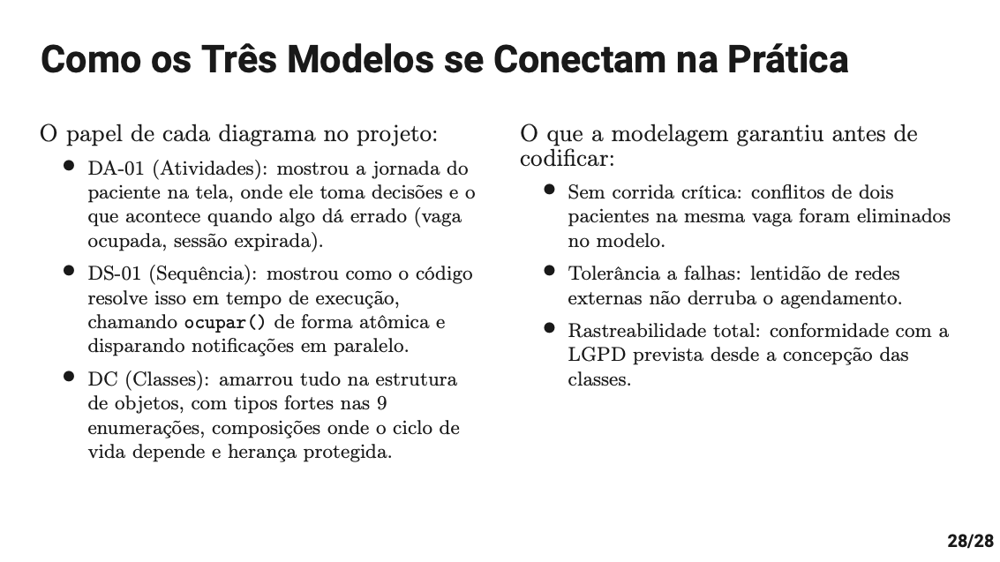

- **Título do Slide:** Como os Três Modelos se Conectam na Prática
- **Seção do Relatório:** Seção 5 (Conclusão e Convergência dos Modelos)
- **Apresentador Sugerido:** Yury Nogueira
- **Tempo Estimado:** 55 segundos
- **Objetivo do Slide:** Amarrar os 3 diagramas em uma visão unificada e destacar as 3 grandes garantias asseguradas antes de escrever uma linha de código.

#### O que falar (Sugestão de fala):
> *"O grande valor deste trabalho reside na **convergência perfeita entre os três modelos**:*  
> *O **DA-01 (Atividades)** nos deu a visão da jornada do paciente e dos processos clínicos, mapeando visualmente onde ocorrem as decisões e os fluxos alternativos.*  
> *O **DS-01 (Sequência)** desceu para o tempo de execução, demonstrando como as instâncias trocam mensagens de forma atômica e como a latência de mensagens externas é isolada com chamadas assíncronas.*  
> *E o **DC (Classes)** estabeleceu o alicerce estático, com tipos de dados fortes, herança segura e relacionamentos de vida dependente nas composições.*  
>  
> *Ao realizarmos essa modelagem com alto rigor antes da codificação, garantimos três vitórias de engenharia:*  
> *1. **Eliminação de condições de corrida**: o lock atômico impede marcações duplas no mesmo horário.*  
> *2. **Tolerância a falhas de rede**: instabilidades em WhatsApp ou e-mail nunca derrubam o agendamento.*  
> *3. **Privacidade e Governança por Design**: conformidade nativa com a LGPD prevista desde a concepção das classes e logs de auditoria."*

- **Pontos-Chave & Postura:** Olhar para a banca com entusiasmo e segurança profissional nos 3 benefícios.
- **Transição:** *"Com isso, encerramos a exposição e abrimos para os questionamentos do professor."*

```
========================================================================================
SLIDE 35: ENCERRAMENTO: OBRIGADO! / DÚVIDAS E DISCUSSÃO
========================================================================================
```

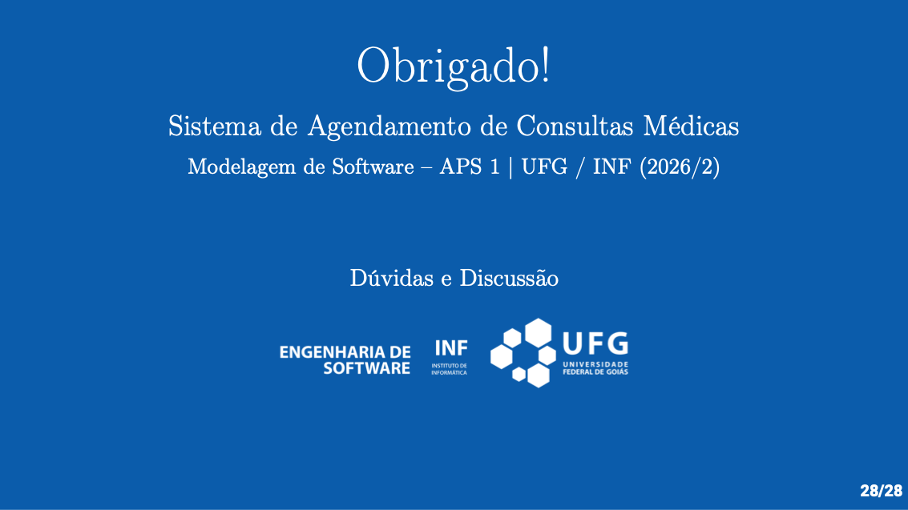

- **Título do Slide:** Encerramento — Obrigado!
- **Seção do Relatório:** Finalização da Apresentação
- **Apresentador Sugerido:** Yury Nogueira (com participação de todo o grupo)
- **Tempo Estimado:** 20 segundos
- **Objetivo do Slide:** Agradecer formalmente e colocar todos os 5 integrantes em prontidão para responder à arguição da banca.

#### O que falar (Sugestão de fala):
> *"Agradecemos imensamente a atenção do professor Diogo e de todos os colegas. Toda a documentação técnica, os arquivos fonte em LaTeX, Beamer e os códigos PlantUML estão devidamente organizados em nosso repositório.*  
> *Agora, nosso grupo inteiro fica à disposição da banca para responder a perguntas, discutir decisões de modelagem e receber seus apontamentos. Muito obrigado!"*

- **Pontos-Chave & Postura:** Todo o grupo deve se posicionar lado a lado, em postura profissional, prontos para responder às perguntas.

---

## 4. Simulação de Perguntas da Banca (Q&A de Alta Performance)

Abaixo estão as 10 perguntas técnicas mais prováveis que um professor avaliador de Modelagem de Software pode fazer, acompanhadas da resposta exata e fundamentada que o grupo deve apresentar:

---

### Pergunta 1:
**"Por que vocês escolheram utilizar uma Trava Atômica em vez de simplesmente verificar se o horário estava livre antes de salvar a consulta?"**
> **Resposta Sugerida (Foco no DS-01 e DA-01):**  
> *"Professor, se apenas consultássemos o status e depois executássemos a reserva em etapas separadas, criaríamos uma janela de vulnerabilidade conhecida como condição de corrida (Race Condition ou Time-of-Check to Time-of-Use). Dois pacientes poderiam checar a disponibilidade no mesmo milissegundo, receber o status `LIVRE` e ambos enviarem a confirmação. Ao invocar diretamente o método `Horario.ocupar()` com trava atômica no banco (como modelado nas mensagens 17 e 18 do DS-01), a checagem e a mudança de estado ocorrem em uma única transação indivisível. Se outro usuário ocupou o slot um milissegundo antes, o método lança imediatamente a `HorarioIndisponivelException`, desviando para o fluxo A2 sem jamais permitir marcações duplas."*

---

### Pergunta 2:
**"Na classe `Usuario`, por que os atributos foram modelados como protegidos (`#`) em vez de privados (`-`)?"**
> **Resposta Sugerida (Foco no DC):**  
> *"Como `Usuario` é uma classe abstrata que jamais será instanciada diretamente, a visibilidade protegida (`#`) permite que suas especializações concretas — `Paciente`, `Medico`, `Secretario` e `Administrador` — acessem diretamente atributos estruturais fundamentais (como `id`, `email`, `senhaHash` e `status`) sem a necessidade de expor métodos setters públicos e perigosos no nível da superclasse. Isso preserva o encapsulamento em relação ao restante do sistema, ao mesmo tempo em que confere naturalidade e eficiência à hierarquia de herança."*

---

### Pergunta 3:
**"Por que o relacionamento entre `Usuario` e `Auditoria` foi modelado como Associação Simples, enquanto entre `Medico` e `Agenda` foi usada Composição?"**
> **Resposta Sugerida (Foco no DC e LGPD):**  
> *"Essa foi uma decisão estratégica de governança e conformidade com a LGPD. Em uma Composição (losango preto), a destruição do todo implica a destruição automática das partes. Entre `Medico` e `Agenda`, isso faz sentido: sem o médico, a agenda não tem razão de existir.  
> Porém, para a `Auditoria`, se modelássemos como composição com `Usuario`, caso um paciente solicitasse a exclusão ou inativação da sua conta nos termos da LGPD, os registros de auditoria poderiam ser apagados por cascata. Como a legislação e as normas de saúde exigem rastreabilidade jurídica de quem agendou, alterou ou cancelou horários, a `Auditoria` precisa ser perene e independente, sobrevivendo mesmo que a entidade do usuário seja excluída."*

---

### Pergunta 4:
**"No Diagrama de Atividades, qual a razão de usar um fork para o envio de e-mail e WhatsApp em vez de seguir um fluxo sequencial?"**
> **Resposta Sugerida (Foco no DA-01 e Resiliência):**  
> *"Provedores externos de mensageria e APIs de WhatsApp operam sobre a internet pública e estão sujeitos a picos de latência, timeouts ou instabilidade temporária. Se o fluxo fosse estritamente sequencial, o paciente ficaria com a tela travada aguardando o retorno dessas APIs externas. Com o fork, o paciente recebe o comprovante e o código de agendamento instantaneamente no Ramo 1 da interface, enquanto o Sistema de Notificação cuida das tentativas e do backoff no Ramo 2 em segundo plano."*

---

### Pergunta 5:
**"O que acontece se o envio de WhatsApp falhar definitivamente após as 3 tentativas? O agendamento é cancelado?"**
> **Resposta Sugerida (Foco no DA-01 e DS-01):**  
> *"Não, professor. O agendamento permanece intacto com status `AGENDADA`. A modelagem prevê isolamento de responsabilidades: uma falha em um canal secundário de comunicação nunca deve anular uma transação médica de negócio já persistida. O objeto `Notificacao` daquele canal tem seu status atualizado para `FALHOU` para fins de controle e reenvio administrativo, enquanto o e-mail segue seu fluxo normalmente."*

---

### Pergunta 6:
**"Por que a relação entre `Horario` e `Consulta` no Diagrama de Classes é de 1 para 0..* e não 1 para 1?"**
> **Resposta Sugerida (Foco no DC):**  
> *"Porque o `Horario` representa um intervalo fixo na grade do médico (por exemplo, terça-feira às 14h00), enquanto a `Consulta` representa o evento clínico. Se um paciente marca uma consulta para esse horário e depois cancela com antecedência, a consulta antiga passa ao estado `CANCELADA` e o horário volta a ficar `LIVRE`. Se outro paciente agendar o mesmo horário mais tarde, existirá uma nova consulta `AGENDADA` associada àquele mesmo horário. Portanto, o histórico do slot guarda referências a todas as consultas que passaram por ele, embora o sistema imponha a regra de negócio de que no máximo **uma** consulta pode estar ativa simultaneamente naquele horário."*

---

### Pergunta 7:
**"Por que vocês modelaram 9 enumerações em vez de tipos primitivos como strings?"**
> **Resposta Sugerida (Foco no DC):**  
> *"O uso de enumerações elimina a possibilidade de strings mágicas e erros de grafia no código e no banco de dados. Elas garantem que o domínio seja estritamente fechado em tempo de compilação. Por exemplo, a enumeração `StatusConsulta` impede que alguém tente criar um estado arbitrário como 'ESPERANDO' ou 'ADIADA' sem que isso passe formalmente por uma revisão da arquitetura do sistema."*

---

### Pergunta 8:
**"Se um paciente quiser desmarcar uma consulta faltando 1 hora para o horário, o sistema permite?"**
> **Resposta Sugerida (Foco nas Regras de Negócio e DA-01):**  
> *"Não. De acordo com a Regra de Negócio RN-20 e o nó de decisão modelado no sistema, cancelamentos e remarcações exigem uma antecedência mínima estrita de **2 horas**. Se o horário atual estiver a menos de 2 horas do início da consulta, o sistema bloqueia a ação na interface e orienta o paciente a contatar a recepção da clínica por telefone."*

---

### Pergunta 9:
**"Como o sistema trata a remarcação de uma consulta no Diagrama de Classes e de Sequência?"**
> **Resposta Sugerida (Foco no DC e autoassociação):**  
> *"A remarcação é tratada de forma atômica: a consulta original tem seu status transicionado para `REMARCADA` e seu horário original é liberado para `LIVRE`. Em seguida, uma nova consulta é instanciada como `AGENDADA` no novo horário escolhido. No Diagrama de Classes, a autoassociação `remarcadaDe (0..1 para 0..1)` faz com que a nova consulta aponte diretamente para o id da consulta anterior, preservando toda a trilha histórica do agendamento."*

---

### Pergunta 10:
**"Qual é a função do participante `Sistema` no Diagrama de Sequência? Ele não se confunde com o todo da aplicação?"**
> **Resposta Sugerida (Foco no DS-01):**  
> *"No Diagrama de Sequência, o participante `:Sistema` representa a classe controladora da aplicação (o padrão Controller de GRASP e da arquitetura MVC). Ele não é o banco de dados nem a interface com o usuário; ele é a camada de serviço/orquestração que recebe os eventos disparados pela fronteira da tela e delega as operações para os objetos de domínio (`Agenda`, `Horario`, `Consulta` e `Auditoria`). Essa separação impede o acoplamento indesejado entre a camada de apresentação e a camada de negócio."*

---

## 5. Checklist Prático para o Dia da Apresentação

- [ ] **Projetor e Proporção:** Verificar se o projetor da sala suporta a proporção **16:9** nativa dos nossos slides.
- [ ] **Cópia Local e Backup:** Garantir o arquivo `slides/apresentacao-aps1.pdf` salvo no desktop do notebook e um backup em pendrive ou nuvem.
- [ ] **Passador de Slides / Laser:** Testar previamente as pilhas e o funcionamento do passador sem fio.
- [ ] **Cronômetro:** Designar um integrante para manter um cronômetro visível discretamente na bancada, sinalizando os tempos de cada seção (meta: ~15 minutos).
- [ ] **Postura em Grupo:** Enquanto um colega estiver apresentando, os outros quatro devem manter atenção visual nos slides e no colega, demonstrando sintonia e união de equipe.
