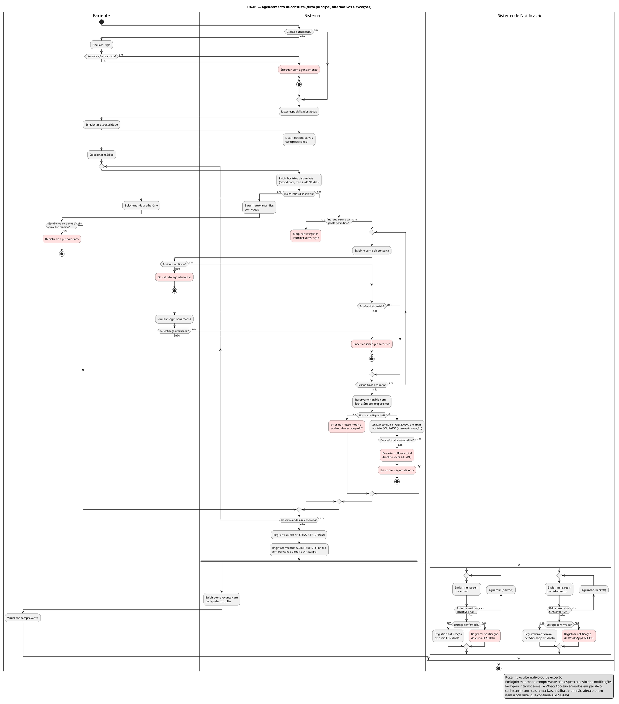
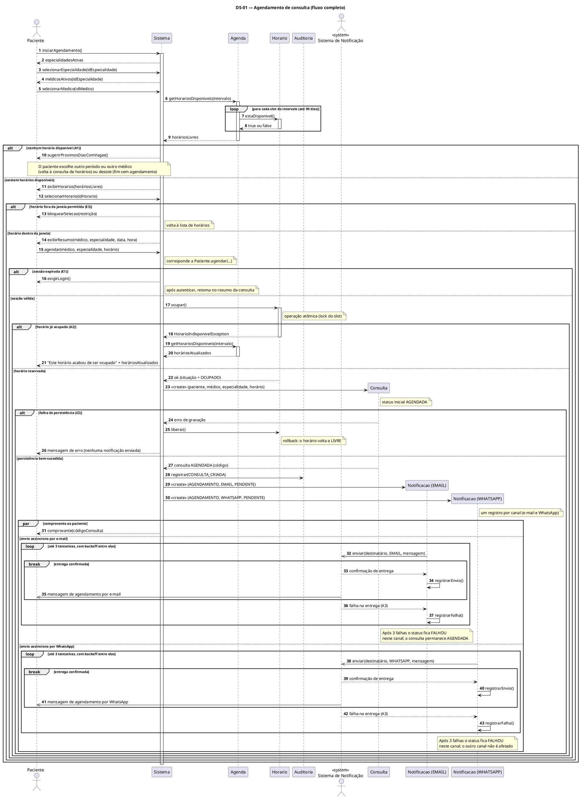
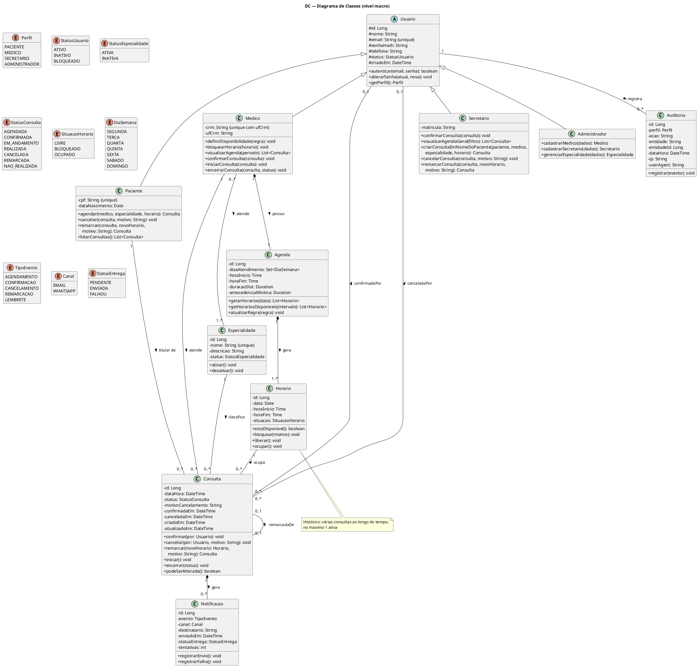

# Trabalho de Modelagem UML — Sistema de Agendamento de Consultas Médicas

---

## Capa

**Universidade Federal de Goiás**

**Engenharia de Software** — **Modelagem de Software**

---

### Modelagem de Software — APS 1

**Tema:** Aplicativo de Agendamento de Consultas Médicas

---

**Integrantes do grupo:**

- Carlos Eduardo Freire da Silva
- Gabriel Henrique Lourenço Dias
- Kayque Vicente Silva
- Luiz Pedro Pereira Mendes Saraiva
- Yury Nogueira de Oliveira Silva

**Professor:** Me. Diogo Oliveira Santos

**Goiânia — 14 de outubro de 2026**

---

## 1. Descrição da Aplicação

### 1.1 Contexto e Objetivos

Este trabalho apresenta a modelagem de um sistema web para utilização em clínicas e consultórios, que permite que os usuários realizem agendamentos de consultas e, para a clínica, o gerenciamento da agenda de atendimento de diversos médicos e suas especialidades.

Temos como objetivo principal dar autonomia ao usuário para que ele consiga, a qualquer momento, realizar um agendamento na clínica desejada, selecionando a especialidade e o médico e definindo o horário, sem precisar fazer ligações ou enviar mensagens, agilizando assim o processo de agendamento, remarcação e cancelamento de consultas. Além disso, a equipe da clínica passa a ter um melhor gerenciamento da agenda de seus médicos especialistas, ganhando agilidade no processo e permitindo que os próprios médicos cadastrem seus horários, enquanto o administrador tem uma visão geral do funcionamento da clínica.

### 1.2 Problema de Negócio e Solução Proposta

Processos manuais em clínicas costumam gerar sobrecarga na recepção, marcações duplas no mesmo horário e alto índice de faltas pela falta de lembretes práticos. Além disso, controles em planilhas ou papel dificultam o remanejamento rápido de horários cancelados e não oferecem histórico confiável para auditoria.

O sistema resolve esses problemas ao centralizar as agendas em uma base única, aplicando validação em tempo real e bloqueio de horários para impedir conflitos entre pacientes que desejam um mesmo horário. Para reduzir as faltas, a aplicação envia confirmações e lembretes simultaneamente por e-mail e WhatsApp, os dois canais mais usados no dia a dia. Além disso, todas as ações críticas (agendamentos, confirmações, cancelamentos e remarcações com motivo obrigatório e alterações de grade) geram registros de auditoria com autor, data/hora, IP e navegador, apoiando a rastreabilidade e a conformidade com a LGPD. A guarda do motivo de cada cancelamento ou remarcação forma um histórico que ajuda a clínica a entender por que os horários são liberados.

### 1.3 Atores do Sistema

O sistema conta com cinco atores bem definidos:

1. **Paciente:** cadastra-se com CPF, e-mail e telefone celular; autentica-se com senha segura; pesquisa médicos por especialidade; consulta a grade de horários disponíveis; e gerencia suas consultas (agendamento, histórico, remarcação e cancelamento). Recebe notificações automáticas por e-mail e WhatsApp, inclusive um lembrete 24 horas antes da consulta.
2. **Médico:** profissional cadastrado com CRM, UF e especialidades ativas. Configura sua disponibilidade semanal (dias de atendimento, horário de expediente e duração das consultas); bloqueia horários pontuais por conveniência; visualiza sua agenda; confirma as próprias consultas; e registra o status do atendimento (iniciando, concluindo ou registrando a ausência do paciente). Não agenda, cancela nem remarca consultas.
3. **Secretário:** profissional da recepção. Acompanha as agendas de todos os médicos, gerencia as consultas pendentes de confirmação (com contato proativo com pacientes quando necessário), registra confirmações ou recusas e pode agendar, remarcar ou cancelar consultas a pedido de pacientes presenciais ou por telefone.
4. **Administrador:** responsável pelos cadastros dentro do sistema. Cadastra e mantém médicos e secretários e gerencia o catálogo de especialidades (ativar e desativar). Não agenda nem altera consultas.
5. **Sistema de Notificação:** componente secundário que roda em segundo plano. Funciona a partir dos eventos gerados pelas operações da clínica e envia as mensagens em paralelo por e-mail e WhatsApp, com fila de retentativas automáticas caso ocorra instabilidade temporária na rede, garantindo que o agendamento nunca trave por falha de envio.

### 1.4 Módulos Funcionais e Regras de Negócio

O sistema é organizado em seis módulos complementares:

- **Módulo de Cadastro e Autenticação:** É responsável pelo gerenciamento e pela autenticação dos usuários, tanto da equipe da clínica quanto dos pacientes. Exige e-mail único para todos e CPF único para pacientes. Médicos são cadastrados pelo par CRM/UF, dados únicos nacionalmente. Os perfis de acesso são exclusivos (`PACIENTE`, `MEDICO`, `SECRETARIO`, `ADMINISTRADOR`). Pacientes se cadastram sozinhos; médicos e secretários são cadastrados pelo administrador. As senhas são armazenadas sob hash criptográfico, com bloqueio temporário após sucessivas tentativas incorretas.
- **Módulo de Especialidades e Médicos:** o administrador gerencia a lista de especialidades. Apenas especialidades ativas aceitam novos agendamentos. Cada médico pode atender em uma ou mais especialidades, e a busca filtra somente profissionais ativos e vinculados à especialidade escolhida.
- **Módulo de Gestão de Horários e Agenda:** organiza a agenda em intervalos de **30 minutos por padrão**, configuráveis pelo médico em blocos de 30 minutos, sem sobreposição para o mesmo médico. Cada intervalo tem um estado claro (`LIVRE`, `BLOQUEADO` ou `OCUPADO`). Os horários ficam disponíveis para reserva dentro do expediente do médico, respeitando uma antecedência mínima de agendamento e um limite de até 90 dias no futuro.
- **Módulo de Agendamento:** guia o paciente em quatro passos: escolha da especialidade, escolha do médico, seleção de data/horário livre e, na mesma tela, visão de um resumo e confirmação. Ao confirmar o resumo, o sistema reserva o horário para evitar que dois pacientes reservem a mesma vaga ao mesmo tempo. A consulta é criada com status `AGENDADA`; a confirmação pelo secretário ou pelo médico (`CONFIRMADA`) é **opcional**; a consulta passa para `EM_ANDAMENTO` durante o atendimento e termina como `REALIZADA` (ou `NAO_REALIZADA`, se o paciente faltar).
- **Módulo de Cancelamento e Remarcação:** o paciente titular ou o secretário podem cancelar ou remarcar, com antecedência mínima de 2 horas. Caso falte menos de 2 horas, a operação (cancelamento ou remarcação) pelo sistema é bloqueada, orientando o contato direto com a clínica. O cancelamento e a remarcação exigem obrigatoriamente um **motivo**. Quando o cancelamento é concluído, o intervalo da consulta volta imediatamente para `LIVRE`. A remarcação é sempre com o mesmo médico: ela cancela a consulta original, libera o horário antigo, ocupa o novo horário e cria uma nova consulta `AGENDADA`, com reversão automática caso o novo horário falhe. Para trocar de médico, o usuário cancela e agenda novamente.
- **Módulo de Notificações e Auditoria:** registra logs imutáveis de cada operação crítica e envia avisos por e-mail e WhatsApp simultaneamente, de forma assíncrona. Cada canal gera o seu próprio registro de notificação, com até 3 tentativas. Uma falha temporária no envio não cancela a consulta; nesse caso, o paciente apenas não recebe a notificação pelos canais cadastrados.

### 1.5 Ciclo de Vida da Consulta

| De | Evento | Para | Quem pode |
|---|---|---|---|
| — | agendar | `AGENDADA` | Paciente, Secretário |
| `AGENDADA` | confirmar | `CONFIRMADA` | Secretário, Médico titular |
| `AGENDADA`, `CONFIRMADA` | iniciar | `EM_ANDAMENTO` | Médico titular |
| `AGENDADA`, `CONFIRMADA` | cancelar (≥ 2 h, com motivo) | `CANCELADA` | Paciente titular, Secretário |
| `AGENDADA`, `CONFIRMADA` | remarcar (≥ 2 h, com motivo) | `REMARCADA` (e nova `AGENDADA`) | Paciente titular, Secretário |
| `AGENDADA`, `CONFIRMADA` | horário passou sem início | `NAO_REALIZADA` | Sistema |
| `AGENDADA`, `CONFIRMADA`, `EM_ANDAMENTO` | registrar ausência | `NAO_REALIZADA` | Médico titular |
| `EM_ANDAMENTO` | encerrar | `REALIZADA` | Médico titular |

`CANCELADA`, `REMARCADA`, `REALIZADA` e `NAO_REALIZADA` são estados finais de cada consulta.

### 1.6 Quem Recebe Cada Notificação

Cada evento gera uma notificação por destinatário e por canal (e-mail e WhatsApp).

| Evento | Paciente | Médico |
|---|---|---|
| Agendamento | sim | não |
| Confirmação | sim | sim |
| Cancelamento | sim | sim |
| Remarcação | sim | sim |
| Lembrete (24 h antes) | sim | não |

### 1.7 Escopo e Premissas

- A aplicação é um **web app responsivo**; não há aplicativo nativo.
- Ficam **fora do escopo**: prontuário eletrônico, prescrições, pagamento, convênios, nota fiscal, teleconsulta e várias clínicas (multiclínica).
- Há um único contexto de clínica.
- A auditoria cobre eventos de negócio (criar, confirmar, cancelar, remarcar, bloquear horário e alterar cadastro), não leituras.

---

## 2. Diagramas de Atividades

Fizemos um único diagrama de atividades, o **DA-01**, com o fluxo principal de agendamento e todos os caminhos alternativos e de erro. Como ele já cobre o que foi pedido, não criamos diagramas separados para cancelar, remarcar e confirmar consulta; esses processos estão explicados nas seções 1.4 e 1.5.

### 2.1 DA-01 — Agendamento de Consulta

**Objetivo:** mostrar o passo a passo do paciente para agendar uma consulta, do login até receber o comprovante, incluindo o que acontece quando algo dá errado.

**Quem participa (raias):** Paciente, Sistema e Sistema de Notificação.

**Como funciona:** o paciente faz login (se ainda não estiver logado), escolhe a especialidade, o médico e um horário livre, confere o resumo e confirma. O sistema reserva o horário de uma vez só, para dois pacientes não pegarem a mesma vaga, grava a consulta como `AGENDADA`, marca o horário como `OCUPADO` e registra a auditoria. Depois disso, o fluxo se divide em duas partes que andam ao mesmo tempo: o sistema mostra o comprovante ao paciente e o Sistema de Notificação envia as mensagens. O envio também se divide em dois, e-mail e WhatsApp, cada um com até 3 tentativas e com seu próprio resultado (`ENVIADA` ou `FALHOU`). No fim tudo se junta, mas o comprovante não fica esperando o envio.

Código PlantUML (fonte do diagrama)

**Como ler o diagrama:** as raias separam o que cada ator faz. Os laços (`repeat`) voltam para a escolha de horário quando não há vagas, quando o horário está fora da janela ou quando outro paciente pegou o horário, e voltam para o resumo depois de um novo login. Os blocos rosa são os caminhos alternativos e de erro. O fork/join mostra o que acontece ao mesmo tempo: o comprovante aparece enquanto as mensagens são enviadas, e se o envio falhar o agendamento continua valendo.

**Onde cada fluxo alternativo (A) e de erro (E) aparece no DA-01:**

| Fluxo | Onde aparece no diagrama |
|---|---|
| Login inicial | No começo, em "Sessão autenticada?"; se o login falhar, o fluxo termina |
| A1 — sem horários | "Há horários disponíveis?" não → o sistema sugere outros dias → o paciente escolhe outro período ou médico (volta para a escolha de horário) ou desiste |
| A2 — horário tomado por outro paciente | "Slot ainda disponível?" não → aviso "Este horário acabou de ser ocupado" → volta para a escolha de horário |
| A3 — falha no envio da mensagem | No Sistema de Notificação: falha no envio → até 3 tentativas → `FALHOU`; a consulta continua `AGENDADA` |
| E1 — sessão expirou | "Sessão ainda válida?" não → novo login → volta para o resumo da consulta |
| E2 — falha ao gravar | "Persistência bem-sucedida?" não → desfaz tudo (o horário volta a `LIVRE`) → mensagem de erro |
| E3 — horário fora da janela | "Horário dentro da janela permitida?" não → bloqueia a seleção e explica a restrição |
| Desistências | "Paciente confirma?" não, ou "Escolhe outro período ou outro médico?" não |

---

## 3. Diagramas de Sequência

O **DS-01** cobre o mesmo cenário do DA-01 sob uma perspectiva diferente: enquanto o diagrama de atividades mapeia *o que* acontece, o diagrama de sequência revela *como* os participantes se comunicam para que isso aconteça. Ele ordena cronologicamente as mensagens trocadas entre o paciente, o sistema, os objetos de negócio (`Agenda`, `Horario`, `Consulta`, `Notificacao`) e o Sistema de Notificação, incluindo os retornos e todos os cenários alternativos e de exceção.

### 3.1 DS-01 — Agendamento de Consulta (fluxo completo)

**Objetivo:** documentar, mensagem a mensagem, o que acontece durante um agendamento. Os pontos centrais são a reserva atômica do horário — que previne conflitos de concorrência —, a criação da consulta e o rollback em caso de falha, e o envio assíncrono e paralelo das notificações por e-mail e WhatsApp.

**Cenário representado:** um paciente autenticado seleciona especialidade, médico e horário, e conclui o agendamento. O diagrama trata todas as situações excepcionais relevantes: ausência de horários disponíveis, seleção de horário fora da janela permitida, sessão expirada, tentativa de reservar um horário já ocupado por outro paciente, falha de gravação no banco e falha no envio da notificação.

Código PlantUML (fonte do diagrama)

**Explicação dos pontos-chave:**

- **Reserva atômica (mensagens 17–18):** quando o paciente confirma o horário, o sistema chama `Horario.ocupar()` em uma única operação indivisível. Se outro paciente chegou primeiro, o método lança `HorarioIndisponivelException` e o fluxo segue para A2 — nunca existe uma janela de tempo entre "verificar disponibilidade" e "efetivar a reserva" que permita duas confirmações simultâneas do mesmo slot.
- **Rollback em caso de falha (mensagem 25):** se a criação da `Consulta` falha por problema de persistência (E2), o sistema desfaz imediatamente a reserva chamando `Horario.liberar()`, devolvendo o slot ao estado `LIVRE`. Nenhuma notificação é disparada nesse caso, garantindo consistência entre os dados e o que o paciente recebe.
- **Criação de objetos em tempo de execução (mensagens 23, 29 e 30):** `Consulta` e os dois objetos `Notificacao` — um por canal — só existem a partir do momento em que são criados no fluxo (setas `<<create>>`). Isso torna explícito que a criação é parte do processo de agendamento, e não algo pré-existente. A mensagem 15, `agendar(...)`, corresponde à operação `Paciente.agendar(medico, especialidade, horario)` do diagrama de classes.
- **Paralelismo no envio (mensagem 31 em diante):** assim que a consulta é gravada com sucesso, o bloco `par` divide o fluxo em três ramos simultâneos: entrega do comprovante ao paciente, envio por e-mail e envio por WhatsApp. Esse comportamento espelha os *forks* do DA-01. As setas com ponta aberta (`->>`) indicam que as chamadas ao Sistema de Notificação são assíncronas — o sistema não espera a confirmação de entrega para liberar o paciente.
- **Retentativas independentes por canal (mensagens 32–43):** cada canal possui seu próprio laço de até 3 tentativas com *backoff* entre elas. Quando uma entrega é confirmada, o bloco `break` encerra o laço daquele canal. Após 3 falhas consecutivas, o status do objeto `Notificacao` passa para `FALHOU` — mas isso afeta apenas o canal em questão; o outro canal continua normalmente e o status da consulta permanece `AGENDADA`.
- **Papel do participante `Sistema`:** representa a camada de aplicação, que orquestra todo o fluxo. As mensagens que chegam a ele (`iniciarAgendamento`, `selecionarMedico`, `selecionarHorario` e outras) são operações do controlador da aplicação, e não métodos diretos das classes de domínio. Essa separação é intencional: ela mantém o diagrama focado na lógica de negócio e na interação entre os objetos, sem misturar detalhes de telas ou de interface com as classes do sistema.

A tabela abaixo mapeia cada fluxo alternativo (A) e de exceção (E) às mensagens do diagrama onde ele é tratado:

| Fluxo | Mensagens |
|---|---|
| A1 — sem horários | 10 |
| E3 — fora da janela | 13 |
| E1 — sessão expirada | 16 |
| A2 — horário ocupado | 17 a 21 |
| E2 — falha de persistência | 24 a 26 |
| A3 — falha na notificação | 36 e 37 (e-mail) e 42 e 43 (WhatsApp), em laços com até 3 tentativas |

---

## 4. Diagrama de Classes — Nível Macro

### 4.1 Objetivo

Apresentar a estrutura orientada a objetos do sistema: classes principais, atributos tipados, métodos essenciais, enumerações e relacionamentos (herança, associação, composição e autorrelação), com multiplicidades e visibilidade (`+` público, `-` privado, `#` protegido).

### 4.2 Diagrama e Código PlantUML

Código PlantUML (fonte do diagrama)

### 4.3 Explicação

**Notação:** `+` indica visibilidade pública, `-` privada e `#` protegida. Os atributos de `Usuario` são protegidos (`#`), pois as subclasses os herdam e os usam; nas demais classes os atributos são privados e os métodos, públicos. O losango preenchido (`*--`) indica composição, o triângulo vazio indica herança e a linha simples indica associação.

**Estrutura de herança:** a classe abstrata `Usuario` concentra os atributos comuns de identificação e autenticação (`id`, `nome`, `email`, `senhaHash`, `telefone`, `status`, `criadoEm`) e os métodos de segurança. As quatro especializações — `Paciente`, `Medico`, `Secretario` e `Administrador` — herdam de `Usuario` e introduzem seus campos e operações próprios (`cpf` para pacientes, par `crm`/`ufCrm` para médicos, `matricula` para secretários e as operações de cadastro do administrador). Os perfis de acesso são mutuamente exclusivos.

**Composições (o todo governa o ciclo de vida das partes):**

- **Medico – Agenda (1:1):** cada médico detém sua própria agenda, que não existe sem ele.
- **Agenda – Horario (1:1..\*):** a agenda divide o expediente em slots; os slots não existem desvinculados de sua agenda.
- **Consulta – Notificacao (1:0..\*):** as notificações pertencem à consulta que as originou (uma por evento, destinatário e canal).

**Associações:**

- **Medico – Especialidade (0..\*:1..\*):** um médico atende uma ou mais especialidades, e uma especialidade pode ter vários médicos.
- **Horario – Consulta (1:0..\*):** ao longo do tempo, um mesmo horário acumula várias consultas (por exemplo, uma cancelada e outra que o ocupou depois), mas **no máximo uma ativa**. A multiplicidade `1:0..1` seria incorreta, porque cancelar e remarcar mantêm a consulta antiga como histórico.
- **Paciente – Consulta e Medico – Consulta (1:0..\*):** o paciente titular e o médico responsável por cada consulta.
- **Especialidade – Consulta (1:0..\*):** a consulta guarda a especialidade escolhida no agendamento, já que um médico atende várias.
- **Consulta – Consulta (0..1:0..1, `remarcadaDe`):** associação reflexiva que liga a consulta remarcada à nova consulta.
- **Consulta – Usuario (0..\*:0..1, `confirmadaPor` e `canceladaPor`):** registra quem confirmou e quem cancelou. Junto com `confirmadaEm`, `canceladaEm` e `motivoCancelamento` (obrigatório ao cancelar ou remarcar), forma o histórico de quem fez cada alteração e por quê.
- **Usuario – Auditoria (1:0..\*):** associação simples, pois o registro de auditoria deve sobreviver ao usuário.

**Enumerações tipadas:**

- `Perfil`: os quatro perfis de acesso (`PACIENTE`, `MEDICO`, `SECRETARIO`, `ADMINISTRADOR`).
- `StatusUsuario`: estado cadastral da conta (`ATIVO`, `INATIVO`, `BLOQUEADO`).
- `StatusEspecialidade`: estado do catálogo (`ATIVA`, `INATIVA`), separado do status de usuário.
- `StatusConsulta`: ciclo de vida do atendimento (`AGENDADA`, `CONFIRMADA`, `EM_ANDAMENTO`, `REALIZADA`, `CANCELADA`, `REMARCADA`, `NAO_REALIZADA`).
- `SituacaoHorario`: estado de cada vaga (`LIVRE`, `BLOQUEADO`, `OCUPADO`).
- `DiaSemana`: dias de atendimento da agenda.
- `TipoEvento`: gatilhos de comunicação (`AGENDAMENTO`, `CONFIRMACAO`, `CANCELAMENTO`, `REMARCACAO`, `LEMBRETE`).
- `Canal`: canais de mensagem (`EMAIL`, `WHATSAPP`).
- `StatusEntrega`: ciclo de entrega de cada mensagem (`PENDENTE`, `ENVIADA`, `FALHOU`).

---

## 5. Considerações Finais

A modelagem desenvolvida mostra como a UML organiza e comunica a estrutura e o comportamento de um sistema antes da implementação, conectando as regras de negócio aos modelos de software.

O **diagrama de atividades** (DA-01) descreve o processo de agendamento de ponta a ponta. Com raias para o paciente, o sistema e o Sistema de Notificação, ele cobre o fluxo principal e todos os fluxos alternativos e de exceção (sem vagas, horário ocupado, horário fora da janela, sessão expirada, falha de gravação e falha de notificação) e usa *fork/join* em dois níveis: o comprovante segue em paralelo ao envio das notificações e, dentro delas, o e-mail e o WhatsApp são enviados em paralelo, cada um com suas tentativas.

O **diagrama de sequência** (DS-01) mostra, no mesmo cenário, a troca de mensagens ao longo do tempo. Seus destaques são a reserva atômica do horário, o rollback em caso de falha, a criação da consulta e o envio assíncrono e paralelo por e-mail e WhatsApp, com até 3 tentativas em cada canal.

O **diagrama de classes** estrutura a visão estática do domínio com 11 classes e 9 enumerações, relacionamentos de herança, composição e associação com multiplicidades, e visibilidade nos membros.

O trabalho passou por uma criteriosa revisão de consistência entre os artefatos. Dessa revisão resultaram decisões que tornaram o modelo mais fiel às regras de negócio, como a multiplicidade entre `Horario` e `Consulta`, o 
 de quem confirmou e quem cancelou, a reserva atômica do horário e a separação entre o comprovante e o envio da notificação.

**Limitações e próximos passos:** a remarcação, a confirmação pelo secretário e o cancelamento estão descritos em texto (seções 1.4 e 1.5), mas não têm diagrama próprio, porque o DA-01 e o DS-01 já cobrem o que foi pedido. Se houver evolução do trabalho, esses cenários são os candidatos naturais a novos diagramas (por exemplo, o cancelamento com bloqueio da janela de 2 horas).

---

## Apêndice A — Especificação de Requisitos e Regras de Negócio

As decisões de modelagem apresentadas neste trabalho foram fundamentadas em um levantamento prévio de requisitos funcionais e regras de negócio, consolidados abaixo para fins de consulta e rastreabilidade.

---

### A.1 Requisitos Funcionais (RF)

#### Módulo de Cadastro e Autenticação

| ID | Requisito | Descrição | Regras relacionadas |
|---|---|---|---|
| RF-01 | Cadastrar paciente | O sistema deve permitir o cadastro de paciente com nome, CPF, data de nascimento, e-mail, telefone e senha. | RN-01, RN-02, RN-03 |
| RF-02 | Autenticar usuário | O sistema deve autenticar paciente, médico, secretário e administrador por e-mail + senha, diferenciando perfis. | RN-04, RN-06 |
| RF-03 | Recuperar senha | O sistema deve permitir redefinição de senha por link enviado ao e-mail cadastrado. | RN-05 |
| RF-04 | Gerenciar cadastro de médico e secretário | O **Administrador** deve poder cadastrar médico (nome, CRM, UF, especialidade(s) e contato) e secretário (nome, matrícula e contato). | RN-02, RN-07, RN-08 |
| RF-05 | Gerenciar especialidades | O **Administrador** deve poder manter o catálogo de especialidades (nome, descrição, status ATIVA/INATIVA). | RN-09 |

#### Módulo de Consulta de Médicos e Especialidades

| ID | Requisito | Descrição | Regras relacionadas |
|---|---|---|---|
| RF-06 | Listar especialidades | O sistema deve exibir todas as especialidades ativas para busca. | RN-09 |
| RF-07 | Listar médicos por especialidade | Dada uma especialidade, o sistema deve listar os médicos ativos que a atendem. | RN-07, RN-10 |
| RF-08 | Exibir horários disponíveis | Para cada médico, o sistema deve exibir apenas os horários **livres** dentro da sua disponibilidade, considerando o horário atual. | RN-11, RN-12, RN-13 |

#### Módulo de Agendamento

| ID | Requisito | Descrição | Regras relacionadas |
|---|---|---|---|
| RF-09 | Agendar consulta | O paciente deve poder agendar consulta selecionando especialidade → médico → data → horário livre, com confirmação final antes do envio. | RN-10, RN-11, RN-13, RN-16, RN-18 |
| RF-10 | Confirmar agendamento | Após a reserva bem-sucedida, o sistema deve exibir resumo da consulta e disparar notificação de agendamento. | RN-25, RN-27 |
| RF-11 | Visualizar minhas consultas | O paciente deve poder listar suas consultas futuras e passadas com respectivo status. | RN-19 |
| RF-12 | Cancelar consulta | O paciente (ou secretário) deve poder cancelar uma consulta futura, informando o motivo (obrigatório), liberando o horário. | RN-20, RN-21 |
| RF-13 | Remarcar consulta | O paciente titular (ou o secretário) deve poder remarcar uma consulta futura **com o mesmo médico**, informando o motivo (obrigatório) e validando o novo horário como uma nova reserva. | RN-13, RN-17, RN-20, RN-21 |
| RF-22 | Agir em nome do paciente | O secretário deve poder agendar, remarcar e cancelar consultas em nome de um paciente cadastrado (atendimento presencial/telefônico), com as mesmas validações de RF-09, RF-12 e RF-13. | RN-10, RN-11, RN-13, RN-16, RN-18, RN-20, RN-23 |

#### Módulo de Agenda do Médico

| ID | Requisito | Descrição | Regras relacionadas |
|---|---|---|---|
| RF-14 | Definir disponibilidade | O médico deve poder definir dias da semana e faixas horárias de atendimento, com antecedência mínima configurável. | RN-11, RN-12, RN-13, RN-15 |
| RF-15 | Bloquear horário | O médico deve poder bloquear um horário específico já disponível (sem consulta), tornando-o indisponível. O secretário pode registrar bloqueios operacionais justificados. | RN-14, RN-15 |
| RF-16 | Visualizar agenda | O médico e o secretário devem poder visualizar a agenda em visão diária/semanal, com status de cada consulta. | RN-19 |
| RF-17 | Atender e encerrar consulta | O médico deve poder iniciar a consulta, marcá-la como **realizada** ao final do atendimento ou registrar a **ausência** do paciente (`NAO_REALIZADA`). | RN-22, RN-24 |

#### Módulo de Confirmação (Secretário)

| ID | Requisito | Descrição | Regras relacionadas |
|---|---|---|---|
| RF-18 | Confirmar consulta | O secretário (ou o médico titular) deve poder confirmar uma consulta com status *agendada*, alterando-a para *confirmada* e registrando quem confirmou e quando. | RN-24, RN-25, RN-26 |
| RF-19 | Visualizar pendências | O sistema deve listar as consultas pendentes de confirmação, filtráveis por médico, data e status. | RN-26 |

#### Módulo de Notificação

| ID | Requisito | Descrição | Regras relacionadas |
|---|---|---|---|
| RF-20 | Notificar eventos | O sistema deve disparar notificações nos eventos: agendada, confirmada, cancelada, remarcada, lembrete pré-consulta. | RN-25, RN-27, RN-28 |
| RF-21 | Registrar notificações | Cada notificação deve ser persistida com destinatário, evento, canal, data/hora e status de entrega. | RN-27 |

---

### A.2 Regras de Negócio (RN)

#### Identificação e acesso

| ID | Regra |
|---|---|
| **RN-01** | O CPF deve ter 11 dígitos, ser válido (módulo 11) e **único** no cadastro de pacientes. |
| **RN-02** | O e-mail deve ser válido e **único** por usuário no sistema. |
| **RN-03** | A senha deve ter no mínimo 8 caracteres, contendo ao menos 1 letra e 1 número. |
| **RN-04** | O sistema autentica por e-mail + senha e deriva o perfil (PACIENTE, MEDICO, SECRETARIO, ADMINISTRADOR) do cadastro. |
| **RN-05** | Links de redefinição de senha expiram em 30 minutos e são de uso único. |
| **RN-06** | Após 5 falhas consecutivas de login, a conta é bloqueada por 15 minutos. |

#### Cadastros e catálogo

| ID | Regra |
|---|---|
| **RN-07** | Todo médico deve ter **ao menos uma** especialidade ativa para aparecer nas buscas. |
| **RN-08** | O par (CRM, UF) do médico é **único** no sistema. |
| **RN-09** | Só são exibidas especialidades com `status = ATIVA`. |
| **RN-10** | Paciente, médico, secretário e administrador só são exibidos com `status = ATIVO`; cadastro inativo não pode gerar novas consultas. |

#### Disponibilidade e horários

| ID | Regra |
|---|---|
| **RN-11** | Um horário só é considerado **disponível** se: pertencer à disponibilidade do médico, estar dentro do expediente configurado, não estiver bloqueado e **não houver consulta ativa** (AGENDADA, CONFIRMADA ou EM_ANDAMENTO) naquele slot. |
| **RN-12** | Cada consulta ocupa **um slot** de **30 minutos por padrão** (configurável pelo médico em múltiplos de 30), sem sobreposição entre consultas do mesmo médico. |
| **RN-13** | Só é permitido agendar a partir de `agora + antecedênciaMinima` da agenda do médico (**padrão 30 min**) e com no máximo **90 dias** de antecedência. |
| **RN-14** | Bloqueios operacionais de horário feitos pelo secretário exigem justificativa e ficam registrados em auditoria. |
| **RN-15** | Alterações de disponibilidade ou bloqueios que atinjam consultas já existentes **não** as cancelam automaticamente; o sistema deve sinalizar conflito e exigir tratamento manual. |

#### Ciclo de vida da consulta

| ID | Regra |
|---|---|
| **RN-16** | Toda consulta nasce com status `AGENDADA` e está sempre associada a **1 paciente, 1 médico, 1 especialidade e 1 slot de horário**. |
| **RN-17** | A **remarcação** é modelada como: cancelamento da consulta original (status `REMARCADA`, com vínculo para a nova) + criação de nova consulta. A remarcação mantém o **mesmo médico**; trocar de médico exige cancelar e agendar novamente. |
| **RN-18** | Apenas uma consulta pode ocupar o mesmo (médico, data, horário) com status ativo; consultas canceladas ou remarcadas permanecem como histórico, vinculadas ao mesmo `Horario`. |
| **RN-19** | Consultas `AGENDADA` ou `CONFIRMADA` cujo slot terminou sem terem sido iniciadas transicionam automaticamente para `NAO_REALIZADA` (executado pelo Sistema/agendador). |
| **RN-20** | Cancelamento/remarcação só é permitido **até 2 horas antes** do horário da consulta. |
| **RN-21** | Cancelamentos e remarcações exigem **confirmação explícita** do usuário, registram autor (`canceladaPor`) e data (`canceladaEm`), e exigem **motivo obrigatório** (`motivoCancelamento`). |
| **RN-22** | Somente o médico titular pode iniciar, encerrar (`REALIZADA`) ou registrar ausência (`NAO_REALIZADA`) de uma consulta. `REALIZADA` só é alcançado a partir de `EM_ANDAMENTO`. |
| **RN-23** | Consulta criada, remarcada ou cancelada pelo secretário em nome do paciente registra o secretário como autor na auditoria e notifica o paciente conforme RN-25. |
| **RN-24** | A confirmação (`CONFIRMADA`) é **opcional**: o médico pode iniciar uma consulta `AGENDADA` ou `CONFIRMADA`. |

#### Confirmação e notificação

| ID | Regra |
|---|---|
| **RN-25** | Cada evento de negócio (`AGENDAMENTO`, `CONFIRMACAO`, `CANCELAMENTO`, `REMARCACAO`) dispara uma notificação por destinatário **e por canal** (e-mail e WhatsApp). Mudanças para `EM_ANDAMENTO`, `REALIZADA` e `NAO_REALIZADA` não geram notificação. |
| **RN-26** | Somente **secretário** ou o **médico titular** pode confirmar consulta; a confirmação registra o autor (`confirmadaPor`) e o timestamp (`confirmadaEm`). |
| **RN-27** | Falha no envio de notificação **não** desfaz a transação principal; a notificação entra em fila de nova tentativa (até 3 tentativas com backoff). Cada canal tem o seu registro de `Notificacao` e as suas tentativas. |
| **RN-28** | O lembrete é disparado **24 h antes** do horário da consulta, apenas para status `CONFIRMADA` ou `AGENDADA`. |