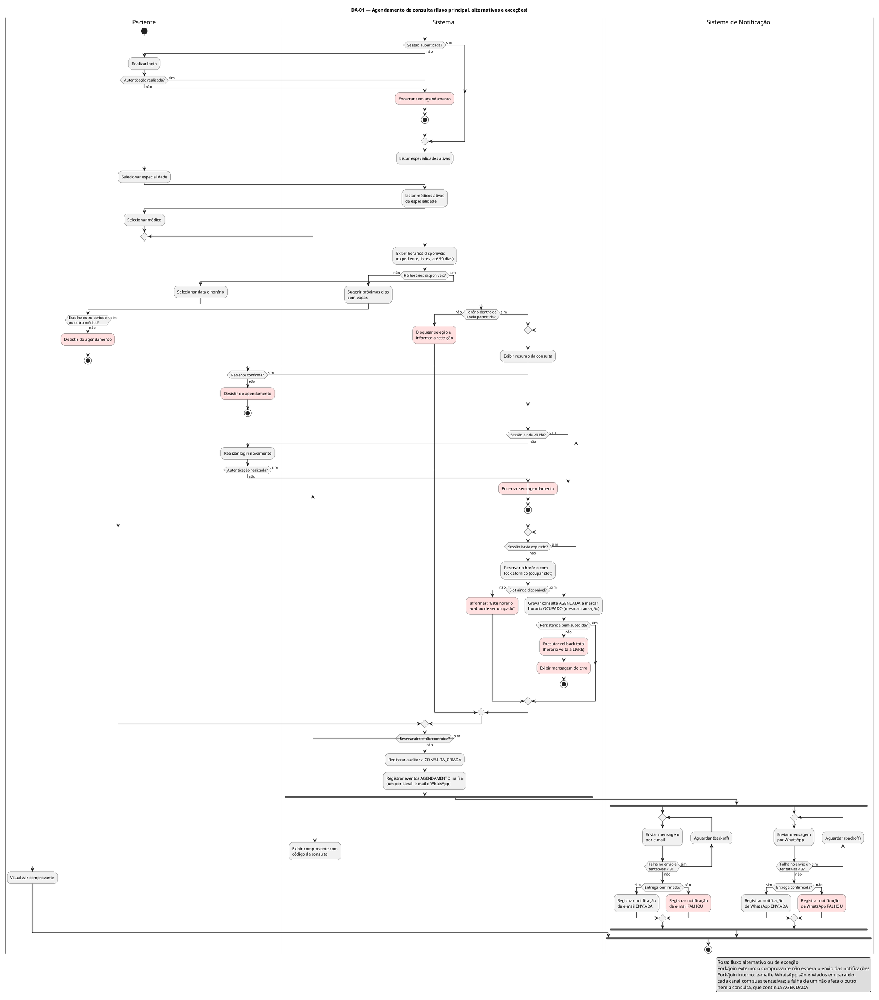
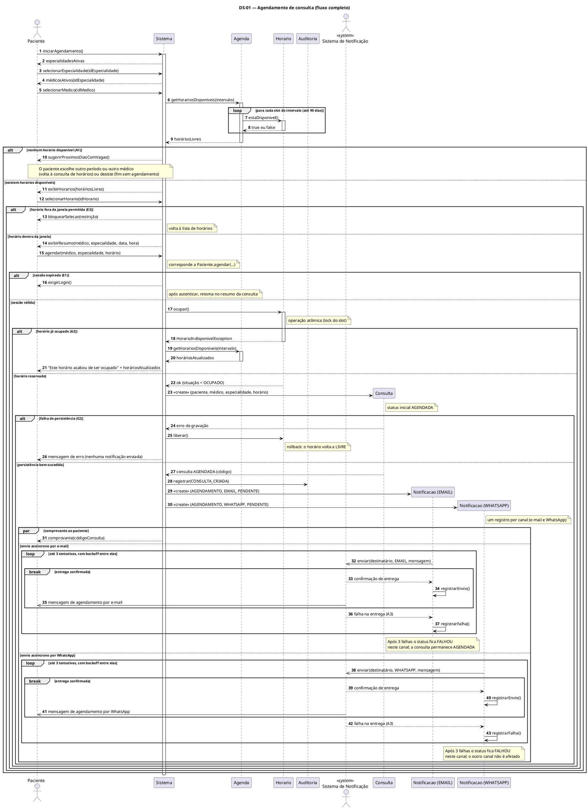
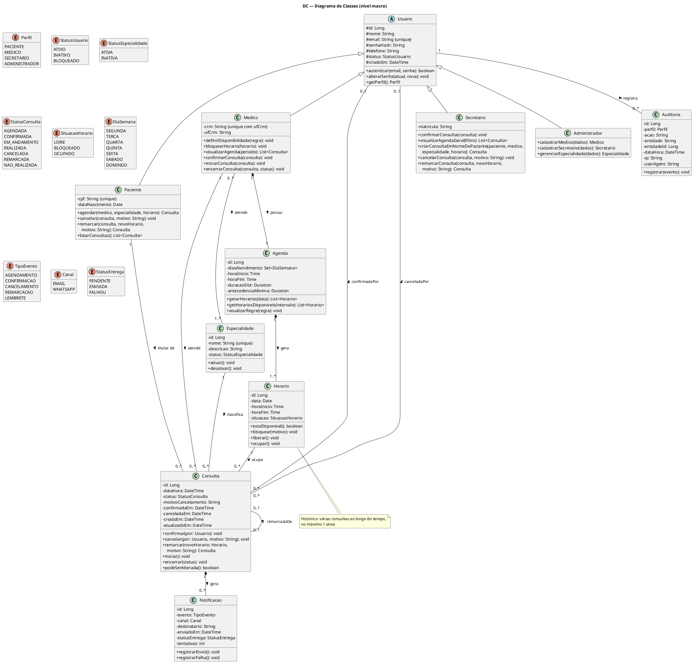

# Trabalho de Modelagem UML — Sistema de Agendamento de Consultas Médicas

---

## Capa

**Universidade Federal de Goiás**

**Engenharia de Software** — **Modelagem de Software**

---

### Modelagem de Software — APS 1

**Tema:** Aplicativo de Agendamento de Consultas Médicas

---

**Integrantes do grupo:**

- Carlos Eduardo Freire da Silva
- Gabriel Henrique Lourenço Dias
- Kayque Vicente Silva
- Luiz Pedro Pereira Mendes Saraiva
- Yury Nogueira de Oliveira Silva

**Professor(a):** Diogo Oliveira Santos

**Goiânia — 14 de outubro de 2026**

---

## 1. Descrição da Aplicação

### 1.1 Contexto e Objetivos

Este trabalho apresenta a modelagem de um sistema web responsivo para agendamento de consultas médicas em clínicas e consultórios, acessível tanto pelo celular quanto pelo computador.

O objetivo principal é dar autonomia ao paciente para que ele possa, a qualquer hora e sem depender de atendimento telefônico, pesquisar especialidades e médicos, consultar horários vagos e agendar, acompanhar, cancelar ou remarcar suas consultas. Ao mesmo tempo, o sistema atende à equipe da clínica: os médicos configuram seus horários de atendimento e acompanham seus pacientes, os secretários monitoram a ocupação da clínica, confirmam consultas e auxiliam pacientes no balcão ou por telefone, e o administrador mantém os cadastros-base do sistema.

### 1.2 Problema de Negócio e Solução Proposta

Processos manuais em clínicas costumam gerar sobrecarga na recepção, marcações duplas no mesmo horário e alto índice de faltas pela falta de lembretes práticos. Além disso, controles em planilhas ou papel dificultam o remanejamento rápido de horários cancelados e não oferecem histórico confiável para auditoria.

O sistema resolve esses problemas ao centralizar as agendas em uma base única, aplicando validação em tempo real e bloqueio atômico de horários para impedir conflitos entre pacientes concorrentes. Para reduzir as faltas, a aplicação envia confirmações e lembretes simultaneamente por e-mail e WhatsApp, os dois canais mais usados no dia a dia. Além disso, todas as ações críticas (agendamentos, confirmações, cancelamentos e remarcações com motivo obrigatório e alterações de grade) geram registros de auditoria com autor, data/hora, IP e navegador, apoiando a rastreabilidade e a conformidade com a LGPD. A guarda do motivo de cada cancelamento ou remarcação forma um histórico que ajuda a clínica a entender por que os horários são liberados.

### 1.3 Atores do Sistema

O sistema conta com cinco atores bem definidos:

1. **Paciente:** cadastra-se com CPF, e-mail e telefone celular; autentica-se com senha segura; pesquisa médicos por especialidade; consulta a grade de horários disponíveis; e gerencia suas consultas (agendamento, histórico, remarcação e cancelamento). Recebe notificações automáticas por e-mail e WhatsApp, inclusive um lembrete 24 horas antes da consulta.
2. **Médico:** profissional cadastrado com CRM, UF e especialidades ativas. Configura sua disponibilidade semanal (dias de atendimento, horário de expediente e duração das consultas); bloqueia horários pontuais por conveniência; visualiza sua agenda; confirma as próprias consultas; e registra o status do atendimento (iniciando, concluindo ou registrando a ausência do paciente). Não agenda, cancela nem remarca consultas.
3. **Secretário:** profissional da recepção. Acompanha as agendas de todos os médicos, gerencia as consultas pendentes de confirmação (com contato proativo com pacientes quando necessário), registra confirmações ou recusas e pode agendar, remarcar ou cancelar consultas a pedido de pacientes presenciais ou por telefone.
4. **Administrador:** responsável pelos cadastros-base. Cadastra e mantém médicos e secretários e gerencia o catálogo de especialidades (ativar e desativar). Não agenda nem altera consultas.
5. **Sistema de Notificação (`<<system>>`):** componente secundário que roda em segundo plano. Consome os eventos gerados pelas operações da clínica e envia as mensagens em paralelo por e-mail e WhatsApp, com fila de retentativas automáticas caso ocorra instabilidade temporária na rede, garantindo que o agendamento nunca trave por falha de envio.

> **Observação:** a descrição inicial do tema lista quatro atores. O **Administrador** foi acrescentado pelo grupo (o professor permite atores adicionais, sem limite) porque alguém precisa cadastrar médicos, secretários e especialidades; sem esse ator, o catálogo ficaria sem responsável.

### 1.4 Módulos Funcionais e Regras de Negócio

O sistema é organizado em seis módulos complementares:

- **Módulo de Cadastro e Autenticação:** gerencia as contas de usuários. Exige e-mail único para todos e CPF único para pacientes. Médicos são cadastrados pelo par CRM/UF, único nacionalmente. Os perfis de acesso são exclusivos (`PACIENTE`, `MEDICO`, `SECRETARIO`, `ADMINISTRADOR`). Pacientes se cadastram sozinhos; médicos e secretários são cadastrados pelo administrador. As senhas devem ter no mínimo 8 caracteres (com letras e números) e são armazenadas sob hash criptográfico, com bloqueio temporário após sucessivas tentativas incorretas.
- **Módulo de Especialidades e Médicos:** o administrador mantém o catálogo de especialidades. Apenas especialidades ativas aceitam novos agendamentos. Cada médico pode atender em uma ou mais especialidades, e a busca filtra somente profissionais ativos e vinculados à especialidade escolhida.
- **Módulo de Gestão de Horários e Agenda:** organiza a agenda em intervalos (slots) de **30 minutos por padrão**, configuráveis pelo médico em múltiplos de 30, sem sobreposição para o mesmo médico. Cada slot tem um estado claro (`LIVRE`, `BLOQUEADO` ou `OCUPADO`). Os horários ficam disponíveis para reserva dentro do expediente do médico, respeitando uma antecedência mínima (padrão de 30 minutos) e uma janela de até 90 dias no futuro.
- **Módulo de Agendamento:** conduz o paciente em quatro passos: escolha da especialidade, escolha do médico, seleção de data/horário livre e, na mesma tela, revisão do resumo e confirmação. A confirmação realiza bloqueio atômico do horário para evitar que dois pacientes reservem a mesma vaga simultaneamente. A consulta é criada com status `AGENDADA`; a confirmação pelo secretário ou pelo médico (`CONFIRMADA`) é **opcional**; a consulta passa para `EM_ANDAMENTO` durante o atendimento e termina como `REALIZADA` (ou `NAO_REALIZADA`, se o paciente faltar).
- **Módulo de Cancelamento e Remarcação:** o paciente titular ou o secretário podem cancelar ou remarcar, com antecedência mínima de 2 horas. Caso falte menos de 2 horas, a operação pelo sistema é bloqueada, orientando o contato direto com a clínica. O cancelamento e a remarcação exigem obrigatoriamente um **motivo**. Quando o cancelamento é concluído, o slot volta imediatamente para `LIVRE`. A remarcação é sempre com o mesmo médico: ela cancela a consulta original (marcada como `REMARCADA`, com vínculo para a nova), libera o slot antigo, ocupa o novo horário e cria uma nova consulta `AGENDADA`, com reversão automática caso o novo horário falhe. Para trocar de médico, o usuário cancela e agenda novamente.
- **Módulo de Notificações e Auditoria:** registra logs imutáveis de cada operação crítica e envia avisos por e-mail e WhatsApp simultaneamente, de forma assíncrona. Cada canal gera o seu próprio registro de notificação, com até 3 tentativas. Uma falha temporária no envio nunca cancela a consulta criada.

### 1.5 Ciclo de Vida da Consulta

| De | Evento | Para | Quem pode |
|---|---|---|---|
| — | agendar | `AGENDADA` | Paciente, Secretário |
| `AGENDADA` | confirmar | `CONFIRMADA` | Secretário, Médico titular |
| `AGENDADA`, `CONFIRMADA` | iniciar | `EM_ANDAMENTO` | Médico titular |
| `AGENDADA`, `CONFIRMADA` | cancelar (≥ 2 h, com motivo) | `CANCELADA` | Paciente titular, Secretário |
| `AGENDADA`, `CONFIRMADA` | remarcar (≥ 2 h, com motivo) | `REMARCADA` (e nova `AGENDADA`) | Paciente titular, Secretário |
| `AGENDADA`, `CONFIRMADA` | horário passou sem início | `NAO_REALIZADA` | Sistema |
| `AGENDADA`, `CONFIRMADA`, `EM_ANDAMENTO` | registrar ausência | `NAO_REALIZADA` | Médico titular |
| `EM_ANDAMENTO` | encerrar | `REALIZADA` | Médico titular |

`CANCELADA`, `REMARCADA`, `REALIZADA` e `NAO_REALIZADA` são estados finais.

### 1.6 Quem Recebe Cada Notificação

Cada evento gera uma notificação por destinatário e por canal (e-mail e WhatsApp).

| Evento | Paciente | Médico |
|---|---|---|
| Agendamento | sim | não |
| Confirmação | sim | sim |
| Cancelamento | sim | sim |
| Remarcação | sim | sim |
| Lembrete (24 h antes) | sim | não |

### 1.7 Escopo e Premissas

- A aplicação é um **web app responsivo**; não há aplicativo nativo.
- Ficam **fora do escopo**: prontuário eletrônico, prescrições, pagamento, convênios, nota fiscal, teleconsulta e várias clínicas (multiclínica).
- Há um único contexto de clínica.
- A auditoria cobre eventos de negócio (criar, confirmar, cancelar, remarcar, bloquear horário e alterar cadastro), não leituras.

---

## 2. Diagramas de Atividades

Foi elaborado um diagrama de atividades completo, o **DA-01**, que reúne o fluxo principal de agendamento e todos os seus fluxos alternativos e de exceção. Por já cumprir o que foi pedido (fluxo principal com fluxos alternativos), o grupo optou por não criar diagramas separados para cancelamento, remarcação e confirmação; esses processos estão descritos nas seções 1.4 e 1.5 (decisão DM-11).

### 2.1 DA-01 — Agendamento de Consulta

**Objetivo:** representar o processo completo de agendamento de consulta pelo paciente, desde a autenticação e a seleção da especialidade até o recebimento do comprovante, incluindo os fluxos alternativos e de exceção.

**Atores (raias):** Paciente, Sistema e Sistema de Notificação.

**Processo representado:** o paciente autenticado percorre a jornada de agendamento: seleciona a especialidade, o médico e um horário livre, revisa o resumo e confirma. O sistema reserva o horário de forma atômica (prevenindo corridas), grava a consulta como `AGENDADA`, marca o horário como `OCUPADO` e registra a auditoria. Em seguida, o fluxo se divide em dois ramos paralelos (*fork*): o sistema exibe o comprovante ao paciente, enquanto o Sistema de Notificação envia as mensagens. Esse segundo ramo se subdivide em outros dois, também em paralelo: um para o e-mail e outro para o WhatsApp, cada um com até 3 tentativas e com seu próprio resultado (`ENVIADA` ou `FALHOU`). Todos se juntam (*join*) no fim, mas o comprovante **não espera** o envio.

Código PlantUML (fonte do diagrama)

**Explicação:** o diagrama usa raias (*swimlanes*) para separar o que é ação do paciente, processamento do sistema e envio do Sistema de Notificação. Os laços (`repeat`) representam os retornos à escolha de horário (sem vagas, horário fora da janela e horário ocupado) e a retomada do resumo após novo login. Os nós rosa marcam fluxos alternativos e de exceção. O *fork/join* representa o paralelismo real do processo: exibir o comprovante e enviar a notificação acontecem ao mesmo tempo, e uma falha de envio nunca desfaz o agendamento.

**Cobertura dos fluxos alternativos (A) e de exceção (E) no DA-01:**

| Fluxo | Onde aparece no diagrama |
|---|---|
| Autenticação inicial | Início: "Sessão autenticada?" e login; sem login, o fluxo termina |
| A1 — sem horários | "Há horários disponíveis?" não → sugerir próximos dias → o paciente escolhe outro período/médico (volta ao laço) ou desiste |
| A2 — horário ocupado por outro paciente | "Slot ainda disponível?" não → mensagem "Este horário acabou de ser ocupado" → volta à escolha de horário |
| A3 — falha na notificação | Ramo do Sistema de Notificação: falha no envio → até 3 tentativas → `FALHOU`; a consulta continua `AGENDADA` |
| E1 — sessão expirada | "Sessão ainda válida?" não → novo login → retoma no resumo da consulta |
| E2 — falha de persistência | "Persistência bem-sucedida?" não → rollback total (horário volta a `LIVRE`) → mensagem de erro |
| E3 — horário fora da janela | "Horário dentro da janela permitida?" não → bloquear seleção e informar a restrição |
| Desistências | "Paciente confirma?" não, e "Escolhe outro período ou outro médico?" não |

---

## 3. Diagramas de Sequência

Foi elaborado um diagrama de sequência completo, o **DS-01**, sobre o mesmo cenário do DA-01 (agendamento). Ele mostra as mensagens trocadas em ordem temporal entre o paciente, o sistema, os objetos de negócio e o Sistema de Notificação, com os retornos e os cenários alternativos e de exceção.

### 3.1 DS-01 — Agendamento de Consulta (fluxo completo)

**Objetivo:** detalhar a sequência de mensagens durante o agendamento, destacando a reserva atômica do horário, a criação da consulta e o envio assíncrono das notificações.

**Cenário representado:** paciente autenticado agenda uma consulta, com tratamento para ausência de horários, horário fora da janela, sessão expirada, concorrência na reserva, falha de gravação e falha de notificação.

Código PlantUML (fonte do diagrama)

**Explicação:**

- **Reserva atômica:** o horário é reservado por uma única chamada, `Horario.ocupar()`, que lança `HorarioIndisponivelException` se outro paciente já tomou o slot (mensagens 17 e 18). Assim não existe um intervalo entre "verificar" e "ocupar" em que duas reservas possam passar juntas.
- **Rollback:** se a gravação da consulta falha, o sistema devolve o horário com `Horario.liberar()` (mensagem 25) e informa o erro, sem enviar nenhuma notificação.
- **Criação de objetos:** `Consulta` e as duas `Notificacao` (uma por canal) aparecem como objetos criados durante o cenário (setas `<<create>>`, mensagens 23, 29 e 30). A mensagem 15, `agendar(...)`, corresponde a `Paciente.agendar(medico, especialidade, horario)`.
- **Paralelismo:** o bloco `par` mostra que o comprovante (mensagem 31), o envio por e-mail e o envio por WhatsApp acontecem em paralelo, como os *forks* do DA-01. As setas com ponta aberta (`->>`) são mensagens assíncronas.
- **Retry por canal:** cada canal tem o seu laço (mensagens 32 a 37 para e-mail e 38 a 43 para WhatsApp), que tenta o envio até 3 vezes. Se a entrega é confirmada, o bloco `break` encerra o laço. Após 3 falhas, o status fica `FALHOU` naquele canal; o outro canal não é afetado e a consulta permanece `AGENDADA`.
- **Participante `Sistema`:** representa a camada de aplicação, que orquestra as chamadas. As mensagens enviadas a ele (`iniciarAgendamento`, `selecionarMedico` e outras) são operações desse controlador, e não métodos das classes de domínio (decisão DM-03).

**Correspondência com os fluxos alternativos (A) e de exceção (E):**

| Fluxo | Mensagens |
|---|---|
| A1 — sem horários | 10 |
| E3 — fora da janela | 13 |
| E1 — sessão expirada | 16 |
| A2 — horário ocupado | 17 a 21 |
| E2 — falha de persistência | 24 a 26 |
| A3 — falha na notificação | 36 e 37 (e-mail) e 42 e 43 (WhatsApp), em laços com até 3 tentativas |

---

## 4. Diagrama de Classes — Nível Macro

### 4.1 Objetivo

Apresentar a estrutura orientada a objetos do sistema: classes principais, atributos tipados, métodos essenciais, enumerações e relacionamentos (herança, associação, composição e autorrelação), com multiplicidades e visibilidade (`+` público, `-` privado, `#` protegido).

### 4.2 Diagrama e Código PlantUML

Código PlantUML (fonte do diagrama)

### 4.3 Explicação

**Notação:** `+` indica visibilidade pública, `-` privada e `#` protegida. Os atributos de `Usuario` são protegidos (`#`), pois as subclasses os herdam e os usam; nas demais classes os atributos são privados e os métodos, públicos. O losango preenchido (`*--`) indica composição, o triângulo vazio indica herança e a linha simples indica associação.

**Estrutura de herança:** a classe abstrata `Usuario` concentra os atributos comuns de identificação e autenticação (`id`, `nome`, `email`, `senhaHash`, `telefone`, `status`, `criadoEm`) e os métodos de segurança. As quatro especializações — `Paciente`, `Medico`, `Secretario` e `Administrador` — herdam de `Usuario` e introduzem seus campos e operações próprios (`cpf` para pacientes, par `crm`/`ufCrm` para médicos, `matricula` para secretários e as operações de cadastro do administrador). Os perfis de acesso são mutuamente exclusivos.

**Composições (o todo governa o ciclo de vida das partes):**

- **Medico – Agenda (1:1):** cada médico detém sua própria agenda, que não existe sem ele.
- **Agenda – Horario (1:1..\*):** a agenda divide o expediente em slots; os slots não existem desvinculados de sua agenda.
- **Consulta – Notificacao (1:0..\*):** as notificações pertencem à consulta que as originou (uma por evento, destinatário e canal).

**Associações:**

- **Medico – Especialidade (0..\*:1..\*):** um médico atende uma ou mais especialidades, e uma especialidade pode ter vários médicos.
- **Horario – Consulta (1:0..\*):** ao longo do tempo, um mesmo horário acumula várias consultas (por exemplo, uma cancelada e outra que o ocupou depois), mas **no máximo uma ativa**. A multiplicidade `1:0..1` seria incorreta, porque cancelar e remarcar mantêm a consulta antiga como histórico.
- **Paciente – Consulta e Medico – Consulta (1:0..\*):** o paciente titular e o médico responsável por cada consulta.
- **Especialidade – Consulta (1:0..\*):** a consulta guarda a especialidade escolhida no agendamento, já que um médico atende várias.
- **Consulta – Consulta (0..1:0..1, `remarcadaDe`):** associação reflexiva que liga a consulta remarcada à nova consulta.
- **Consulta – Usuario (0..\*:0..1, `confirmadaPor` e `canceladaPor`):** registra quem confirmou e quem cancelou. Junto com `confirmadaEm`, `canceladaEm` e `motivoCancelamento` (obrigatório ao cancelar ou remarcar), forma o histórico de quem fez cada alteração e por quê.
- **Usuario – Auditoria (1:0..\*):** associação simples, pois o registro de auditoria deve sobreviver ao usuário.

**Enumerações tipadas:**

- `Perfil`: os quatro perfis de acesso (`PACIENTE`, `MEDICO`, `SECRETARIO`, `ADMINISTRADOR`).
- `StatusUsuario`: estado cadastral da conta (`ATIVO`, `INATIVO`, `BLOQUEADO`).
- `StatusEspecialidade`: estado do catálogo (`ATIVA`, `INATIVA`), separado do status de usuário.
- `StatusConsulta`: ciclo de vida do atendimento (`AGENDADA`, `CONFIRMADA`, `EM_ANDAMENTO`, `REALIZADA`, `CANCELADA`, `REMARCADA`, `NAO_REALIZADA`).
- `SituacaoHorario`: estado de cada vaga (`LIVRE`, `BLOQUEADO`, `OCUPADO`).
- `DiaSemana`: dias de atendimento da agenda.
- `TipoEvento`: gatilhos de comunicação (`AGENDAMENTO`, `CONFIRMACAO`, `CANCELAMENTO`, `REMARCACAO`, `LEMBRETE`).
- `Canal`: canais de mensagem (`EMAIL`, `WHATSAPP`).
- `StatusEntrega`: ciclo de entrega de cada mensagem (`PENDENTE`, `ENVIADA`, `FALHOU`).

---

## 5. Considerações Finais

A modelagem desenvolvida mostra como a UML organiza e comunica a estrutura e o comportamento de um sistema antes da implementação, conectando as regras de negócio aos modelos de software.

O **diagrama de atividades** (DA-01) descreve o processo de agendamento de ponta a ponta. Com raias para o paciente, o sistema e o Sistema de Notificação, ele cobre o fluxo principal e todos os fluxos alternativos e de exceção (sem vagas, horário ocupado, horário fora da janela, sessão expirada, falha de gravação e falha de notificação) e usa *fork/join* em dois níveis: o comprovante segue em paralelo ao envio das notificações e, dentro delas, o e-mail e o WhatsApp são enviados em paralelo, cada um com suas tentativas.

O **diagrama de sequência** (DS-01) mostra, no mesmo cenário, a troca de mensagens ao longo do tempo. Seus destaques são a reserva atômica do horário, o rollback em caso de falha, a criação da consulta e o envio assíncrono e paralelo por e-mail e WhatsApp, com até 3 tentativas em cada canal.

O **diagrama de classes** estrutura a visão estática do domínio com 11 classes e 9 enumerações, relacionamentos de herança, composição e associação com multiplicidades, e visibilidade nos membros.

O trabalho passou por uma revisão de consistência entre os artefatos (seção 6). Dessa revisão resultaram decisões que tornaram o modelo mais fiel às regras de negócio, como a multiplicidade entre `Horario` e `Consulta`, o registro de quem confirmou e quem cancelou, a reserva atômica do horário e a separação entre o comprovante e o envio da notificação.

**Limitações e próximos passos:** a remarcação, a confirmação pelo secretário e o cancelamento estão descritos em texto (seções 1.4 e 1.5), mas não têm diagrama próprio, porque o DA-01 e o DS-01 já cobrem o que foi pedido. Se houver evolução do trabalho, esses cenários são os candidatos naturais a novos diagramas (por exemplo, o cancelamento com bloqueio da janela de 2 horas).

---

## 6. Verificação de Consistência e Decisões de Modelagem

### 6.1 Decisões de Modelagem

| # | Decisão | Justificativa |
|---|---|---|
| DM-01 | Enumeração `StatusEntrega` (`PENDENTE`, `ENVIADA`, `FALHOU`). | Formaliza o ciclo de vida da mensageria assíncrona e a rastreabilidade de cada envio. |
| DM-02 | Enumeração `StatusEspecialidade` (`ATIVA`, `INATIVA`), separada de `StatusUsuario`. | Evita que uma especialidade assuma estados impróprios, como `BLOQUEADO`. |
| DM-03 | A interface é abstraída em um único participante de controle (`Sistema`) no diagrama de sequência. | Mantém o foco nas transações do domínio, sem acoplar a frameworks de front-end. |
| DM-04 | Quinto ator: **Administrador**. | Alguém precisa cadastrar médicos, secretários e especialidades. O professor permite atores adicionais. |
| DM-05 | O **motivo do cancelamento e da remarcação é obrigatório**. | Gera mais dados e um histórico de motivos para a clínica (`motivoCancelamento`, também usado na remarcação). |
| DM-06 | Canais **EMAIL e WHATSAPP**, usados em paralelo, com **uma `Notificacao` por canal**. | São os canais mais usados; um registro por canal permite retry e status de entrega independentes. Decisão da equipe: envio simultâneo pelos dois canais, sem canal de reserva; o atributo `canalPreferido` foi removido, pois não teria função nesse modelo. |
| DM-07 | A **confirmação é opcional**. | Evita que consultas fiquem travadas se ninguém confirmar. |
| DM-08 | A **remarcação é sempre com o mesmo médico** (cancelar a original e criar a nova, com vínculo). | Preserva o histórico; trocar de médico é cancelar e agendar de novo. |
| DM-09 | `Horario` 1 para 0..\* `Consulta`, com no máximo 1 ativa. | O histórico de cancelamentos e remarcações mantém consultas antigas ligadas ao mesmo horário. |
| DM-10 | **Composição** em Medico–Agenda, Agenda–Horario e Consulta–Notificacao; `Auditoria` fica como associação simples. | Nas composições o todo governa o ciclo de vida das partes; a auditoria deve sobreviver ao usuário. |
| DM-11 | Apenas **DA-01 e DS-01** são entregues. | Eles já contêm os fluxos alternativos e de exceção pedidos; cancelamento e confirmação ficam documentados em texto (seções 1.4 e 1.5). |
| DM-12 | A reserva do horário é **uma única operação atômica** (`ocupar()`, que lança exceção se o slot foi tomado). | Uma verificação seguida de uma ocupação em duas chamadas não seria atômica. |
| DM-13 | A consulta guarda a **especialidade escolhida** por associação própria. | Um médico atende várias especialidades; sem isso, não se saberia sob qual delas a consulta foi marcada. |
| DM-14 | Atributos de `Usuario` com visibilidade `#`. | As subclasses herdam e usam esses atributos. |

### 6.2 Análise de Consistência entre Modelos

**Classes versus Sequência.** Todas as mensagens do DS-01 enviadas a objetos de domínio correspondem a operações declaradas nas classes:

| Mensagem (nº) | Objeto | Operação no diagrama de classes |
|---|---|---|
| 6 e 19 `getHorariosDisponiveis(intervalo)` | Agenda | `Agenda.getHorariosDisponiveis(intervalo)` |
| 7 `estaDisponivel()` | Horario | `Horario.estaDisponivel()` |
| 17 `ocupar()` | Horario | `Horario.ocupar()` |
| 25 `liberar()` | Horario | `Horario.liberar()` |
| 15 `agendar(...)` | Paciente (via Sistema) | `Paciente.agendar(medico, especialidade, horario)` |
| 23 `<<create>>` | Consulta | criação de `Consulta` (status inicial `AGENDADA`) |
| 28 `registrar(CONSULTA_CRIADA)` | Auditoria | `Auditoria.registrar(evento)` |
| 29 e 30 `<<create>>` | Notificacao (EMAIL e WHATSAPP) | criação de uma `Notificacao` por canal (`PENDENTE`) |
| 34 e 40 `registrarEnvio()` | Notificacao | `Notificacao.registrarEnvio()` |
| 37 e 43 `registrarFalha()` | Notificacao | `Notificacao.registrarFalha()` |

As demais mensagens são operações do controlador `Sistema` (decisão DM-03). A exceção `HorarioIndisponivelException` é lançada por `Horario.ocupar()` quando o slot já foi tomado; ela pertence ao controle de erros do `Sistema` e não é uma classe do diagrama.

**Atividades versus Sequência.** Cada fluxo alternativo e de exceção do DA-01 tem a mensagem correspondente no DS-01 (tabela da seção 3.1): A1, A2, A3, E1, E2 e E3. Os *forks/joins* do DA-01 (comprovante × notificações e e-mail × WhatsApp) correspondem ao bloco `par` do DS-01.

**Classes versus Atividades.** A multiplicidade `Horario 1:0..*  Consulta` com "no máximo 1 ativa" sustenta o laço de "horário ocupado" do DA-01: a reserva é recusada se já existe consulta ativa no horário. As ações "marcar horário como `OCUPADO`" e "rollback" usam `Horario.ocupar()` e `Horario.liberar()`.

**Máquina de estados.** O ciclo de vida da seção 1.5 é o único usado nos três artefatos: o agendamento cria a consulta como `AGENDADA` (DA-01 e DS-01), e os demais estados são os do enumerador `StatusConsulta`.

### 6.3 Quadro de Validação dos Artefatos

| Critério | Resultado | Evidência |
|---|---|---|
| Sintaxe dos diagramas | Verificado | Os 3 blocos PlantUML foram validados com o PlantUML 1.2024.3 (opção `-syntax`) |
| Desenho dos diagramas | Verificado | Os 3 diagramas foram renderizados em SVG (`assets/`) e inspecionados |
| Imagens atualizadas | Gerado | As imagens de `assets/` foram geradas a partir dos blocos PlantUML deste arquivo |
| Conformidade de métodos | Consistente | Tabela da seção 6.2 |
| Unicidade de horário | Consistente | `ocupar()` atômico no DS-01 e laço "Slot ainda disponível?" no DA-01; multiplicidade `1:0..*` com no máximo 1 ativa |
| Desacoplamento da mensageria | Consistente | *Fork/join* no DA-01 e bloco `par` no DS-01 |
| Coerência de papéis | Consistente | Atores e permissões da seção 1.3 conferem com o ciclo de vida da seção 1.5 |

**Atendimento às instruções do professor:**

| Diagrama | Instrução | Onde foi atendida |
|---|---|---|
| Atividades | Nó inicial, ações, decisões e nó final | DA-01: início, ações, losangos de decisão e nós finais |
| Atividades | Fork/join, se houver paralelismo | DA-01: comprovante em paralelo ao envio da notificação |
| Atividades | Pelo menos um fluxo alternativo | DA-01: A1, A2, A3, E1, E2 e E3 |
| Atividades | Raias por ator | DA-01: Paciente, Sistema e Sistema de Notificação |
| Sequência | Cenário principal, mensagens em ordem temporal, retornos | DS-01: agendamento, numeração das mensagens e setas de retorno tracejadas |
| Classes | Classes principais, atributos e métodos | Seção 4: 11 classes com atributos e métodos |
| Classes | Associação, herança, composição e multiplicidade | Seção 4: as quatro relações, com multiplicidades nas extremidades |
| Classes | Visibilidade (`+`, `-`, `#`) | Seção 4: `#` em `Usuario`, `-` nos demais atributos, `+` nos métodos |

---

*Trabalho acadêmico de modelagem de software contendo a descrição da aplicação, o diagrama de atividades, o diagrama de sequência e o diagrama de classes, com verificação de consistência entre os artefatos.*
