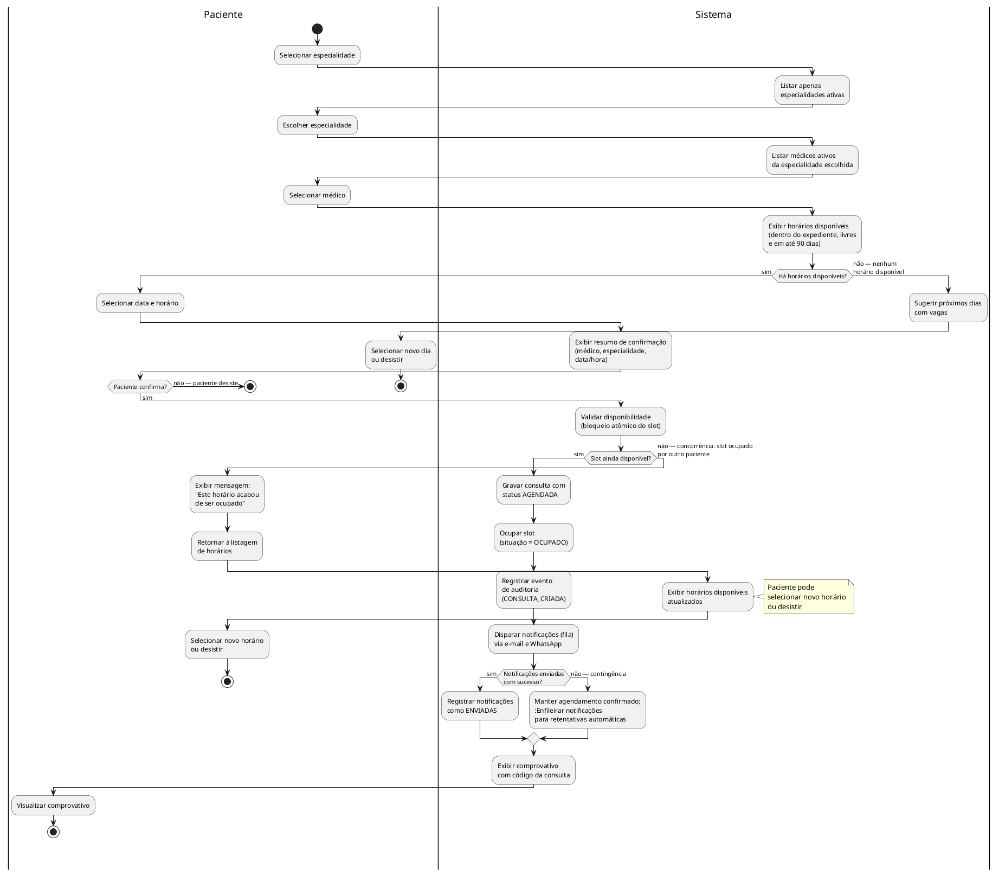
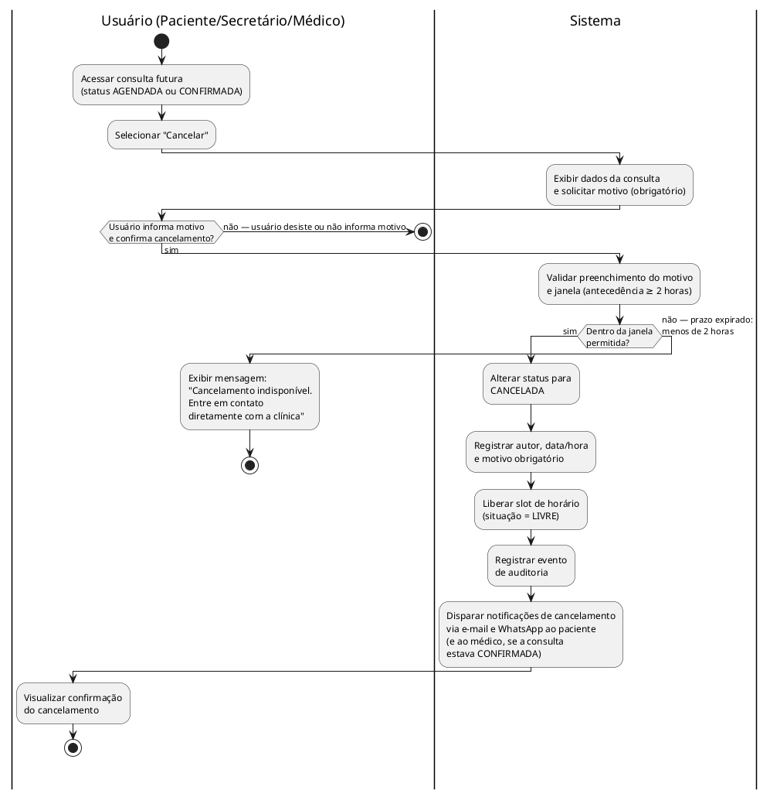
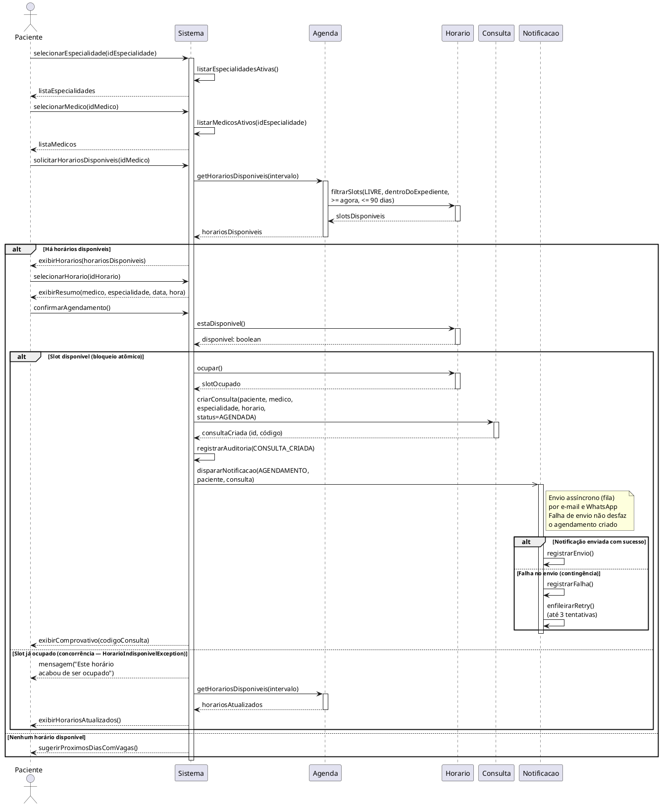
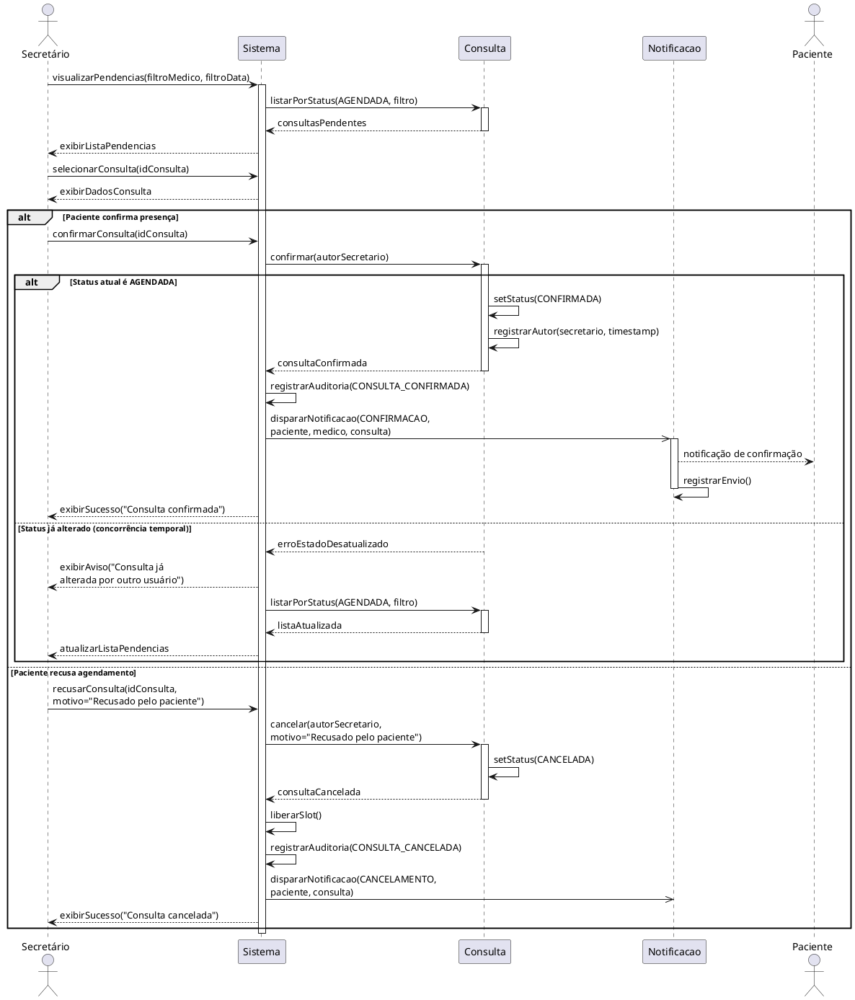
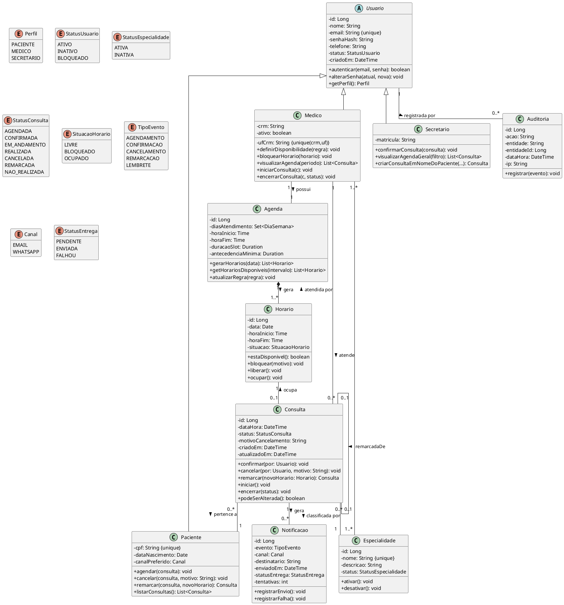

# Trabalho de Modelagem UML — Sistema de Agendamento de Consultas Médicas

---

## Capa

**Universidade Federal de Goiás**

**Engenharia de Software** — **Modelagem de Software**

---

### Modelagem de Software — APS 1

**Tema:** Aplicativo de Agendamento de Consultas Médicas

---

**Integrantes do grupo:**

- Carlos Eduardo Freire da Silva
- Gabriel Henrique Lourenço Dias
- Kayque Vicente Silva
- Luiz Pedro Pereira Mendes Saraiva
- Yury Nogueira de Oliveira Silva

**Professor(a):** Diogo Oliveira Santos

**Goiânia — 14 de outubro de 2026**

---

## 1. Descrição da Aplicação

### 1.1 Contexto e Objetivos

Este trabalho apresenta a modelagem de um sistema web responsivo para agendamento de consultas médicas em clínicas e consultórios, acessível tanto pelo celular quanto pelo computador.

O objetivo principal é dar autonomia ao paciente para que ele possa, a qualquer hora e sem depender de atendimento telefônico, pesquisar especialidades e médicos, consultar horários vagos e agendar, acompanhar, cancelar ou remarcar suas consultas. Ao mesmo tempo, o sistema atende à equipe da clínica: os médicos configuram seus horários de atendimento e acompanham seus pacientes, enquanto os secretários monitoram a ocupação da clínica, confirmam presenças e auxiliam pacientes no balcão ou por telefone.

### 1.2 Problema de Negócio e Solução Proposta

Processos manuais em clínicas costumam gerar sobrecarga na recepção, marcações duplas no mesmo horário e alto índice de faltas pela falta de lembretes práticos. Além disso, controles em planilhas ou papel dificultam o remanejamento rápido de horários cancelados e não oferecem histórico confiável para auditoria.

O sistema resolve esses problemas ao centralizar as agendas em uma base única, aplicando validação em tempo real e bloqueio atômico de horários para impedir conflitos entre pacientes concorrentes. Para reduzir as faltas, a aplicação envia confirmações e lembretes simultaneamente por e-mail e WhatsApp. Além disso, todas as ações críticas (agendamentos, confirmações, cancelamentos com motivo obrigatório e alterações de grade) geram registros de auditoria com autor, data/hora e IP, garantindo rastreabilidade e conformidade com a LGPD.

### 1.3 Atores do Sistema

O sistema conta com quatro atores bem definidos:

1. **Paciente:** cadastra-se com CPF, e-mail e telefone celular; autentica-se com senha segura; pesquisa médicos por especialidade; consulta a grade de horários disponíveis; e gerencia suas consultas (agendamento, histórico, remarcação e cancelamento). Recebe notificações automáticas por e-mail e WhatsApp e pode responder para confirmar presença.
2. **Médico:** profissional cadastrado com CRM, UF e especialidades ativas. Configura sua disponibilidade semanal (dias de atendimento, horário de expediente e duração das consultas); bloqueia horários pontuais por conveniência; visualiza sua agenda; e registra o status do atendimento (iniciando e concluindo a consulta).
3. **Secretário:** profissional da recepção. Acompanha as agendas de todos os médicos, gerencia as consultas pendentes de confirmação (com contato proativo com pacientes quando necessário), registra confirmações ou recusas e pode agendar ou cancelar consultas a pedido de pacientes presenciais ou por telefone.
4. **Sistema de Notificação (`<<system>>`):** componente secundário que roda em segundo plano. Consome os eventos gerados pelas operações da clínica e envia as mensagens em paralelo via e-mail e WhatsApp, com fila de retentativas automáticas caso ocorra instabilidade temporária na rede, garantindo que o agendamento nunca trave por falha de envio.

### 1.4 Módulos Funcionais e Regras de Negócio

O sistema é organizado em seis módulos complementares:

- **Módulo de Cadastro e Autenticação:** gerencia as contas de usuários. Exige e-mail único para todos e CPF único para pacientes. Médicos são cadastrados pelo par CRM/UF, único nacionalmente. Os perfis de acesso são exclusivos (`PACIENTE`, `MEDICO`, `SECRETARIO`). As senhas devem ter no mínimo 8 caracteres (com letras e números) e são armazenadas sob hash criptográfico, com bloqueio temporário após sucessivas tentativas incorretas.
- **Módulo de Especialidades e Médicos:** mantém o catálogo de especialidades. Apenas especialidades ativas aceitam novos agendamentos. Cada médico pode atender em uma ou mais especialidades, e a busca filtra somente profissionais ativos e vinculados à especialidade escolhida.
- **Módulo de Gestão de Horários e Agenda:** organiza a agenda em intervalos fixos de 30 minutos (slots), sem sobreposição para o mesmo médico. Cada slot tem um estado claro (`LIVRE`, `BLOQUEADO` ou `OCUPADO`). Os horários ficam disponíveis para reserva dentro do expediente do médico, respeitando uma janela de até 90 dias no futuro.
- **Módulo de Agendamento:** conduz o paciente em passos diretos: escolha da especialidade, escolha do médico, seleção de data/horário livre, revisão dos dados e confirmação. A confirmação realiza bloqueio atômico do horário para evitar que dois pacientes reservem a mesma vaga simultaneamente. A consulta é criada com status `AGENDADA`, pode ser `CONFIRMADA`, passa para `EM_ANDAMENTO` durante a consulta e termina como `REALIZADA`.
- **Módulo de Cancelamento e Remarcação:** qualquer cancelamento ou remarcação exige antecedência mínima de 2 horas. Caso falte menos de 2 horas, o cancelamento pelo sistema é bloqueado, orientando o contato direto com a clínica. O cancelamento exige obrigatoriamente um motivo/justificativa; quando concluído, o slot volta imediatamente para `LIVRE`. A remarcação cancela a consulta original (marcada como `REMARCADA` com vínculo recíproco), libera o slot antigo, bloqueia o novo horário e cria uma nova consulta `AGENDADA`, com reversão automática caso o novo horário falhe.
- **Módulo de Notificações e Auditoria:** registra logs imutáveis de cada operação crítica e envia avisos por e-mail e WhatsApp simultaneamente de forma assíncrona. Uma falha temporária no envio da mensagem nunca cancela a consulta criada, ficando a notificação em fila para novas tentativas.

---

## 2. Diagramas de Atividades

Em conformidade com o escopo priorizado para a entrega acadêmica, foram selecionados dois diagramas complementares: o **DA-01**, que detalha o fluxo principal de valor do sistema (jornada de agendamento), e o **DA-02**, que evidencia o fluxo alternativo crítico com ramificações condicionais de controle temporal e liberação de recursos (cancelamento de consulta).

### 2.1 DA-01 — Fluxo Principal de Agendamento de Consulta

**Objetivo:** representar o processo completo de agendamento de consulta pelo paciente, desde a seleção da especialidade até o recebimento da confirmação, incluindo fluxos alternativos e de exceção.

**Processo representado:** o paciente autenticado percorre uma jornada em cinco etapas: seleção de especialidade, seleção de médico, escolha de data e horário livre, revisão do resumo e confirmação final. O sistema valida a disponibilidade do horário de forma atômica (prevenindo corridas), grava a consulta como `AGENDADA`, ocupa o horário e dispara notificação em segundo plano. São representados os caminhos alternativos de inexistência de horários livres, de disputa concorrente pelo mesmo horário (quando outro paciente confirma frações de segundo antes) e de falha na entrega da notificação.

**Explicação:** o diagrama utiliza raias (*swimlanes*) para separar o que é ação do paciente do processamento interno do sistema. O fluxo principal cobre a jornada de agendamento em passos diretos. Os pontos de decisão tratam as regras principais: verificação de vagas no futuro, confirmação do paciente, bloqueio atômico do horário para evitar reservas simultâneas e contingência caso a notificação falhe (garantindo que uma falha de envio nunca cancele a consulta agendada).

---

### 2.2 DA-02 — Cancelamento de Consulta

**Objetivo:** representar o cancelamento de uma consulta futura, destacando a obrigatoriedade do motivo, a antecedência mínima de 2 horas e a liberação imediata do horário.

**Processo representado:** o usuário (paciente, secretário ou médico) seleciona uma consulta futura (`AGENDADA` ou `CONFIRMADA`), solicita o cancelamento e deve obrigatoriamente informar o motivo. Com o motivo preenchido, o sistema valida se a solicitação foi feita com pelo menos 2 horas de antecedência. Em caso positivo, o status da consulta muda para `CANCELADA`, o slot de horário volta para `LIVRE`, a ação é registrada em auditoria e as notificações são disparadas por e-mail e WhatsApp.

**Explicação:** o diagrama destaca duas regras fundamentais: o preenchimento obrigatório do motivo do cancelamento e o limite de antecedência de pelo menos 2 horas. Se o prazo tiver expirado, o sistema bloqueia o cancelamento automático para evitar horários ociosos na clínica sem aviso prévio. Quando o cancelamento é realizado, a vaga é liberada imediatamente (`LIVRE`) e ambos os canais (e-mail e WhatsApp) são notificados.

---

## 3. Diagramas de Sequência

Foram elaborados dois diagramas de sequência focados nos cenários mais importantes: o **DS-01**, que detalha as trocas de mensagens no agendamento pelo paciente, e o **DS-02**, que apresenta a confirmação de presença pela secretaria, incluindo tratamento de concorrência e recusa.

### 3.1 DS-01 — Fluxo de Agendamento Completo

**Objetivo:** detalhar a sequência de mensagens entre o paciente, o sistema e os objetos de negócio durante o agendamento, destacando a validação atômica do horário e o envio assíncrono de notificações.

**Cenário representado:** paciente autenticado realiza o agendamento, com tratamento para horário indisponível, concorrência no momento da reserva e contingência em falhas de notificação.

**Explicação:** o diagrama detalha o ciclo de vida temporal da transação de agendamento. O objeto `Horario` é verificado e imediatamente travado de forma atômica para prevenir condição de corrida entre múltiplos usuários concorrentes. O bloco condicional `alt` principal gerencia a existência de datas vagas; o bloco interno lida com o caso em que dois pacientes tentam confirmar o mesmo horário simultaneamente, lançando `HorarioIndisponivelException` e atualizando a grade em tela. Por sua vez, a mensagem assíncrona (`->>`) enviada a `Notificacao` isola a transação principal: mesmo que o serviço externo de envio oscile, o registro da consulta médica permanece íntegro e salvo no banco de dados.

---

### 3.2 DS-02 — Confirmação de Consulta pelo Secretário

**Objetivo:** representar a interação do secretário com o sistema para confirmar uma consulta, evidenciando o registro do autor e a notificação simultânea ao paciente e ao médico.

**Cenário representado:** secretário autenticado abre a lista de consultas pendentes de confirmação, seleciona um agendamento e executa a confirmação no sistema após contato com o paciente, tratando cenários concorrentes e hipótese de recusa.

**Explicação:** o diagrama mostra a rotina do secretário ao interagir com a `Consulta`. O primeiro bloco `alt` trata a confirmação versus a recusa do paciente. A validação de concorrência trata acessos simultâneos: caso o paciente tenha acabado de cancelar a consulta pelo app, o sistema barra a confirmação com dados antigos. Ao confirmar, o sistema registra quem confirmou, a data/hora e dispara as notificações.

---

## 4. Diagrama de Classes — Nível Macro

### 4.1 Objetivo

Apresentar a estrutura orientada a objetos do sistema: classes principais, atributos tipados, métodos essenciais, enumerações e relacionamentos (herança, associação, composição e autorrelação).

### 4.2 Código PlantUML

### 4.3 Explicação

**Estrutura de herança:** a classe abstrata `Usuario` concentra os atributos comuns de identificação e autenticação (`id`, `nome`, `email`, `senhaHash`, `telefone`, `status`, `criadoEm`) e os métodos de segurança. As três especializações — `Paciente`, `Medico` e `Secretario` — herdam de `Usuario` e introduzem seus respectivos campos de domínio (como `cpf` para pacientes, par `crm`/`ufCrm` para médicos e `matricula` para secretários). Os perfis de acesso são mutuamente exclusivos por credencial.

**Relacionamentos principais:**

- **Medico – Especialidade (N:N):** reflete a prática médica real na qual um profissional pode atender em múltiplas especialidades registradas, ao mesmo tempo em que uma especialidade da clínica agrega múltiplos médicos habilitados.
- **Medico – Agenda (1:1):** cada médico detém sua própria grade de expediente e disponibilidade parametrizada.
- **Agenda – Horario (1:N, composição):** a grade divide o expediente em blocos discretos e indivisíveis de atendimento (slots de 30 minutos). A relação de composição indica dependência de existência: os slots não existem desvinculados de sua respectiva agenda médica.
- **Horario – Consulta (1:0..1):** restrição cardinal de unicidade. Um slot livre pode não possuir nenhuma consulta vinculada, mas quando ocupado, atende estritamente a uma única consulta ativa, impossibilitando reservas simultâneas no mesmo período.
- **Consulta – Paciente (N:1):** um paciente pode manter histórico de múltiplas consultas agendadas, realizadas ou canceladas.
- **Consulta – Medico (N:1):** o agendamento vincula-se explicitamente ao profissional responsável pela condução do atendimento clínico.
- **Consulta – Especialidade (N:1):** a especialidade médica vinculada à consulta é congelada no instante do agendamento, preservando a fidelidade histórica caso o médico venha a alterar suas especialidades no futuro.
- **Consulta – Consulta (auto-relação 0..1):** a associação reflexiva via atributo `remarcadaDe` estabelece o encadeamento histórico em operações de remarcação, ligando a consulta cancelada/remarcada à nova consulta agendada.
- **Consulta – Notificacao (1:N):** cada atendimento emite comunicações ao longo de suas transições de estado (criação, confirmação, cancelamento, lembrete prévio). O método de cancelamento exige obrigatoriamente a passagem do parâmetro `motivo`, persistido no atributo `motivoCancelamento`.
- **Usuario – Auditoria (1:N):** cada operação registrada no log imutável de auditoria armazena a identidade do usuário operador, garantindo conformidade com a LGPD.

**Enumerações tipadas:**
- `Perfil`: tipifica as três categorias de atores humanos do sistema (`PACIENTE`, `MEDICO`, `SECRETARIO`).
- `StatusUsuario`: modela o estado cadastral da conta (`ATIVO`, `INATIVO`, `BLOQUEADO`).
- `StatusEspecialidade`: delimita o estado operacional das especialidades médicas (`ATIVA`, `INATIVA`), onde somente especialidades ativas aceitam novos agendamentos. A tipagem dedicada evita confusão conceitual com o status de usuários (que inclui contas bloqueadas).
- `StatusConsulta`: gerencia o ciclo de vida completo do atendimento (`AGENDADA`, `CONFIRMADA`, `EM_ANDAMENTO`, `REALIZADA`, `CANCELADA`, `REMARCADA`, `NAO_REALIZADA`).
- `SituacaoHorario`: governa o estado de cada vaga da grade (`LIVRE`, `BLOQUEADO`, `OCUPADO`).
- `TipoEvento`: categoriza os gatilhos de comunicação disparados no sistema.
- `Canal`: especifica os canais de transmissão de mensagens suportados pelo sistema (`EMAIL`, `WHATSAPP`). Como regra de domínio, as notificações e confirmações são emitidas simultaneamente por ambos os canais, garantindo registro na caixa postal e agilidade no mensageiro móvel; o atributo `canalPreferido` no paciente indica a via prioritária para resposta e interação direta.
- `StatusEntrega`: rastreia o ciclo de entrega de cada mensagem gerada (`PENDENTE`, `ENVIADA`, `FALHOU`).

---

## 5. Considerações Finais

A modelagem desenvolvida demonstra como a UML permite organizar e comunicar a arquitetura de um sistema antes da implementação, conectando as regras de negócio aos modelos de software.

Os **diagramas de atividades** detalharam os processos centrais: o caminho completo de agendamento pelo paciente (**DA-01**) e o cancelamento com suas restrições (**DA-02**). O uso de raias (*swimlanes*) delimitou com clareza o que é de responsabilidade do usuário e o que é executado pelo sistema, cobrindo regras práticas como a antecedência mínima de 2 horas e a devolução imediata do horário cancelado para a grade.

Os **diagramas de sequência** detalharam a dinâmica e a troca de mensagens entre os objetos ao longo do tempo. O agendamento (**DS-01**) destacou a reserva atômica de horários para evitar condições de corrida entre pacientes, enquanto a rotina da recepção (**DS-02**) tratou o fluxo de confirmação e as exceções de recusa ou cancelamento simultâneo.

Por fim, o **diagrama de classes** estruturou a visão estática do domínio através de 10 classes e 8 enumerações bem delimitadas, estabelecendo os relacionamentos essenciais — como a herança de usuários, a composição da agenda em slots de atendimento, a ligação entre médicos e especialidades e a rastreabilidade por auditoria.

A consistência entre os modelos garante que cada método invocado nos fluxos de sequência e atividades corresponda exatamente a uma operação das classes, oferecendo uma base técnica sólida e pronta para guiar o desenvolvimento do sistema.

---

## 6. Verificação de Consistência e Decisões de Modelagem

### 6.1 Decisões Arquiteturais e de Modelagem

Para garantir a precisão formal dos diagramas e a autossuficiência do modelo, foram adotadas as seguintes decisões de engenharia de software:

| # | Decisão de Modelagem | Justificativa Técnica |
|---|----------------------|-----------------------|
| DM-01 | Tipagem explícita da enumeração `StatusEntrega` (`PENDENTE`, `ENVIADA`, `FALHOU`) no diagrama de classes. | Formaliza o ciclo de vida da mensageria assíncrona, viabilizando o controle de estado e a rastreabilidade da comunicação disparada nos agendamentos e confirmações. |
| DM-02 | Criação da enumeração dedicada `StatusEspecialidade` (`ATIVA`, `INATIVA`) para a entidade `Especialidade`. | Isola a semântica de ativação do catálogo médico do estado cadastral de contas de usuário (`StatusUsuario`), impedindo que especialidades assumam estados impróprios como `BLOQUEADO`. |
| DM-03 | Abstração da camada de apresentação em um participante de controle unificado (`Sistema`) nos diagramas de sequência. | Mantém o foco no comportamento do domínio e nas transações lógicas do sistema, evitando acoplamento prematuro com frameworks específicos de front-end antes da fase de implementação. |

### 6.2 Análise de Consistência entre Modelos

A modelagem foi concebida de forma totalmente integrada, assegurando coerência mútua entre os diagramas:

- **Classes versus Sequência:** todas as mensagens síncronas representadas nos diagramas de sequência — como `confirmar()`, `cancelar()`, `podeSerAlterada()`, `ocupar()`, `liberar()`, `estaDisponivel()`, `registrarEnvio()` e `registrarFalha()` — correspondem a operações públicas declaradas nas respectivas classes (`Consulta`, `Horario`, `Notificacao`, `Agenda`).
- **Classes versus Atividades:** as restrições de cardinalidade (por exemplo, a multiplicidade `1:0..1` entre `Horario` e `Consulta`) sustentam diretamente as decisões dos diagramas de atividades, garantindo que nenhum horário livre seja alocado duplamente.
- **Atividades versus Sequência:** as ramificações de concorrência e exceção mapeadas no fluxo de atividades (como indisponibilidade de slot e estado desatualizado) possuem correspondência direta nos fragmentos combinados `alt` dos diagramas de sequência via exceções tipadas (`HorarioIndisponivelException`).
- **Máquina de Estados da Consulta:** o ciclo de vida refletido na enumeração `StatusConsulta` (`AGENDADA` → `CONFIRMADA` ou `CANCELADA`) é rigorosamente seguido tanto nas decisões dos diagramas de atividades quanto nas mensagens de atualização de estado nos diagramas de sequência.

### 6.3 Quadro de Validação dos Artefatos

| Critério de Validação | Avaliação | Evidência nos Modelos |
|---|---|---|
| Conformidade de métodos | ✅ Consistente | Operações chamadas na sequência são métodos formais do diagrama de classes. |
| Coerência de papéis e atores | ✅ Consistente | Atores humanos (`Paciente`, `Médico`, `Secretário`) atuam segundo suas competências definidas nos diagramas de atividades e sequência. |
| Integridade temporal de cancelamento | ✅ Consistente | Janela de antecedência mínima (≥ 2 horas) validada e tratada no diagrama de atividades DA-02. |
| Unicidade de horário | ✅ Consistente | Multiplicidade `1:0..1` entre `Horario` e `Consulta` suportada por bloqueio atômico no DA-01 e DS-01. |
| Desacoplamento de mensageria | ✅ Consistente | Mensagem assíncrona para `Notificacao` isola a transação principal no DA-01, DS-01 e DS-02. |

---

*Trabalho acadêmico de modelagem de software estruturado de forma integral e autossuficiente, contendo a especificação conceitual, fluxos de atividades, dinâmica sequencial e estrutura de classes orientada a objetos.*
